# FDE Nexus: Enterprise AI-Powered Cloud Engineering, Self-Service and Operations Automation Platform

**Author:** Ashish Gajjar
**Document type:** Product and architecture specification (design only, no implementation)
**Version:** 0.1 draft for architecture and business review
**Initial cloud:** AWS. Designed for future multi-cloud extensibility.
**Status of numbers:** Every target, SLO, RTO, RPO, duration and cost-saving figure in this document is a **design recommendation that requires business approval and baseline measurement**. Nothing here has been built, measured or validated yet.

> **Guiding principle:** *One platform. Complete lifecycle automation. Governed self-service. Intelligent engineering. Secure operations.*

## How to Use This Document

This specification answers the ten parts of the FDE Nexus brief and produces the 28 requested deliverables. The table below shows where each deliverable lives.

| # | Deliverable | Where |
|---|---|---|
| 1 | Complete PRD | Part 1, Part 2, Part 8 and the requirements catalog in Part 10 |
| 2 | Enterprise architecture document | This whole document (Parts 1 to 10) |
| 3 | Platform capability map | Part 1, Capability Map |
| 4 | Functional module specifications | Part 2 (modules M01 to M16) |
| 5 | System context diagram | Part 6, System Context |
| 6 | High-level architecture diagram | Part 6, High-Level Architecture |
| 7 | Detailed component architecture | Part 6, Component Architecture |
| 8 | Cloud infrastructure architecture | Part 6, Cloud Infrastructure Architecture |
| 9 | AI multi-agent architecture | Part 2 (M09) and Part 6, AI Multi-Agent Architecture |
| 10 | Security architecture | Part 4 |
| 11 | Data governance architecture | Part 5, Data Governance Architecture |
| 12 | Database architecture | Part 5, Database Architecture |
| 13 | Automation engine architecture | Part 6, Automation Engine Architecture |
| 14 | End-to-end operational workflows | Part 3 |
| 15 | API specifications | Part 10, API Specifications |
| 16 | Database ER diagrams | Part 5, Entity Relationship Model |
| 17 | IAM permission model | Part 4, IAM Permission Model |
| 18 | Threat model | Part 4, Threat Model |
| 19 | Disaster recovery design | Part 6, Disaster Recovery and Platform Continuity |
| 20 | Deployment architecture | Part 6, Deployment Architecture |
| 21 | Operational runbooks | Part 10, Operational Runbooks |
| 22 | Test strategy | Part 10, Test Strategy |
| 23 | Implementation backlog | Part 10, Implementation Backlog |
| 24 | Release roadmap | Part 9 |
| 25 | Acceptance criteria | Part 9 (per phase) and Part 10 (traceability matrix) |
| 26 | Risk register | Part 10, Risk Register |
| 27 | Open decisions and dependencies | Part 10, Open Decisions, Assumptions and Dependencies |
| 28 | Operational ownership matrix | Part 10, Ownership Matrix |

**Conventions.** Modules are `M01` to `M16`. Architecture components are `C01` to `C16`. Phases are `P1` to `P7`. Security controls are `SC-xx`. Requirements are `REQ-…` and `NFR-…`. Test cases are `TC-…`. Operations are `OP-…`. Risks are `R-xx`, open decisions are `OD-xx` and assumptions are `AS-xx`. Terminology is generic: no company, customer or product branding, and no account identifiers, are used anywhere.

---

# Part 1: Product Strategy

## 1.1 Product Vision

FDE Nexus is the single governed control plane through which engineers request, build, operate, secure and retire cloud services. Automation is the default, AI assistance is built in, and humans stay in control of risk.

It is not a dashboard, a provisioning tool or a chatbot. It is an engineering platform that connects the whole lifecycle: **request, validate, approve, provision, deploy, operate, recover, optimize, retire, evidence.**

The platform exists so that the secure, compliant and cost-aware way of doing things is also the easiest way. Teams get a "paved road". Central teams get policy, visibility and audit. Everyone gets less ticket-driven waiting.

## 1.2 Business Objectives

Targets are proposals. They need a measured baseline before they can be committed.

| ID | Objective | Why it matters | Proposed target (to be baselined) |
|---|---|---|---|
| BO-1 | Faster delivery of standard infrastructure | Waiting on tickets slows teams | A large majority of standard requests fully automated, with lead time measured in hours instead of days |
| BO-2 | Lower change failure rate | Manual change is error-prone | Measurable reduction in failed or rolled-back changes versus baseline |
| BO-3 | Audit readiness by default | Evidence gathering is slow and manual | Evidence for in-scope controls generated automatically and continuously |
| BO-4 | Reduce cloud waste | Idle and oversized resources cost money | Reduction in addressable waste, validated by FinOps |
| BO-5 | Faster recovery from incidents | Downtime hurts customers | Lower mean time to detect and recover versus baseline |
| BO-6 | Consistent security and compliance posture | Unmanaged accounts and public exposure are risks | Zero unmanaged accounts, policy compliance rate above an agreed threshold |
| BO-7 | Better engineering experience | Tool sprawl drains focus | Improved developer satisfaction, measured by survey |
| BO-8 | Safe adoption of AI in engineering | AI without governance is a liability | AI assistance available only through governed, audited, authorized paths |

## 1.3 Technical Objectives

| ID | Objective |
|---|---|
| TO-1 | Everything is declarative and version-controlled: infrastructure, policy, catalog items, automations and agent definitions. |
| TO-2 | One policy decision point (PDP) for authorization and guardrails, used by humans, automations and AI agents alike. |
| TO-3 | Long-running operations run as durable workflows with approvals, retries, compensation and full history. |
| TO-4 | Execution runs with least privilege: ephemeral workers, short-lived credentials, per-job scope. |
| TO-5 | Every action produces tamper-evident audit evidence. |
| TO-6 | API-first. The portal, the AI assistant and external tools use the same governed APIs. |
| TO-7 | Modular monolith first. Split into services only where isolation, scaling or release cadence justifies it. |
| TO-8 | AI agents are first-class identities with narrow tools. They cannot bypass authorization, policy or approval. |
| TO-9 | The platform can recover and rebuild itself, including from a total loss of its primary region. |
| TO-10 | Cloud-specific logic sits behind provider interfaces, so a second cloud can be added later without rewriting the core. |

## 1.4 Target Users and Personas

| Persona | Goals | Main modules | Typical access tier |
|---|---|---|---|
| Application developer | Get environments, databases and deployments quickly and safely | M01, M13, M04, M05 | Self-service within own team scope |
| Forward Deployed Engineer (FDE) | Embed with product teams, build catalog items and integrations, feed lessons back to the platform | M01, M03, M09, M16 | Elevated authoring rights in sandbox and non-production |
| Platform engineer | Build and operate modules, templates and the platform itself | M02, M03, M04, M10 | Platform maintainer rights, production via approval |
| SRE / operations engineer | Keep services healthy, respond to incidents, run automations | M11, M10, M14 | Operational rights, JIT for production |
| Security engineer | Define policy, review findings, drive remediation | M08, M07, M15 | Policy author, finding triage |
| Data steward / governance lead | Classify, own, retain and protect data | M06 | Governance administration |
| Database reliability engineer (DRE) | Run database fleet reliably | M05, M14 | Database operations, JIT for production |
| FinOps analyst | Understand and reduce cost | M12 | Cost visibility and recommendation rights |
| Engineering manager / approver | Approve requests and changes, review access | M01, M13, M07 | Approver for own scope |
| Auditor / compliance officer | Verify controls and collect evidence | M08, M06, audit views | Read-only, evidence export |
| Platform administrator | Manage tenants, roles, integrations, platform settings | All | Break-glass only for sensitive actions |
| Executive sponsor | See outcomes, cost and risk | Dashboards | Read-only summary views |

## 1.5 Enterprise Operating Model

**Platform as a product.** A product team owns the roadmap, backlog and adoption. Success is measured by use and outcomes, not by features shipped.

**Federated governance, centralized guardrails.** Central teams own policy, identity, audit and the platform core. Domain teams own their catalog items and the resources they request.

| Team | Owns | Decides |
|---|---|---|
| Platform Product | Roadmap, catalog strategy, adoption | What is built and in what order |
| Platform Engineering | Core services, Terraform modules, Kubernetes platform | Technical design, release readiness |
| FDE team | Embedded delivery, catalog items, integrations, field feedback | What is learned in the field and fed back |
| SRE | Platform reliability, runbooks, on-call | SLOs, incident response |
| Security | Policy-as-code, security controls, findings | Security policy and exceptions |
| Data Governance Council | Classification, retention, residency | Data policy |
| FinOps | Cost policy, budgets, optimization | Cost governance |
| Service / domain owners | Their catalog items and resources | How their services are run within policy |

**Governance forums:** Architecture Review Board (design standards), Policy Council (monthly review of policy-as-code and exceptions), Platform Steering (priorities and funding), Change Advisory (risk-based, light-touch for standard changes).

**Autonomy ladder.** Automation and AI are introduced in steps, never all at once.

| Level | Name | Behavior |
|---|---|---|
| A0 | Advise | Reads and explains. No actions. |
| A1 | Draft | Prepares plans, code and requests for a human to submit. |
| A2 | Act with approval | Executes after explicit human approval. |
| A3 | Act within policy | Executes pre-approved, low-risk, reversible actions automatically. |
| A4 | Bounded autonomy | Handles a defined class of work end to end, with limits, verification and kill switch. |

The platform launches at A0 to A2. A3 is earned per operation with evidence. A4 is reserved for a few well-understood operations, in the last phase.

**Support model.** L1: portal help and chat. L2: platform on-call. L3: engineering. Severity-based response targets are defined during onboarding (open decision OD-17).

## 1.6 Product Boundaries

**In scope:** governed self-service, infrastructure and Kubernetes lifecycle, database lifecycle, data governance metadata, access governance, security policy and findings, AI-assisted engineering, operations automation, change and deployment governance, FinOps, DR orchestration, software supply chain, integrations, and the platform's own self-management.

**Integrates with but does not replace:** the enterprise identity provider, ITSM and CMDB, source control and CI/CD systems, observability backends, cloud-native services (the platform orchestrates them), security scanners, and cost management tools.

**Out of scope for the MVP and early phases:** a general-purpose application PaaS, end-user application hosting concerns, building a new CI system, replacing the ITSM, a custom observability backend, and active multi-cloud operation. Multi-cloud is a design seam only (TO-10).

**Build, buy or integrate rule.** Integrate or buy for commodity capabilities (identity, scanning, metrics storage). Build what makes the platform distinctive: the governed workflow, the policy and approval spine, the catalog, the operation registry and the agent governance.

## 1.7 Functional and Non-Functional Scope

**Functional scope:** 16 modules (Part 2) plus shared platform services: audit ledger, policy decision point, workflow engine, operation registry, notification service and platform self-management.

**Non-functional scope:** availability, scalability, latency, reliability, security, data consistency, backup, recovery, disaster recovery, accessibility, observability, audit completeness, AI safety and operational efficiency (Part 8).

## 1.8 MVP and Subsequent Releases

**MVP (Release 1)** is Phase 1 plus a thin slice of Phase 2. The goal is one complete, governed, end-to-end path that proves the model.

| In the MVP | Not in the MVP |
|---|---|
| SSO with MFA, RBAC, tenant model, audit ledger | ABAC at scale, JIT/PAM (Phase 3) |
| Portal with role-based navigation, service catalog, request tracking | Global search beyond basic, AI assistant |
| Cloud account inventory and onboarding of existing accounts | Automated account vending at scale |
| Approval workflow with risk tiers | Advanced change calendar |
| Terraform execution for three catalog items (standard environment baseline, network, Kubernetes namespace) | Full Kubernetes cluster lifecycle |
| Policy gate, security scan and cost estimate on every plan | Drift auto-remediation |
| Notifications and ITSM ticket link | Database lifecycle, data catalog |
| Platform backups and a documented recovery procedure | Automated platform DR failover |

| Release | Phase | Theme |
|---|---|---|
| R1 (MVP) | P1 + P2 slice | Foundation and first governed provisioning path |
| R2 | P2 | Core infrastructure automation |
| R3 | P3 | Security and governance |
| R4 | P4 | Database and data management |
| R5 | P5 | Operations automation, reliability and DR |
| R6 | P6 | AI engineering |
| R7 | P7 | Intelligent enterprise platform |

## 1.9 Product Success Metrics

| Metric | Definition | Proposed target (to be baselined) |
|---|---|---|
| Self-service adoption | Share of eligible requests created through the platform | Rising quarter on quarter, high steady state |
| Provisioning lead time | Request approved to resource ready (standard items) | Hours, measured at p50 and p90 |
| Automation rate | Requests completed with no manual step | Most standard items |
| Approval cycle time | Request submitted to decision | Within agreed SLA by risk tier |
| Change failure rate | Changes causing incident or rollback | Below baseline and trending down |
| Policy compliance rate | Resources compliant with active policy | Above an agreed threshold |
| Unmanaged resources | Resources outside inventory or tagging policy | Trending to zero |
| Audit evidence coverage | In-scope controls with automatic evidence | Near complete for in-scope controls |
| MTTR | Time to restore service | Below baseline |
| Platform availability | Portal and API availability | See NFR-AVL-01 |
| Waste reduced | Savings from accepted optimizations | Validated by FinOps |
| User satisfaction | Survey score | Above target and rising |
| AI usefulness | Share of agent suggestions accepted | Tracked per agent |
| AI safety | Guardrail blocks, groundedness score, policy violations by agents | No agent-caused policy violation reaching production |

## 1.10 Platform Ownership and Operating Responsibilities

| Area | Accountable owner | On-call | Decision rights |
|---|---|---|---|
| Portal and catalog | Platform Product | Platform on-call | Catalog structure, UX |
| Workflow, execution, registry | Platform Engineering | Platform on-call | Technical design |
| Policy and security controls | Security | Security on-call | Policy content and exceptions |
| Database service | DRE lead | DB on-call | Database standards |
| Data governance | Data Governance Council | n/a (business hours) | Classification and retention |
| AI platform | Platform Engineering with Security | AI platform on-call | Model, tool and agent approvals |
| Reliability and DR | SRE | SRE on-call | SLOs, DR exercises |
| Cost governance | FinOps | n/a | Budgets and cost policy |
| Integrations | Platform Engineering | Platform on-call | Contract changes |

The full responsibility matrix is in Part 10 (Ownership Matrix).

---

## Platform Capability Map

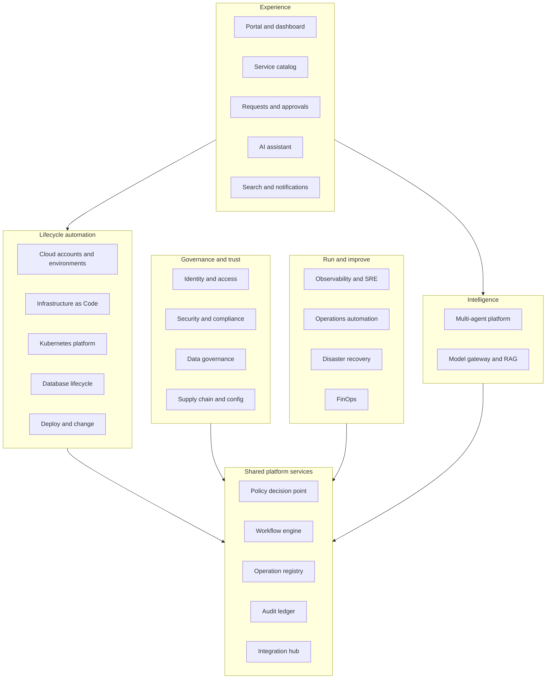

| Capability domain | Level-1 capabilities | Modules |
|---|---|---|
| Experience | Dashboard, catalog, requests, approvals, inventory view, search, notifications, assistant | M01, M09 |
| Infrastructure | Account lifecycle, networking, compute, storage, load balancing, DNS, certificates, decommissioning | M02 |
| Delivery as code | Module registry, plan, policy check, scan, cost estimate, apply, state, drift, rollback | M03 |
| Container platform | Cluster, node pools, namespaces, RBAC, network policy, ingress, storage, upgrades, backup | M04 |
| Data platform | Database provisioning, backup, HA, patching, performance, migration, archival | M05 |
| Data governance | Classification, ownership, catalog, lineage, quality, retention, residency, masking, deletion | M06 |
| Identity and access | SSO, MFA, RBAC, ABAC, JIT, PAM, reviews, service and workload identity | M07 |
| Security and compliance | Policy engine, posture, scanning, secrets, certificates, findings, evidence | M08 |
| Intelligence | Agents, model gateway, RAG, evaluation, guardrails, tracing | M09 |
| Automation | Scheduled, event and incident-driven operations with controls | M10 |
| Reliability | Metrics, logs, traces, alerts, incidents, SLOs, RCA, capacity | M11 |
| Financial | Estimates, budgets, allocation, anomalies, rightsizing, unit economics | M12 |
| Change and release | Change requests, windows, pipelines, verification, rollback | M13 |
| Continuity | Backup policy, RTO and RPO, replication, failover, DR exercises | M14 |
| Supply chain | Registries, SBOM, signing, provenance, baselines, patch compliance | M15 |
| Integration | Contracts, webhooks, events, retries, rate limits | M16 |
| Platform core | Policy, workflow, registry, audit, notifications, self-management | Shared |

## Module Overview

| ID | Module | Primary owner | Main phase |
|---|---|---|---|
| M01 | Platform Experience and Self-Service Portal | Platform Product | P1 |
| M02 | Cloud Account and Infrastructure Lifecycle | Platform Engineering | P1 to P2 |
| M03 | Infrastructure as Code and Automation | Platform Engineering | P2 |
| M04 | Kubernetes and Container Platform Management | Platform Engineering | P2 |
| M05 | Database Lifecycle and Management | DRE | P4 |
| M06 | Enterprise Data Governance | Data Governance Council | P4 |
| M07 | Identity and Access Management | Security | P1, P3 |
| M08 | Security and Compliance Management | Security | P3 |
| M09 | AI Engineering and Multi-Agent Platform | Platform Engineering and Security | P6 |
| M10 | Operations Automation Engine | Platform Engineering and SRE | P2, P5 |
| M11 | Observability and SRE | SRE | P5 |
| M12 | FinOps and Resource Optimization | FinOps | P2 to P7 |
| M13 | Deployment and Change Management | Platform Engineering | P2 |
| M14 | Disaster Recovery and Business Continuity | SRE | P5 |
| M15 | Software Supply Chain and Configuration Management | Security and Platform Engineering | P3 |
| M16 | Enterprise Integration Hub | Platform Engineering | P1 onward |

# Part 2: Functional Module Specifications

Each module is independent in ownership and data, but integrated through shared platform services: the policy decision point, the workflow engine, the operation registry and the audit ledger. A module is a **logical module inside the modular core** unless Part 6 says it is a separate deployable service.

Every module follows the same rules: its APIs are authorized by the policy decision point, every state change is audited, every long-running action is a workflow, and every automated action is an operation in the registry (Part 7).

## M01: Platform Experience and Self-Service Portal

**Purpose:** one front door for all users, with role-aware navigation and governed self-service. **Owner:** Platform Product. **Phase:** P1 (assistant in P6).

| Capability | Specification |
|---|---|
| Unified dashboard | Role-based tiles: my requests, pending approvals, my resources, health, cost, security findings, upcoming changes. Each tile reads from the same governed APIs as external clients. |
| Role-based navigation | Menu items and actions are driven by permissions from the policy decision point. Hidden is not secure: the API enforces the same rules. |
| Service catalog | Versioned catalog items with owner, description, inputs schema, policy and cost hints, approval tier, SLA, and lifecycle (draft, published, deprecated, retired). |
| Request management | Guided forms generated from the item's input schema. Validation, estimated cost, policy pre-check, request status timeline, cancellation and re-submit. |
| Approval center | One inbox for all approvals (resource, access, change, data access). Shows risk tier, plan summary, cost, policy results, requester history. Delegation and escalation supported. SoD blocks self-approval. |
| Deployment dashboard | Live and historical deployments with stage status, logs, plan diff, verification results and rollback action. |
| Resource inventory | Searchable inventory by owner, tag, environment, account and type, with relationships and compliance state. Source: M02 and the collectors. |
| Operational health | Service health, SLO status, open incidents, maintenance windows. Source: M11. |
| Notifications | In-app, email and chat. User-configurable by event type and severity. Approval reminders and escalations. |
| Global search | Permission-trimmed search across catalog, requests, resources, runbooks, documents and people. Results are filtered by the caller's access, never after the fact in the browser. |
| AI conversational assistant | Embedded chat that answers questions, drafts requests and explains plans, using the caller's identity and permissions. It can submit a request on the user's behalf only through the normal request API, with the normal approvals (M09). |

**Key controls:** SC-01, SC-02, SC-11, SC-21. **Integrations:** IdP, ITSM, chat, email. **Accessibility:** target WCAG 2.2 AA (NFR-ACC-01).

## M02: Cloud Account and Infrastructure Lifecycle

**Purpose:** create, register, baseline and retire cloud accounts and the infrastructure inside them. **Owner:** Platform Engineering. **Phase:** P1 (inventory, onboarding), P2 (provisioning).

| Capability | Specification |
|---|---|
| Account onboarding | Register an existing account: verify ownership, assume a read-only discovery role, run baseline assessment, apply the required tags and guardrails, then enable features step by step. |
| Account provisioning | Create new accounts through the organization structure with the standard baseline: logging, security tooling, network attachment, IAM boundary, budgets. Evaluate AWS Organizations with Control Tower or a Terraform-based account factory (OD-04). |
| Account registration | Metadata record: business owner, technical owner, cost center, data classification ceiling, environment type, regions allowed, compliance scope. |
| Environment creation | An environment is a named set of resources with a purpose (sandbox, development, test, staging, production) and an applied policy set. Created from catalog templates. |
| Regions and AZ management | Allowed-region policy per environment and data classification. AZ spread rules for production. Capacity and quota awareness. |
| VPC and networking | Standard VPC patterns, subnets, routing, NAT, endpoints, connectivity to shared services, security groups and network ACL baselines, IP address management. |
| Compute provisioning | Approved instance families and images, autoscaling groups, launch templates, patching baseline. |
| Storage provisioning | Block, file and object storage patterns with encryption, backup tags and lifecycle rules by default. |
| Kubernetes infrastructure | Hand-off to M04 for cluster lifecycle. M02 supplies the network, IAM and encryption foundations. |
| Load balancing | Application and network load balancers from templates, WAF association, access logging. |
| DNS and certificates | Delegated zones per environment, record management with ownership checks, certificate issuance and renewal (with M08). |
| Decommissioning | Dependency analysis, data protection check (backup, retention, legal hold), owner and approver sign-off, staged shutdown with a recovery window, then destruction and evidence. |

**Key controls:** SC-04, SC-09, SC-10, SC-20. **Integrations:** cloud provider APIs, IdP, CMDB.

## M03: Infrastructure as Code and Automation

**Purpose:** safe, repeatable infrastructure change through Terraform. **Owner:** Platform Engineering. **Phase:** P2.

| Capability | Specification |
|---|---|
| Terraform module registry | Curated, versioned modules with owner, tests, documentation, input and output contracts, security review status and support level. |
| Version-controlled templates | Catalog items reference module versions in source control. Changes go through pull requests with review and automated checks. |
| Automated plan generation | Runs in an isolated execution worker with short-lived scoped credentials. Output stored in object storage, encrypted, with a content hash. |
| Plan review | Human-readable plan summary: create, change and destroy counts, sensitive changes highlighted, blast radius, cost delta, policy results. The reviewed plan is the plan that is applied (hash-bound). |
| Policy validation | Plan evaluated by the policy decision point (for example against OPA policies). Hard failures block. Advisory findings warn. |
| Security scanning | IaC static analysis and misconfiguration checks on code and plan. |
| Cost estimation | Estimated monthly cost delta before approval, with budget impact. |
| Deployment orchestration | Workflow: plan, validate, approve, schedule, apply, verify, record. One concurrent apply per state. |
| State management | Remote encrypted state per environment and component, access restricted to execution workers. |
| State locking | Locking on every plan and apply. Stuck-lock recovery is an audited, approved operation. |
| Drift detection | Scheduled plan-only runs. Drift is classified (benign, risky, unauthorized) and routed to a remediation workflow. |
| Rollback and recovery | Roll-forward by default. Rollback means applying the previous known-good module version or snapshot. Destructive reverts need higher approval. State backup and restore procedure. |
| Module versioning and deprecation | Semantic versions, deprecation notices, usage inventory showing which deployments use a version, and an upgrade workflow. |

**Key controls:** SC-04, SC-09, SC-13, SC-20. **Note:** Terraform licensing changes in recent years make OpenTofu a candidate alternative (OD-05).

## M04: Kubernetes and Container Platform Management

**Purpose:** provide a governed container platform on EKS. **Owner:** Platform Engineering. **Phase:** P2 (core), P3 (security), P5 (backup, upgrades at scale).

| Capability | Specification |
|---|---|
| Cluster lifecycle | Create, configure, upgrade and retire clusters from versioned templates. One minor version at a time. Pre-upgrade checks and post-upgrade verification. |
| Node pool management | Pool definitions by workload type and isolation need. Managed node groups or an autoscaler such as Karpenter, based on decision OD-06. |
| Autoscaling | Pod and node autoscaling policies with guardrails and cost caps. |
| Workload deployment | GitOps-based delivery (for example Argo CD) with environment promotion and drift correction. |
| Namespace management | Self-service namespaces with owner, quota, default network policy, labels and cost allocation. |
| RBAC | Mapping from platform roles to Kubernetes roles. No direct cluster-admin for people in production (JIT only). |
| Network policies | Default deny with approved patterns. |
| Ingress management | Standard ingress controllers, certificate and DNS automation, WAF integration. |
| Storage and PVC lifecycle | Storage classes, encryption, snapshot policy, orphan volume detection, reclaim policy governance. |
| Container image scanning | Scan on build, on admission and on schedule. Block on critical findings per policy. |
| Resource quotas | Namespace-level requests and limits, with right-sizing recommendations (M12). |
| Pod health | Restart loops, readiness, OOM kills, evictions and scheduling failures surfaced in the portal. |
| Scheduling analysis | Explains why a pod is pending: capacity, taints, affinity, quotas, topology constraints. |
| Kubernetes upgrades | Version compatibility checks (APIs, add-ons), staged rollout (non-production first), PDB-aware node rotation, rollback plan. |
| Cluster backup and recovery | Cluster state and persistent data backup, restore tests, and rebuild-from-code procedure. |

**Key controls:** SC-09, SC-10, SC-12, SC-13. **Integrations:** EKS, registry, GitOps controller, M08, M11.

## M05: Database Lifecycle and Management

**Purpose:** run the database fleet as a governed, observable and recoverable service. **Owner:** DRE. **Phase:** P4 (performance and forecasting in P5).

**Database categories:** relational (for example PostgreSQL, MySQL), NoSQL (document, key-value), cache (Valkey or Redis), search (OpenSearch), warehouse, and streaming (managed Kafka or equivalent).

| Capability | Specification |
|---|---|
| Database catalog | Approved engines, versions, sizes, topologies and support levels by category, each with default backup, encryption, HA and monitoring. |
| Provisioning | Catalog-driven. Mandatory fields: owner, data classification, environment, backup policy, retention class, RTO and RPO tier. |
| Instance and cluster configuration | Parameter groups, storage, networking, maintenance windows, monitoring. Configuration baseline and drift detection. |
| Version management | Supported version matrix, end-of-support tracking and upgrade planning. |
| Schema management | Schema changes through reviewed migration scripts, with dry-run, lock-impact estimate and rollback or compensating script. Platform never edits production schema without an approved change. |
| Users and roles | Application and human database roles. Humans via JIT and IAM authentication where available. No shared admin accounts. |
| Credential rotation | Automatic rotation through the secrets manager, with consumer notification and verification. |
| Encryption | Encryption at rest with customer-managed keys, in-transit TLS enforced. |
| Backup and restore | Policy-based backups, immutable copies, scheduled restore validation. |
| Point-in-time recovery | PITR where supported, with a restore-to-new-instance workflow and cutover guidance. |
| Replication and HA | Multi-AZ by default for production. Read replicas, cross-region replicas by tier. |
| Failover | Automated for managed HA, orchestrated and approved for cross-region. Failback procedure. |
| Performance monitoring | Key metrics, slow queries, locks, connections, replication lag. |
| Query analysis and index recommendations | Recommendation only. Applying an index is a change operation. |
| Capacity forecasting | Storage, connections and compute trend forecasting, feeding M12 and M11. |
| Patching and upgrades | Minor patching in windows, major upgrades through blue/green or replica-based cutover with rollback. |
| Migration | Source assessment, schema and data migration, validation, cutover and rollback plan. |
| Data archival | Policy-based archival to lower-cost storage with retrieval process. |
| Secure decommissioning | Final backup per retention policy, dependency check, owner approval, deletion and evidence (including key handling per M06). |

**Key controls:** SC-05, SC-07, SC-16, SC-18. **Integrations:** cloud database services, secrets manager, M06, M11, M14.

## M06: Enterprise Data Governance

**Purpose:** know what data exists, who owns it, how sensitive it is, and enforce rules over it. **Owner:** Data Governance Council. **Phase:** P4 (AI data governance in P6).

| Capability | Specification |
|---|---|
| Data classification | Four levels: Public, Internal, Confidential, Restricted. Each level maps to required controls (encryption, access approval, masking, residency, retention). |
| Data ownership | Every data asset has an accountable owner. Assets without owners are flagged and escalated. |
| Data stewardship | Stewards manage definitions, quality rules and access requests for their domain. |
| Metadata catalog | Technical and business metadata for databases, tables, buckets, streams and platform datasets. |
| Data lineage | Table and column lineage where tooling allows. Pipeline-level lineage as a minimum. Platform lineage: which request created which resource. |
| Data discovery | Automated scanning of approved stores for assets and sensitive patterns. |
| Data quality | Rule definitions, scheduled checks, scorecards and issue routing. |
| Data retention | Retention classes with legal hold override. Automated enforcement with approval for deletion of Restricted data. |
| Data residency | Region policies by classification and legal requirement. Deployment and replication blocked if they violate residency. |
| Data masking | Masking and tokenization patterns for non-production copies and AI use. |
| Encryption | Key hierarchy by classification, key ownership and rotation (SC-05). |
| Data access approval | Request, justification, owner approval, time-bound grant, review. |
| Sensitive-data detection | Pattern and classifier-based detection in data stores, logs and (for platform data) prompts. |
| Data archival | Defined archival tiers and retrieval service levels. |
| Secure data deletion | Deletion by policy: logical delete, crypto-shredding by key destruction where applicable, verification and evidence. |
| Compliance evidence | Evidence packages: classification coverage, access reviews, retention actions, deletion certificates. |

**Governance of platform data, including AI data (conversations, embeddings, prompts, generated content):** defined in Part 5, AI and Platform Data Governance.

**Key controls:** SC-05, SC-16. **Integrations:** M05, M07, M08, M09, data platforms.

## M07: Identity and Access Management

**Purpose:** the right people and workloads have the right access, only when needed, with proof. **Owner:** Security. **Phase:** P1 (SSO, RBAC), P3 (JIT, PAM, reviews).

| Capability | Specification |
|---|---|
| SSO and MFA | The platform never stores passwords. Authentication through the enterprise IdP using OIDC (preferred) or SAML. MFA enforced by the IdP, with step-up for high-risk actions. |
| SCIM provisioning | Users and groups synchronized from the IdP. Deprovisioning removes platform access automatically. |
| RBAC | Platform roles by persona, scoped to tenant, team or environment. |
| ABAC | Attributes (team, environment, classification, risk tier, time, device posture where available) refine decisions through the policy decision point. |
| IAM role management | Cloud role catalog with permission boundaries and owner. Role creation and change follow the request workflow. |
| Just-in-time access | Time-boxed elevation to production roles after approval and reason. |
| Privileged access management | Privileged sessions via brokered access, session recording where feasible, break-glass with alerts and review. |
| Temporary permissions | Every grant has an expiry. Default maximum durations per role. |
| Access expiration and revocation | Automatic expiry. Automatic revocation on role change, leaving the company or a policy violation. |
| Access reviews | Periodic certification campaigns by owner and risk. Unreviewed access is revoked after the grace period. |
| Approval workflows | Manager plus resource owner, with security for high-risk. No self-approval. |
| Service identities and workload identity | Platform components, automations and agents use dedicated, short-lived, narrowly scoped identities (for example IRSA or Pod Identity, and cross-account role assumption). No long-lived keys. |
| Session auditing | All platform sessions and elevated sessions are logged with identity, action and target. |

**Separation of duties and least privilege** are enforced in policy (Part 4, IAM Permission Model). **Key controls:** SC-01, SC-02, SC-03, SC-17.

## M08: Security and Compliance Management

**Purpose:** one place to define policy, see risk and drive remediation. **Owner:** Security. **Phase:** P3.

| Capability | Specification |
|---|---|
| Security policy engine | Central policy decision point with versioned policy bundles, shadow mode, test suites and staged rollout. |
| Policy-as-Code | Policies in source control with review and automated tests. Rego (OPA) is the primary candidate (OD-08). |
| Cloud security posture management | Continuous configuration assessment against policy and benchmark rules. |
| Vulnerability scanning | Hosts, images and dependencies, with risk-based prioritization. |
| Infrastructure security scanning | IaC and runtime configuration checks. |
| Container security | Image scanning, admission control, runtime signals. |
| Image signing and SBOM | Signature verification at admission (with M15). |
| Secrets management | Central secrets manager, rotation workflows, secret scanning in repositories and logs. |
| Certificate lifecycle | Inventory, issuance, renewal and expiry alerts. |
| KMS and encryption | Key policy standards, rotation and separation of key administrators from key users. |
| Network security | Segmentation standards, security group review, egress control. |
| Public exposure detection | Detects publicly reachable storage, databases and endpoints. Auto-open of a finding, optional auto-remediation by policy. |
| Compliance monitoring | Control library mapped to frameworks. Evaluate CIS Benchmarks, NIST CSF, ISO 27001 and SOC 2 according to the organization's obligations (OD-09). |
| Security findings | Normalized finding model: asset, severity, evidence, owner, SLA, status. |
| Risk scoring | Combines severity, exploitability, exposure, data classification and business criticality. |
| Remediation workflows | Assign, fix via platform operation, verify, close. Exceptions require expiry and approver. |
| Audit evidence | Evidence collection tied to controls, exportable for auditors. |

**Key controls:** SC-04, SC-07, SC-12, SC-13, SC-19.

## M09: AI Engineering and Multi-Agent Platform

**Purpose:** safe, useful AI assistance across the lifecycle, under the same governance as everything else. **Owner:** Platform Engineering with Security. **Phase:** P6 (multi-agent autonomy in P7).

**Non-negotiable rule:** agents act through the same APIs and the same policy decision point as people. They cannot bypass authorization, policy checks or production approvals.

### Agent catalog

| Agent | Purpose | Read tools | Write or propose tools | Initial autonomy |
|---|---|---|---|---|
| Infrastructure architecture | Recommend designs and trade-offs from requirements and standards | Catalog, standards, inventory, cost | Draft design document | A0 to A1 |
| Infrastructure provisioning | Turn approved intent into catalog requests and plans | Catalog, policy results, quotas | Submit request (user identity), prepare plan | A1 to A2 |
| Terraform generation | Draft and review Terraform within approved modules | Module registry, standards | Propose pull request | A1 |
| Kubernetes troubleshooting | Diagnose workload and cluster issues from evidence | Pods, events, logs, metrics (read-only) | Propose remediation operation | A0, then A2 |
| Database operations | Explain performance issues, propose indexes, plan maintenance | Metrics, query stats, config | Propose change operation | A0 to A1 |
| Security analysis | Triage findings, explain risk, propose fixes | Findings, inventory, policy | Propose remediation | A0 to A2 |
| Data governance | Suggest classifications, owners and retention | Metadata catalog, scan results | Propose catalog update | A1 |
| FinOps | Explain cost changes, suggest rightsizing | Cost, usage, inventory | Propose optimization operation | A0 to A2 |
| Incident management | Correlate alerts, summarize, suggest runbook steps | Alerts, topology, change history | Propose runbook execution | A0 to A2 |
| Observability | Build queries, explain dashboards, suggest alerts and SLOs | Metrics, logs, traces | Propose alert rule | A0 to A1 |
| Documentation and knowledge retrieval | Answer questions from approved knowledge with citations | Knowledge base (access-aware) | None | A0 |

### Platform components

| Component | Specification |
|---|---|
| Agent orchestration | Controls agent runs, task decomposition, hand-offs, step and time limits. Supports one agent, then supervised multi-agent flows. |
| Model gateway | Single entry point to models. Authentication, model allow-list, routing, rate limits, token and cost budgets, request and response logging per policy, content filters, provider failover. |
| Model selection | Per-task model policy by data classification, capability, latency and cost. Restricted data only to approved model endpoints. |
| Prompt versioning | Prompts and system instructions in source control with version, owner, test results and rollout stage. |
| Retrieval-augmented generation | Retrieval from approved sources only, with the caller's permissions applied at retrieval time. Citations required. |
| Knowledge base and vector database | Curated documents (runbooks, standards, architecture, past incidents). Ingestion with owner, classification and review date. |
| Agent memory boundaries | Short-term memory scoped to a session. No cross-user memory. Long-term memory only for approved, non-sensitive preferences, with user visibility and deletion. |
| Tool registry | Every tool has a schema, owner, risk tier, required permissions, rate limit and an allow-list of agents. |
| Tool authorization | Each tool call is authorized by the policy decision point using the user identity, the agent identity and the operation risk tier. Both must be allowed. |
| Human approval | State-changing tool calls above the pre-approved tier create an approval request, shown with the agent's evidence and plan. |
| Agent evaluation | Offline evaluation sets per agent (accuracy, groundedness, safety, policy compliance), run on every prompt, model or tool change. Online sampling and review. |
| Hallucination controls | Grounding in retrieved evidence, required citations, "unknown" as a valid answer, output validation against schemas, cross-checks against inventory. |
| Prompt injection protection | Content from tools, logs and documents is treated as untrusted data. Separation of instructions and data, tool allow-lists, output filtering, no tool call derived solely from untrusted content without policy check. |
| Data leakage prevention | Redaction before model calls, classification-aware routing, output scanning, no training on platform data by providers (contractual and technical control). |
| Execution tracing | Full trace per run: prompts, retrieved sources, tool calls, decisions, approvals, tokens and cost. Access-controlled and retained per policy. |
| Cost monitoring | Budgets per team and agent, alerts, hard stops, cost per outcome reporting. |
| Kill switch | Per agent, per tool and global. Tested regularly. |

**Key controls:** SC-14, SC-15, SC-16. Full architecture in Part 6.

## M10: Operations Automation Engine

**Purpose:** all automation runs through one controlled engine. **Owner:** Platform Engineering and SRE. **Phase:** P2 (engine core), P5 (operation library).

| Capability | Specification |
|---|---|
| Scheduled operations | Calendar and cron-style schedules with maintenance windows and holiday freezes. |
| Event-driven automation | Triggered by platform or cloud events (for example resource created, finding opened, certificate nearing expiry). |
| Incident-triggered automation | Triggered by alert or incident state, running diagnostics first and remediation only if allowed by tier. |
| Resource lifecycle automation | Expiry of temporary resources, tagging enforcement, ownership reminders, cleanup of orphaned resources. |
| Patch management | Patch baselines, rings (non-production first), windows, verification and rollback. |
| Backup scheduling | Policy-driven schedules, validation restores. |
| Database maintenance | Statistics, vacuum, minor patching, replica checks. |
| Kubernetes maintenance | Node rotation, add-on updates, certificate renewal. |
| Certificate renewal | Automatic renewal with deployment verification. |
| Secret rotation | Rotation with consumer verification and rollback. |
| Resource cleanup | Idle resource shutdown, snapshot pruning, with owner notification and grace period. |
| Capacity optimization | Rightsizing and scaling adjustments within guardrails. |
| Recovery workflows | Restore, failover and rebuild workflows from M14. |
| Configuration remediation | Drift correction toward baselines under policy. |

**Mandatory record for every automation:** owner, trigger, preconditions, authorization scope, approval requirement, execution timeout, retry strategy, idempotency controls, verification and audit evidence. The full contract is in Part 7. An automation without a complete record cannot be enabled.

## M11: Observability and SRE

**Purpose:** see the platform and the services it manages, and respond well. **Owner:** SRE. **Phase:** P5 (platform self-monitoring from P1).

| Capability | Specification |
|---|---|
| Centralized metrics | Time-series metrics through OpenTelemetry and Prometheus-compatible collection. |
| Logs | Structured logging with correlation identifiers, central search and retention tiers. |
| Distributed tracing | OpenTelemetry traces across portal, API, workflows and workers. |
| Alert management | Alert definitions as code, severity, ownership, routing, silencing and maintenance windows. |
| Alert correlation | Group related alerts by topology and change history to reduce noise. |
| Incident management | Declare, assign, communicate, track, resolve. Integrates with the ITSM and paging tools. |
| Root cause analysis | Timeline of changes, deployments, config drift and alerts. Agent-assisted analysis, human-confirmed. |
| SLO management | SLIs, SLOs, burn-rate alerts. |
| Error budgets | Budget tracking and policy (for example slow releases when budget is spent). |
| Service health | Aggregated health from SLOs, dependencies and incidents. |
| Dependency mapping | Service and infrastructure relationships from inventory, traces and declared dependencies. |
| Runbook automation | Runbooks as steps with embedded safe operations (from the registry). |
| Capacity planning | Trend and forecast across compute, storage, database and quotas. |
| Reliability analytics | Trends in incidents, MTTR, change failure rate, toil. |
| Post-incident reporting | Template-driven report with timeline, impact, causes, actions and owners. Follow-up actions tracked to completion. |

## M12: FinOps and Resource Optimization

**Purpose:** make cost visible before and after deployment, and reduce waste. **Owner:** FinOps. **Phase:** P2 (estimates), P5 (reporting), P7 (intelligence).

| Capability | Specification |
|---|---|
| Cost estimation | Pre-approval cost delta from IaC plans. |
| Budgets | Per team, environment and account, with alerts and enforcement options. |
| Cost allocation | Tag and account-based allocation, with untagged cost shown separately. |
| Resource tagging | Mandatory tag policy enforced at request time and by drift checks. |
| Cost forecasting | Trend-based and plan-based forecasts. |
| Anomaly detection | Detect unusual spend and notify the owner. |
| Idle resource identification | Utilization-based detection with owner confirmation. |
| Rightsizing | Compute, database and storage recommendations with risk indicators. |
| Reserved capacity recommendations | Commitment recommendations, reviewed by FinOps. |
| Storage optimization | Lifecycle tiers, snapshot and backup cost review. |
| Cost center reporting | Chargeback or showback reports. |
| Unit economics | Cost per service, per transaction or per environment where data exists. |
| Cost governance | Budget approvals, exception handling, optimization KPIs. |

## M13: Deployment and Change Management

**Purpose:** consistent, risk-based change from commit to production. **Owner:** Platform Engineering. **Phase:** P2.

| Capability | Specification |
|---|---|
| CI/CD integrations | Triggers and status exchange with source control and pipeline systems. The platform governs change. It does not replace the CI system. |
| Change requests | Standard, normal and emergency change types. Pre-approved standard changes for low-risk, repeatable work. |
| Approval workflows | Risk-tier-based approvers, including CAB for high-risk. |
| Risk classification | Computed from target environment, blast radius, data classification, reversibility, change size and recent failures. |
| Deployment windows | Freeze periods, windows per environment, exceptions with approval. |
| Scheduling | Scheduled start with pre-checks at start time. |
| Pipeline execution | Run, observe and record pipeline stages. |
| Deployment verification | Automated health checks, SLO guard, smoke tests. Failure triggers rollback policy. |
| Rollback | Automatic where defined, otherwise one-click with approval. |
| Change history | Immutable record: who, what, when, why, approvals, results. |
| Conflict detection | Detect overlapping changes on the same service, dependency or window. |
| Release management | Release trains, notes, version and artifact traceability. |

## M14: Disaster Recovery and Business Continuity

**Purpose:** make recovery routine, tested and evidenced. **Owner:** SRE. **Phase:** P5 (policy design from P4).

| Capability | Specification |
|---|---|
| Backup policies | Tiered policies by service criticality with immutability options. |
| Backup validation | Scheduled restore tests, integrity checks and reporting. |
| Recovery objectives | RTO and RPO captured per service and compared with measured results. |
| RTO and RPO management | Tier model (Part 8), gap analysis and remediation tracking. |
| Cross-region recovery | Replication and rebuild designs by tier. |
| Replication | Database, object and secret replication health monitoring. |
| Failover | Orchestrated, approved workflows with pre-checks. |
| Failback | Controlled return with data reconciliation. |
| Recovery runbooks | Executable runbooks linked to services. |
| DR exercises | Scheduled, scoped exercises with success criteria and evidence capture. |
| Evidence collection | Timestamps, logs, test results and sign-offs. |
| Platform-level DR | The platform's own recovery design, tested separately (Part 6). |

## M15: Software Supply Chain and Configuration Management

**Purpose:** trust what runs. **Owner:** Security and Platform Engineering. **Phase:** P3 (baselines and drift to P5).

| Capability | Specification |
|---|---|
| Artifact registries | Governed registries for images, packages and modules with retention and access control. |
| Container image management | Approved base images, rebuild on vulnerability, deprecation. |
| SBOM | SBOM generation and storage (SPDX or CycloneDX), queryable by component. |
| Software signing | Sign artifacts at build time. Verify at admission and deployment. |
| Provenance | Build provenance attestations (for example SLSA levels as a target). |
| Dependency scanning | Known-vulnerability and license checks. |
| Configuration baselines | Hardened baselines for operating systems, clusters and services. |
| Configuration drift | Detect and report deviation. Remediate under policy. |
| Patch compliance | Patch status by asset with SLAs per severity. |
| Release artifact management | Link artifact versions to changes, deployments and environments. |

## M16: Enterprise Integration Hub

**Purpose:** connect to the tools the enterprise already uses, reliably and securely. **Owner:** Platform Engineering. **Phase:** P1 onward.

| Integration area | Pattern | Examples of systems (generic) |
|---|---|---|
| Identity providers | OIDC, SAML, SCIM | Enterprise IdP |
| CI/CD | Webhook plus API | Pipeline systems |
| ITSM and change management | REST API, bidirectional sync | Ticketing, change, CMDB |
| Monitoring | Pull and push, alert webhook | Metrics, logging, paging tools |
| Messaging | Chat apps and email | Notifications and approvals |
| Documentation | API, index sync | Wiki and knowledge tools |
| Source control | Webhook, app installation | Git hosting |
| Cloud-native services | SDK and events | Organizations, config, security and cost services |
| Security tools | API, finding import | Scanners and posture tools |
| Cost management | Export ingestion | Billing and cost tools |

Contracts, webhooks, event schemas, retries, rate limits, authentication and failure handling are specified in Part 10 (API Specifications). **Principles:** adapters are isolated so one failing integration cannot stop the platform. Each adapter has a circuit breaker, a dead-letter queue and a health indicator. Credentials come from the secrets manager and are rotated.

# Part 3: Platform Operating Model

## 3.1 End-to-End Lifecycle

| # | Step | Actor | Platform component | Gates and controls | Evidence produced |
|---|---|---|---|---|---|
| 1 | User onboarding | New user, IdP | M07 (SCIM) | User created by the IdP, never by hand. Default role: none. | Provisioning event |
| 2 | Identity verification | User | M07 (OIDC or SAML) | MFA, session policy, device posture where available. | Login event |
| 3 | Role assignment | Manager, resource owner | M07 | Role requested, approved by manager and owner. SoD check. | Approval and grant record |
| 4 | Service registration | Service owner | M01 catalog, M16 | Owner, tier, data classification, runbook link and on-call required. | Service record |
| 5 | Catalog publication | Platform product, security | M01, M03 | Item reviewed: inputs, policies, cost hints, tests passed. | Publication record, version |
| 6 | Self-service request | Requester | M01 | Form validated against schema. Quota and entitlement checked. | Request record |
| 7 | Requirement validation | Platform | C03, C06 | Required fields, naming, tags, allowed regions, classification ceiling. | Validation result |
| 8 | Security and cost evaluation | Platform | C06, M08, M12 | Policy decision, security pre-check, cost estimate against budget. | Policy decision log, estimate |
| 9 | Approval | Approver(s) | M01 approval center | Tiered approval by risk. No self-approval. Timeouts and escalation. | Approval record |
| 10 | IaC plan creation | Execution worker | M03, C05 | Isolated worker, scoped credentials, plan hashed and stored. | Plan artifact, hash |
| 11 | Deployment scheduling | Platform, requester | M13 | Window, freeze and conflict checks. | Schedule record |
| 12 | Controlled execution | Execution worker | C04, C05 | Plan hash match, lock, idempotency key, timeout, retries. | Execution log |
| 13 | Post-deployment validation | Platform | M13, M11 | Health, config and policy verification. Failure triggers rollback policy. | Verification report |
| 14 | Inventory and CMDB sync | Platform | M02, M16 | Resource registered with owner and tags. CMDB updated. | Inventory entry, sync record |
| 15 | Monitoring and operations | SRE, owners | M11, M10 | Default alerts and SLOs attached. Maintenance automations scheduled. | Alert and automation configs |
| 16 | Incident and remediation | SRE, agents | M11, M10, M09 | Runbook steps by risk tier. Human approval where required. | Incident record |
| 17 | Continuous optimization | FinOps, owners | M12, M08 | Recommendations, accepted or rejected with reason. | Recommendation decisions |
| 18 | Resource decommissioning | Owner | M02, M05, M06 | Dependency, retention and legal-hold checks. Recovery window. | Decommission certificate |
| 19 | Audit and compliance reporting | Auditor, security | M08, C11 | Evidence by control, immutable ledger. | Evidence package |

## 3.2 Governed Request Sequence

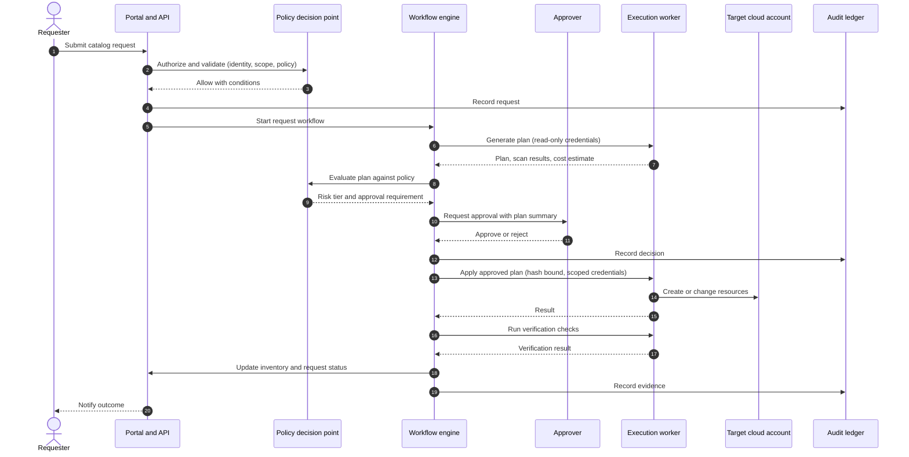

## 3.3 Infrastructure Provisioning Workflow

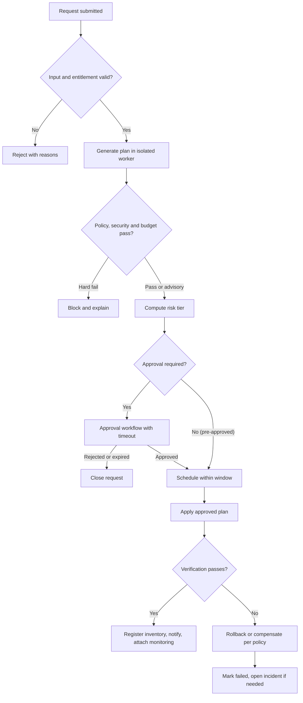

| Step | Failure behavior | Rollback |
|---|---|---|
| Plan generation | Retry up to the configured limit. Then fail and notify. | None needed (read-only). |
| Apply | Partial apply recorded. State is the source of truth. | Re-apply previous known-good version or destroy created resources if the request is new and has no data. |
| Verification | Fail closed. Resource marked "unverified" and not handed over. | Same as above. |
| Notification | Retry. Does not block the workflow. | None. |

## 3.4 Database Workflows

**Provision a database**

1. Requester selects a catalog item (engine, size, environment).
2. Mandatory metadata: owner, classification, backup policy, retention class, RTO and RPO tier.
3. Policy check: encryption, network placement, allowed region, classification versus environment (no Restricted data in a sandbox).
4. Cost estimate and approval by tier (production needs owner and DRE approval).
5. Plan, apply and verification: connectivity, encryption on, backup job created, monitoring attached, credentials stored in secrets manager.
6. Register in the data catalog (M06) with owner and classification.
7. Hand over credentials by reference (secret path), never by value in tickets or chat.

**Change or migrate a database (schema, version, parameter)**

1. Submit change with migration script and rollback script.
2. Automated checks: syntax, lock impact estimate, dry run on a recent copy where available.
3. Risk tier from size, criticality and reversibility. Production changes need DRE approval and a window.
4. Pre-checks: fresh backup or snapshot confirmed, replication healthy.
5. Execute with timeout and abort criteria.
6. Verify: application health checks, error rates, replication lag.
7. Roll back or compensate on failure. Record evidence.

**Restore (point in time)**

1. Request with target time and reason.
2. Restore into a **new** instance. Never overwrite the source by default.
3. Validate data. Owner approves cutover.
4. Cutover through a change. Keep the old instance for the retention window.

## 3.5 Access Request Workflow

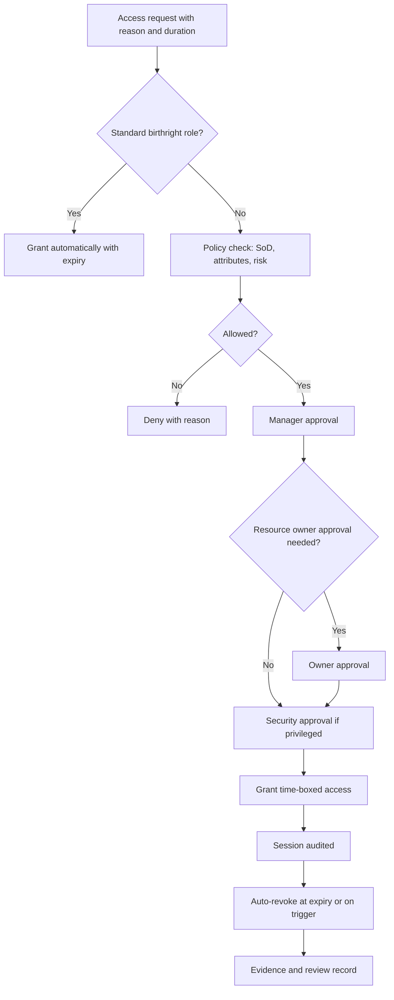

Rules: maximum durations per role, mandatory reason for production, break-glass is a separate flow with immediate alert and mandatory post-use review within one business day (design recommendation).

## 3.6 Security Remediation Workflow

1. A finding is created (scan, posture check, vulnerability feed) and normalized.
2. The finding is enriched with asset owner, environment, classification and exposure, then risk-scored.
3. The finding is assigned to the owner with an SLA by risk score.
4. Remediation options are offered: platform operation (for example close a public bucket), IaC pull request, or manual guidance.
5. Low-risk reversible fixes can run automatically under pre-approved policy (A3). Others follow approval.
6. Verification re-scans the asset.
7. Closure requires verification, or an exception with an approver, an expiry date and compensating controls.
8. Aged or breached SLAs escalate automatically.

## 3.7 Application Deployment Workflow

1. A pipeline produces a signed artifact with SBOM and provenance (M15).
2. The pipeline requests deployment through the platform (change request or pre-approved standard change).
3. Admission checks: signature valid, no critical vulnerabilities per policy, image from approved registry.
4. Risk tier decides the approvals and the window.
5. Progressive delivery (for example canary or rolling) with an SLO guard.
6. Automated verification. On failure the rollback policy runs.
7. Release record links the commit, artifact, SBOM, approvals and results.

## 3.8 Recovery Workflows

**Backup restore (single resource):** identify the recovery point, restore to a new resource, validate, cut over by approved change.

**Regional failover (service tier with cross-region recovery):**

1. Declare disaster (incident commander plus business authority).
2. Pre-checks: replication lag within RPO tolerance, target region capacity and secrets available.
3. Freeze changes in the primary region.
4. Execute the failover runbook in order: data layer, platform dependencies, compute, traffic.
5. Verify service health from the secondary region.
6. Communicate status.
7. Failback later as a separate planned change, with data reconciliation.

Every step is an operation with timeout, verification and evidence. Recovery workflows are rehearsed in DR exercises (M14).

---

# Part 4: Security Architecture

## 4.1 Security Principles

| Principle | How it is applied |
|---|---|
| Zero trust | No implicit trust from network location. Every request is authenticated and authorized by the policy decision point, including service-to-service. |
| Defense in depth | Layers: edge, API, authorization, workflow, worker isolation, cloud IAM boundaries, data encryption, detection. |
| Least privilege | Narrow roles, short-lived credentials, per-job scope, permission boundaries. |
| Separation of duties | The requester cannot approve. The author of a policy cannot approve its exception. Key administrators are not key users. |
| Privileged access management | JIT elevation, brokered sessions, break-glass with review. |
| Workload identity | Platform components and agents use their own scoped, short-lived identities. |
| Network isolation | Separate networks for control plane, workers, data stores and AI. Default deny, egress allow-lists. |
| Encryption | At rest with customer-managed keys, in transit with TLS (mutual TLS between internal services). |
| Secrets rotation | No static secrets in code or images. Rotation automated. |
| Immutable audit | Append-only, hash-chained, stored with write-once retention. |
| Fail closed | Policy engine or audit unavailable means high-risk operations pause, not proceed. |
| Secure by default | Templates and catalog items start from hardened baselines. |

## 4.2 Trust Boundaries

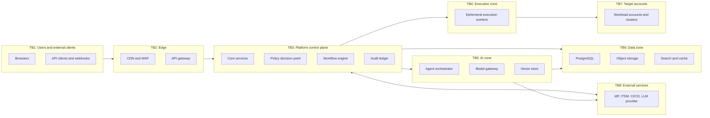

| Boundary | What crosses it | Control at the boundary |
|---|---|---|
| TB1 to TB2 | Requests, webhooks | TLS, WAF, rate limiting, webhook signature verification |
| TB2 to TB3 | Authenticated API calls | Token validation, authorization per request, input validation |
| TB3 to TB4 | Job definitions | Signed job spec, hash-bound plan, per-job role, no inbound access to workers |
| TB4 to TB7 | Cloud API calls | Assumed role per account, permission boundary, SCP guardrails, CloudTrail |
| TB3 to TB5 | Agent tasks, tool calls | Policy check on every tool call, no direct data store access for agents |
| TB5 to TB8 | Model requests | Model gateway only, redaction, allow-listed endpoints, budget limits |
| TB3 to TB6 | Data access | Service identity, row-level security, encryption, network isolation |
| TB3 and TB8 | Integration calls | Authenticated adapters, schema validation, rate limits, DLQ |

## 4.3 Secure Execution Workers

Workers are the most sensitive component: they hold temporary power over target accounts.

| Control | Specification |
|---|---|
| Ephemeral | One job per worker. The worker is destroyed after the job. No state is kept on disk. |
| Isolation | Dedicated node pool or sandboxed containers in a separate network zone. No access to the control plane database or other jobs. |
| Credentials | Short-lived cloud credentials obtained for the job from a scoped role for the **target account and operation type**. Duration capped by the timeout. |
| Inputs | Signed job specification. The apply step accepts only a plan whose hash was approved. |
| Network | No inbound. Egress allow-listed to the cloud APIs, the module registry, and the artifact store. |
| Supply chain | Worker images are signed, minimal and rebuilt on a schedule. Terraform providers are pinned and mirrored. |
| Code from users | Custom modules are not executed unless from the approved registry. Arbitrary code execution paths (for example local-exec) are blocked by policy. |
| Observability | Worker logs stream to the audit and logging pipeline with secrets masked. |

## 4.4 Identity, Keys, Secrets and Network

| Area | Specification |
|---|---|
| API authentication | OIDC tokens for users. Short-lived workload tokens for services. Mutual TLS inside the cluster. |
| Authorization enforcement | Central policy decision point, called on every request. Deny by default. Decisions logged. |
| Secrets | Secrets manager as the source. Rotation schedules by secret type. Access only via workload identity. Secret scanning in code and logs. |
| Key management | Customer-managed keys per data class and per environment. Separate key administrators and key users. Key rotation. Multi-Region keys where DR needs them. |
| Encryption at rest | All stores. Database, object storage, search, cache, backups and snapshots. |
| Encryption in transit | TLS 1.2 or higher, preferably 1.3. Internal mTLS. |
| Network | Private subnets for all services. Private endpoints to cloud services. Separate segments for control plane, workers, data and AI. |
| Edge | WAF, DDoS protection, rate limiting, bot controls on public endpoints. |

## 4.5 Immutable Audit Design

| Element | Specification |
|---|---|
| What is recorded | Authentication, authorization decisions, requests, approvals, plans, executions, agent runs and tool calls, configuration changes, secret and key operations, data access approvals, break-glass use. |
| Format | Structured events with actor, on-behalf-of, action, target, decision, policy version, correlation id, time, outcome and hash of the previous event. |
| Storage | Append-only table with hash chaining, shipped continuously to object storage with write-once retention (for example S3 Object Lock in compliance mode) in a separate log-archive account. |
| Integrity | Periodic verification job re-computes the chain. Break in the chain raises a critical alert. |
| Access | Read via audit API with its own permission. No delete or update path exists for anyone, including administrators. |
| Retention | Per policy (Part 5). Legal hold supported. |

## 4.6 AI Agent Isolation

- Agents run in their own network zone and service identity. They have **no direct credentials** to cloud accounts or data stores.
- Agents reach the world only through the **tool registry**. Each tool call is authorized for both the human principal and the agent identity.
- Model requests go only through the **model gateway** with redaction, budgets and logging.
- Retrieval applies the caller's permissions. Embeddings carry access labels.
- A tool call that changes state is an **operation request** and follows Part 7. Agents cannot approve their own requests.
- Kill switch at agent, tool and global levels.
- Per-run limits: steps, time, tokens, cost, tool call count.

## 4.7 Threat Model

**Method:** STRIDE for platform components, plus AI-specific threats (aligned in spirit with common LLM application risk lists). Residual risk ratings are design-time estimates and must be validated by the security team.

| ID | Threat | Component | STRIDE | Example attack | Mitigations | Detection | Residual |
|---|---|---|---|---|---|---|---|
| T-01 | Stolen user session | Portal | S | Attacker reuses a token from a compromised laptop | Short token life, MFA and step-up for risky actions, device and IP anomaly checks, token binding where possible | Impossible-travel and anomaly alerts | Medium |
| T-02 | Privilege escalation through role assignment | IAM | E | User adds themselves to an admin group | SoD policy, approvals, IdP-managed groups, audit | Alerts on role changes | Low |
| T-03 | Approval bypass | Workflow | T, E | Call apply API directly without approval | Apply accepts only workflow-issued, hash-bound jobs. Policy check in the worker. | Mismatch alerts | Low |
| T-04 | Self-approval or collusion | Approvals | R | Requester approves with a second account | SoD, identity linkage, high-risk needs independent approver, periodic collusion analytics | Approval graph analytics | Medium |
| T-05 | Malicious Terraform module | IaC | T | Module with hidden resource or exfiltration | Approved registry only, code review, pinned versions, provider allow-list, plan policy that blocks risky resources | Plan diff review, runtime detection | Medium |
| T-06 | Compromised execution worker | Execution | E | Exploit in the worker image | Ephemeral, isolated, no inbound, per-job role, signed images | Egress anomalies, runtime security | Medium |
| T-07 | Over-privileged cloud role | Target accounts | E | Execution role with admin rights | Permission boundaries, SCPs, per-operation roles, periodic access analysis | IAM analyzer findings | Medium |
| T-08 | State file exposure | IaC | I | Secrets inside state | Encrypted remote state, restricted access, avoid secrets in state, secret scanning | Access logs | Low |
| T-09 | Audit tampering | Audit | T, R | Admin alters or deletes records | Hash chain, write-once storage, separate account, separate keys | Chain verification | Low |
| T-10 | Secrets leakage in logs | All | I | Token printed in a log line | Secret masking, log scanning, short-lived secrets | Secret scanner on logs | Medium |
| T-11 | Cross-tenant data access | Core, search | I | Query returns another team's resources | Row-level security, tenant-scoped indexes, permission-trimmed search, tests | Anomaly detection, test suite | Low |
| T-12 | API abuse or denial of service | Edge, API | D | Flood of requests or heavy queries | WAF, rate limits, quotas, pagination limits, autoscaling | Rate and latency alerts | Low |
| T-13 | Webhook spoofing | Integrations | S | Fake event triggers an action | Signature verification, allow-lists, replay protection, treat events as hints, re-fetch state | Signature failure alerts | Low |
| T-14 | Dependency or supply chain compromise of the platform | Platform build | T | Malicious library in the platform | Pinned dependencies, SBOM, signing, scanning, build isolation, provenance | Scanner alerts, provenance checks | Medium |
| T-15 | Insider data exfiltration | Data | I | Bulk export by authorized user | Export limits and approvals, DLP, audit, anomaly detection | Volume anomalies | Medium |
| T-16 | Prompt injection via logs or documents | AI | T, E | A log line instructs the agent to run a destructive tool | Content marked untrusted, tool allow-lists, per-call authorization, no state change without approval, output validation | Guardrail blocks, review of flagged runs | Medium |
| T-17 | Excessive agency | AI | E | Agent chains tools beyond intended scope | Narrow tools, step limits, risk-tiered approvals, simulation before action | Run tracing, anomaly alerts | Medium |
| T-18 | Data leakage to model provider | AI | I | Restricted data sent in a prompt | Classification-aware redaction, model routing rules, no-training terms, private endpoints, output scan | DLP on prompts, gateway logs | Medium |
| T-19 | Knowledge base poisoning | AI | T | Malicious document added to the knowledge base | Curated sources with owners, ingestion review, provenance, access labels, periodic re-evaluation | Source drift checks | Medium |
| T-20 | Hallucinated action or advice | AI | T | Agent invents a resource or command | Grounding, citations, schema validation, existence checks against inventory, human approval | Evaluation sets, user feedback | Medium |
| T-21 | Denial of wallet | AI | D | Runaway agent loop burns budget | Token and cost budgets, run limits, alerts, hard stop | Cost anomaly alerts | Low |
| T-22 | Loss of control plane region | Platform | D | Regional outage | DR design and exercises (Part 6) | Health checks | Medium |

### Attack scenarios (end to end)

| Scenario | Path | Where it should be stopped | Residual note |
|---|---|---|---|
| A1: Stolen admin session creates a public database | Token theft, approve own request, deploy | MFA and step-up (T-01), SoD (T-04), policy blocks public database, audit alert | Requires validation of step-up coverage |
| A2: Poisoned module exfiltrates data | PR adds a resource that copies data out | Registry review (T-05), plan policy blocks unapproved resource types and egress | Review quality is a human factor |
| A3: Log line makes the troubleshooting agent delete a namespace | Untrusted log content in agent context | Delete is not a read tool. Agent identity has no write. Tool call needs approval (T-16, T-17) | Low if write tools remain gated |
| A4: Worker compromise targets other accounts | Exploit in worker | Per-job scoped role limited to one account and operation (T-06, T-07) | Depends on role scoping discipline |
| A5: Insider wipes audit trail | Admin deletes records | Write-once storage, separate account, chain check (T-09) | Low |
| A6: RAG returns another team's confidential runbook | Retrieval without permissions | Permission-aware retrieval, access labels (T-11, T-19) | Needs testing with real data |

## 4.8 IAM Permission Model

### Platform roles

| Role | Scope | Intent |
|---|---|---|
| Requester | Own team | Browse catalog, submit and track requests, view own resources |
| Team approver | Own team | Approve requests within limits |
| Resource owner | Own resources | Approve access, change, decommission |
| Developer | Own team, non-production | Self-service in non-production |
| Platform engineer | Platform modules | Author modules, templates, automations in non-production. Production by JIT |
| SRE operator | Production operations | Run approved operations. Elevated actions by JIT |
| Database engineer | Database fleet | Run database operations. Production by JIT |
| Security analyst | Findings | Read findings, triage, request remediation |
| Policy author | Policy repo | Propose policy. Cannot approve own exceptions |
| Data steward | Data domain | Classify, approve data access |
| FinOps analyst | Cost data | View cost, create budgets, recommend |
| Auditor | Read-only | Read evidence and audit logs. Cannot change anything |
| Tenant administrator | Tenant | Manage team membership and settings |
| Platform administrator | Platform | Configure platform. No access to approve own changes. No access to secrets values. |
| Break-glass | Emergency | Time-limited, heavily audited |

### Permission matrix (V view, R request, A approve, E execute, M manage)

| Capability | Requester | Developer | Platform eng. | SRE | DB eng. | Security | Data steward | FinOps | Auditor | Admin |
|---|---|---|---|---|---|---|---|---|---|---|
| Catalog browse | V | V | V, M | V | V | V | V | V | V | M |
| Request resources | R | R | R | R | R | V | V | R | V | R |
| Approve requests (own scope) | A (team) | no | A | A | A | A | A | A | no | no |
| Run approved operations | no | E (non-prod) | E | E | E | E (security ops) | no | no | no | no |
| Production change | R | R | R | R, E (JIT) | R, E (JIT) | R | no | no | no | no |
| Policy author or edit | no | no | propose | no | no | M | no | no | no | no |
| Security findings | no | V (own) | V | V | V (own) | M | V | no | V | no |
| Data classification | no | no | no | no | propose | V | M | no | V | no |
| Cost data | V (own) | V (own) | V | V | V | V | V | M | V | V |
| Audit logs | no | no | no | no | no | V | no | no | V | no |
| Secrets values | no | no | no | no | no | no | no | no | no | no (accessed only by workloads) |
| Platform configuration | no | no | M (limited) | no | no | no | no | no | no | M |

*The matrix expresses intent. Final permission sets are approved by Security and tested by TC-SEC-02 and TC-API-01.*

### ABAC attributes

User: team, role, location, employment type, clearance. Resource: owner team, environment, classification, criticality, tags. Action: risk tier, destructive flag, bulk flag. Context: time, change window, incident status, device posture, network zone. Example rule: *deny deployment to production if the change window is closed and the incident severity is high, unless emergency change approval exists.*

### Separation-of-duties rules

| Rule | Enforcement |
|---|---|
| Requester cannot approve own request | Policy deny when requester equals approver or shares a delegation chain |
| Policy author cannot approve exceptions to own policy | Policy deny |
| Module author cannot be sole approver for production use of that module | Approval rule |
| Key administrator cannot use keys for data access | Key policy and IAM |
| Platform administrator cannot approve their own configuration change | Four-eyes on platform configuration |
| An agent cannot approve | Approvals accept human identities only |
| Auditor roles are read-only and separated from operational roles | Role exclusion |

### Cloud-side IAM model (AWS)

| Layer | Design |
|---|---|
| Organization | Multi-account structure with guardrail SCPs (deny disabling logging, deny leaving the organization, region restrictions, deny public exposure of selected services). |
| Platform accounts | Dedicated accounts for platform control plane, non-production platform, shared services, security tooling and log archive. |
| Target accounts | A **platform execution role** per account and per operation class (read-only discovery, provisioning, database operations, Kubernetes operations, recovery). Each has a permission boundary and trust only for the platform's workers, with an external condition. |
| People | Access through the workforce identity service and JIT roles. No IAM users with long-lived keys. |
| Workloads | Workload identity (for Kubernetes, IRSA or Pod Identity). |
| Break-glass | Separate emergency roles, alerting on use, credentials sealed and tested. |
| Review | Periodic IAM analysis for unused permissions and external access. |

## 4.9 Security Control Catalog

| ID | Control | Used by |
|---|---|---|
| SC-01 | SSO and MFA enforcement, step-up for risky actions | M01, M07 |
| SC-02 | Central authorization (RBAC and ABAC) at the policy decision point, deny by default | All |
| SC-03 | JIT access and privileged session management | M07 |
| SC-04 | Policy-as-code gates on requests, plans and deployments | M02, M03, M08, M13 |
| SC-05 | Encryption at rest with customer-managed keys and key separation | M05, M06, stores |
| SC-06 | TLS everywhere, mTLS between services | All |
| SC-07 | Secrets management with automated rotation, secret scanning | M05, M08 |
| SC-08 | Immutable, hash-chained audit ledger | All |
| SC-09 | Ephemeral, isolated execution workers with per-job scoped credentials | M03, M04, M10 |
| SC-10 | Network segmentation, private endpoints, egress allow-lists | All |
| SC-11 | API protection: WAF, validation, rate limits, quotas | M01, M16 |
| SC-12 | Artifact signing, provenance and admission verification | M04, M15 |
| SC-13 | Vulnerability, IaC and container scanning with risk-based gating | M03, M04, M08, M15 |
| SC-14 | AI guardrails: injection defense, output validation, grounding | M09 |
| SC-15 | AI tool authorization and human approval for state change | M09 |
| SC-16 | Classification enforcement, masking and redaction | M05, M06, M09 |
| SC-17 | Separation of duties | M07, M13 |
| SC-18 | Immutable backups and recovery controls | M05, M14 |
| SC-19 | Security monitoring and detection engineering | M08, M11 |
| SC-20 | Risk-based change control and approvals | M02, M03, M13 |
| SC-21 | Tenant isolation (row-level security, scoped indexes, scoped caches) | Core, stores |
| SC-22 | Secure development and supply chain controls for the platform itself | Platform build |

# Part 5: Data and Database Architecture

## 5.1 Role of Each Data Store

| Store | Role | What lives here | What must **not** live here |
|---|---|---|---|
| Relational database (PostgreSQL) | **System of record** for transactional platform metadata | Tenants, users, roles, catalog, requests, approvals, plans metadata, deployments, inventory, policies metadata, operation registry, runs, findings, incidents, agent definitions | Large blobs, raw logs, metrics, secrets values |
| Object storage (S3) | Durable artifacts and documents | Plan files, state backups, evidence packages, reports, exports, backups, archived audit and logs, knowledge documents | Data needing transactional updates |
| Cache (Valkey or Redis) | Temporary state and speed | Sessions, rate-limit counters, short-lived locks, hot lookups, idempotency fast path | Anything not safely rebuildable. Never the only copy of a record. |
| Search engine (OpenSearch) | Search and log analytics | Searchable projections of inventory and requests, platform logs, audit search index | System of record (it is a projection, rebuildable) |
| Vector database | Retrieval over approved knowledge | Embeddings of approved documents with access labels and source references | Source of truth for documents. Restricted data without approval. |
| Event bus and queues (EventBridge, SQS, SNS) | Asynchronous workflows and events | Domain events, work queues, dead-letter queues | Long-term storage |
| Workflow persistence | Durable workflow history | Workflow state and history (owned by the workflow engine) | Business records (those stay in PostgreSQL) |
| Time-series storage (Prometheus-compatible) | Metrics | Platform and service metrics, SLO data | Logs, events |
| Secrets manager | Secrets | Credentials, tokens, keys material references | Configuration without secrets |
| Audit ledger | Tamper-evident action record | Append-only audit events and hash chain, plus write-once archive | Anything editable |

## 5.2 Data Domains, Ownership and Source of Truth

| Domain | Authoritative source | Stored in | Classification | Owner | Retention (proposed) |
|---|---|---|---|---|---|
| Identity and membership | Enterprise IdP (users, groups). Platform holds a synchronized copy. | PostgreSQL | Confidential | Security | Life of employment plus policy period |
| Roles, grants, access reviews | Platform | PostgreSQL | Confidential | Security | Per audit policy (for example 7 years) |
| Catalog and templates | Source control (templates). Platform holds published versions. | Git, PostgreSQL | Internal | Platform Product | Life of item plus period |
| Requests and approvals | Platform | PostgreSQL | Internal | Platform Product | Per audit policy |
| Plans and execution artifacts | Platform | S3 with metadata in PostgreSQL | Confidential | Platform Engineering | Per audit policy, then archive |
| Cloud resources (actual state) | **Cloud provider** is truth for what exists. Platform inventory is a synchronized projection. | PostgreSQL, OpenSearch | Internal to Confidential | Resource owner | Current plus history |
| Infrastructure desired state | Terraform code in source control and state | Git, S3 state | Confidential | Platform Engineering | Versioned |
| Policy | Source control (policy repo) | Git, PostgreSQL (active set) | Internal | Security | Versioned |
| Findings | Platform (normalized from scanners) | PostgreSQL | Confidential | Security | Per policy |
| Data catalog metadata | Platform | PostgreSQL | Internal | Data Governance | Life of asset |
| Incidents | Incident tool or platform (per decision OD-12) | PostgreSQL | Internal | SRE | Per policy |
| Metrics | Metrics store | Time-series | Internal | SRE | Short (high resolution) to long (aggregated) |
| Audit events | Audit ledger | PostgreSQL (hot), S3 write-once (archive) | Restricted | Security | Per compliance requirement |
| Cost data | Cloud billing exports (truth). Platform holds aggregates. | S3, PostgreSQL | Confidential | FinOps | Per finance policy |
| AI conversations and runs | Platform | PostgreSQL, S3 | Confidential | AI platform owner | Short by default (see 5.6) |
| Embeddings and knowledge | Source documents (truth). Embeddings are derived. | Vector store, S3 | By source classification | Knowledge owners | Rebuildable |
| Secrets | Secrets manager | Secrets manager | Restricted | Security | Rotated |

## 5.3 Entity Relationship Model

The model is split into three views. All tables carry `tenant_id`, `created_at`, `updated_at`, `created_by`, and a `version` column for optimistic locking. These common columns are omitted from the diagrams for readability.

### View 1: Core platform, catalog, requests and infrastructure

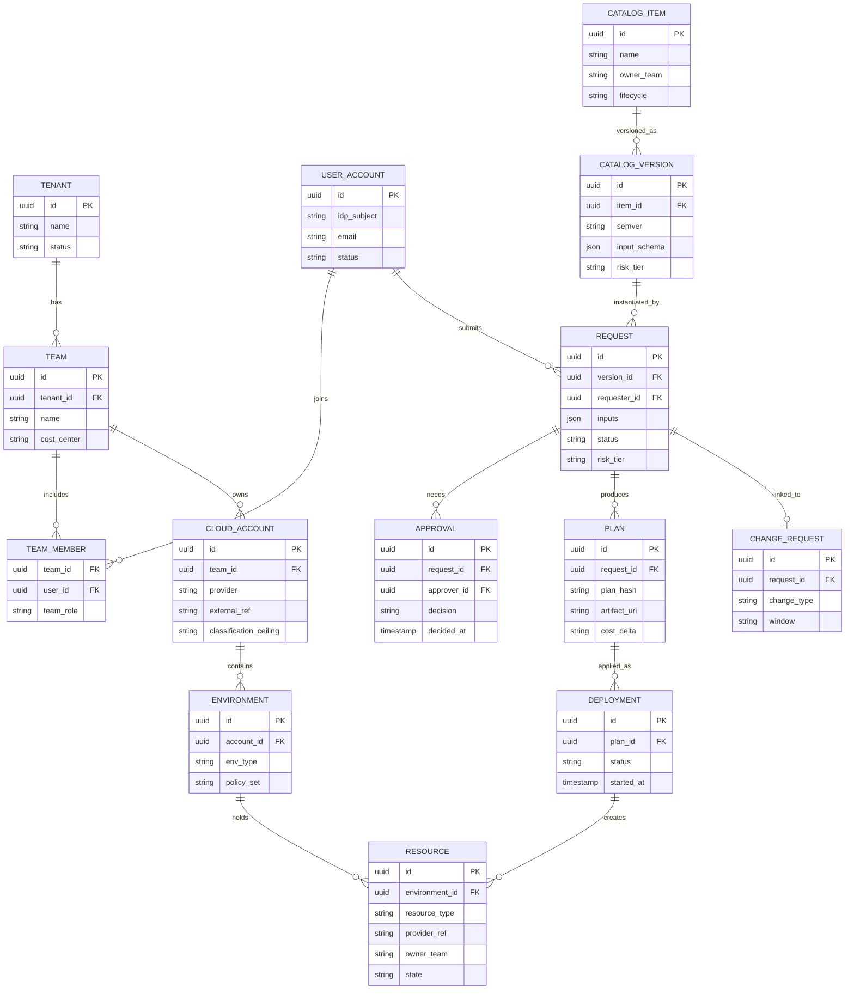

### View 2: Access, policy, security and data governance

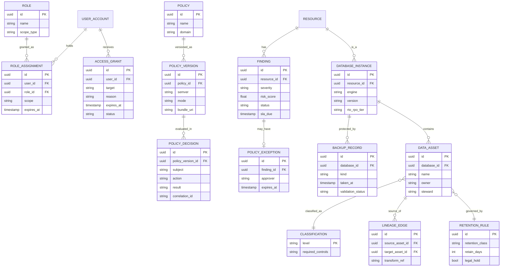

### View 3: Operations, AI, observability, cost and audit

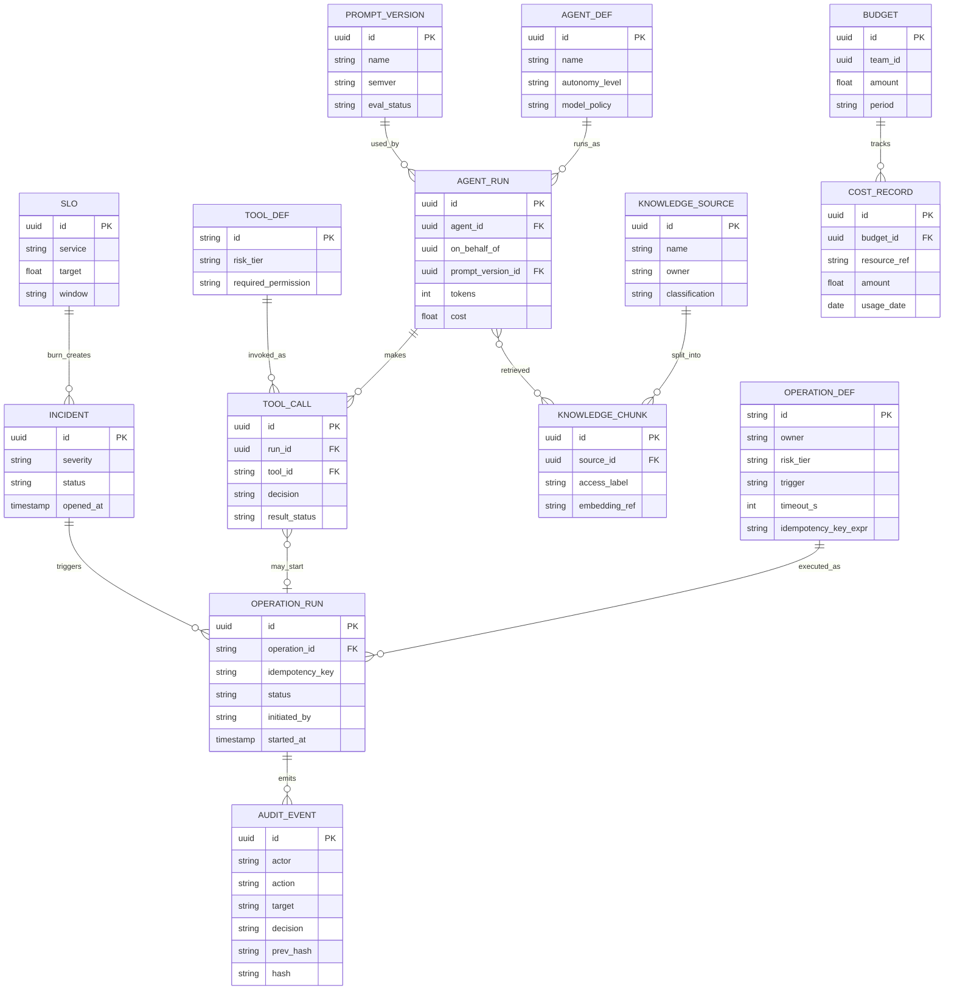

## 5.4 Schema Versioning and Data Migration

| Topic | Specification |
|---|---|
| Migration tooling | Versioned, ordered migration scripts in source control, applied by the pipeline. No manual schema edits in production. |
| Compatibility | **Expand and contract**: add (expand), deploy code that works with both, migrate data, then remove (contract) in a later release. Rolling deploys never see an incompatible schema. |
| Testing | Every migration is tested forward on a production-like copy and, where feasible, backward. Duration and lock behavior are measured. |
| Large changes | Online techniques (batching, concurrent index builds). Maintenance windows only when unavoidable. |
| Rollback | Prefer roll-forward fixes. Destructive migrations require a snapshot and an explicit approval. |
| API versioning | APIs are versioned. Events carry schema versions with a compatibility policy. |
| Data migration between stores | Idempotent, resumable jobs with reconciliation counts and checksums before cutover. |

## 5.5 Database Architecture

| Aspect | Design |
|---|---|
| Engine | PostgreSQL, managed (for example Aurora PostgreSQL-compatible or RDS Multi-AZ). Final choice OD-03. |
| Topology | One writer, multiple readers across availability zones. Read replicas for reporting. |
| Logical layout | One database, schemas per module (for example `catalog`, `request`, `iam`, `inventory`, `policy`, `ops`, `ai`). Cross-module access through APIs or defined views, not ad-hoc table joins. This keeps a later service split cheap. |
| Tenancy | `tenant_id` on every table with **row-level security** enforced in the database. Application roles cannot bypass it. |
| High availability | Multi-AZ with automatic failover. Connection retry and idempotent writes in clients. |
| Failover | Automatic within the region. Cross-region failover is orchestrated and approved (Part 6, DR). |
| Backup | Continuous backup with point-in-time recovery, daily snapshots, copies to a second region and an isolated account. Restore tests monthly. |
| Replication | Cross-region replica (for example global database) for DR. Lag monitored and alerted against the RPO. |
| Encryption | Customer-managed keys at rest. TLS in transit. Column-level encryption for specific Restricted fields. |
| Partitioning | Time partitioning for audit, events, runs and decisions. Old partitions detach and archive to object storage. |
| Performance | Connection pooling, query budgets per API, slow query log, index review each release, no unbounded queries (pagination mandatory), cache for hot read paths. |
| Capacity | Storage and connection forecasts reviewed monthly. Load tests before releases that change data shape. |
| Operations | Patching in windows with blue/green where available. Parameter changes through code. |
| Access | No human access in production except JIT with approval and session audit. Application credentials rotate automatically. |

## 5.6 Data Governance Architecture

The platform applies to its **own** data the same governance it offers to others.

### Classification levels

| Level | Examples | Required controls |
|---|---|---|
| Public | Published docs | Integrity |
| Internal | Catalog, request metadata | Authentication, tenant isolation |
| Confidential | Plans, findings, cost, conversations | Encryption, role-based access, audit, masked in non-production |
| Restricted | Audit ledger, secrets references, personal data, keys | Strong encryption with dedicated keys, approval for access, no use for AI by default, strict retention and deletion |

### AI and platform data governance

| Data | Classification | Where | Retention (proposed) | Rules |
|---|---|---|---|---|
| Operational data (inventory, requests) | Internal to Confidential | PostgreSQL | Per audit policy | Normal controls |
| Application data touched by platform | By source | Not stored (referenced) | n/a | Platform does not copy application data. Database operations act in place. |
| Audit records | Restricted | Ledger and write-once archive | Compliance-driven | Immutable. Legal hold supported. |
| AI conversations | Confidential | PostgreSQL, S3 | Short by default (for example 30 to 90 days) with user and admin deletion on request | Not used to train models. Redacted before storage where sensitive patterns are detected. Owner can delete. |
| Prompts and system instructions | Internal | Git, PostgreSQL | Versioned, kept for audit | Reviewed. No secrets or customer data in prompts. |
| Embeddings | Same as source | Vector store | Rebuilt when source changes or expires | Carry access labels. Deleted when source is deleted or restricted. Embeddings of Restricted data not created without approval. |
| Generated content (plans, code, reports) | Confidential | Git, S3, PostgreSQL | Per artifact type | Marked as AI-generated with the run id. Human review before use. |
| Agent traces | Confidential | S3, search | Short to medium | Access limited. Redaction on ingest. |
| Model gateway logs | Confidential | Search, S3 | Short | Metadata by default. Full payload logging only where policy allows. |

### Governance mechanics

| Topic | Specification |
|---|---|
| Data quality | Constraints in the database. Validation at APIs. Reconciliation jobs compare inventory with cloud truth and report drift and freshness. Quality scorecards by domain. |
| Lineage | Platform lineage links request, plan, deployment and resource. Data lineage (M06) links assets and pipelines. Lineage is stored as edges and queryable. |
| Access governance | Access to data stores is JIT. Dataset-level access is reviewed on a schedule. Exports are logged and limited. |
| Retention and deletion | Retention rules per class. Deletion jobs are operations with evidence. Crypto-shredding by key destruction for stores that use dedicated keys. Legal hold blocks deletion. |
| Residency | Region allow-lists per classification. Replication targets validated against residency before enabling. |
| Archival | Cold data moves to lower-cost storage with retrieval SLAs. Archival is verified before source deletion. |
| Compliance evidence | Automatic evidence for classification coverage, review completion, deletion certificates, key rotations. |

## 5.7 Backup, Recovery and Data DR

| Data | Backup | Recovery approach | Proposed objectives (need approval) |
|---|---|---|---|
| PostgreSQL | Continuous plus snapshots, cross-region copies | PITR in region. Cross-region replica promotion for disaster | RPO 5 min, RTO 60 min |
| Audit ledger | Hot table plus continuous shipping to write-once storage | Replay from archive | RPO near zero in region, up to 15 min cross-region |
| Object storage | Versioning, cross-region replication, object lock for critical buckets | Restore versions or fail over to the replica bucket | RPO 15 min |
| Workflow persistence | Same as PostgreSQL (own database) | PITR or replica promotion | RPO 5 min, RTO 60 min |
| Search | Rebuilt from sources, snapshots as accelerator | Re-index | RTO hours (not authoritative) |
| Cache | None | Rebuild | Not applicable |
| Vector store | Rebuild from approved sources, snapshots as accelerator | Re-embed | RTO hours (not authoritative) |
| Secrets | Multi-Region replication of secrets, key replication | Promote replicas | Aligned with PostgreSQL |
| Metrics | Replicated or accept loss of recent history | Failover to secondary collection | Accept short gaps |

*All numbers are design recommendations requiring business approval.*

---

# Part 6: Technical Architecture

## 6.1 Architecture Principles

1. **Modular monolith first.** One deployable core with strict module boundaries. Modules talk through internal interfaces, can be extracted later because data access is schema-separated.
2. **Separate only for a reason.** A component becomes its own deployable only when it needs different isolation, scaling, release cadence, runtime or failure domain.
3. **Durable workflows for anything long-running or approval-based.**
4. **One policy decision point** for humans, automations and agents.
5. **Ephemeral isolated execution** for anything touching target accounts.
6. **Everything observable and recoverable**, including the platform itself.
7. **Provider seams.** Cloud-specific code sits behind interfaces (compute, network, identity, database, secrets). AWS is the only implementation in the MVP.

## 6.2 System Context

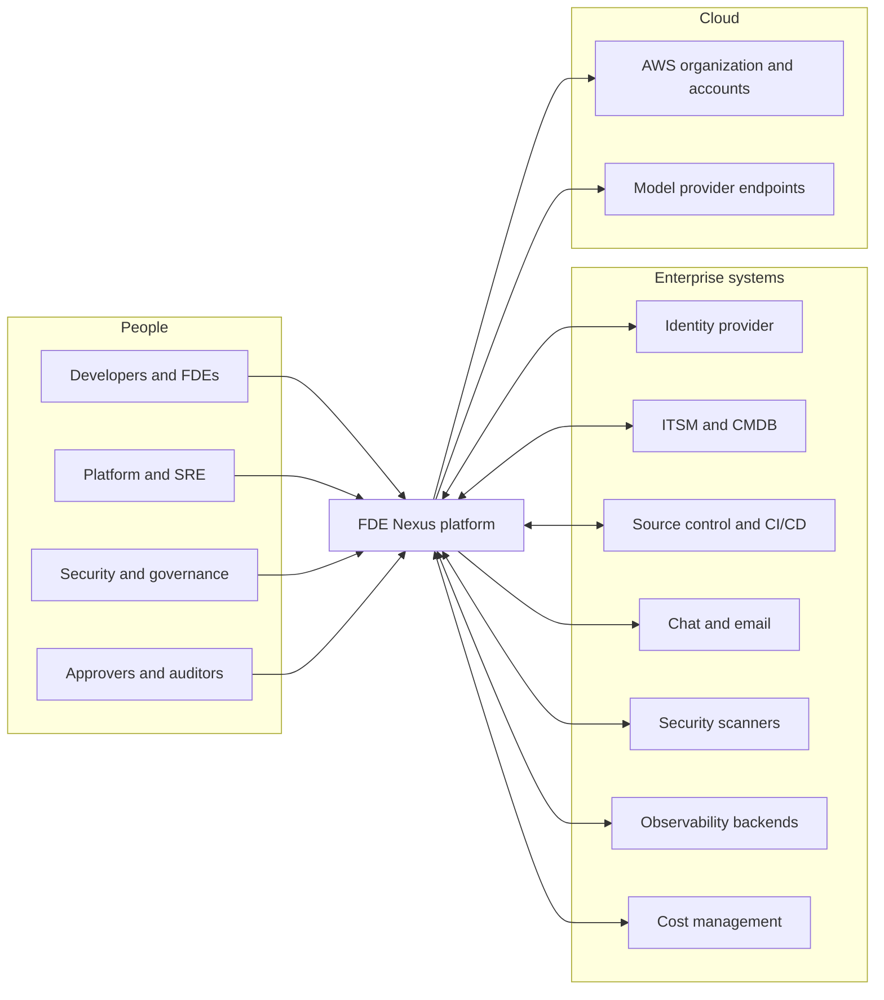

## 6.3 High-Level Architecture

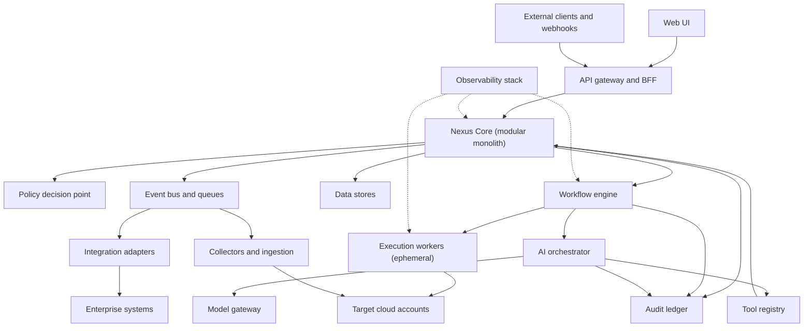

## 6.4 Component Architecture

| ID | Component | Responsibility | Deployable | Scaling | Why separate (or not) |
|---|---|---|---|---|---|
| C01 | Web UI | Next.js application | Own | Horizontal | Different runtime and release cadence |
| C02 | API gateway and BFF | Authentication, routing, rate limits, aggregation | Own | Horizontal | Edge concerns and security boundary |
| C03 | **Nexus Core** | Modules M01 (API), M02, M03, M05 to M08, M12 to M15 logic, catalog, requests, approvals, inventory, governance metadata, notifications | **One modular service** | Horizontal | Shared data and transactions, one release unit, avoids premature microservices |
| C04 | Workflow engine and workers | Durable workflows for requests, approvals, changes, recovery | Own | By queue depth | Different scaling and failure profile |
| C05 | Execution workers | Run Terraform, Kubernetes, database and recovery operations | Own, ephemeral | By job demand | **Security isolation is mandatory** |
| C06 | Policy decision point | Evaluate policy bundles | Sidecar or small service | Horizontal | Latency-critical, independent policy release |
| C07 | AI orchestrator | Agent runs, tool calls, evaluation hooks | Own | By run demand | Isolation of AI zone, different risk profile |
| C08 | Model gateway | Model access, redaction, budgets, logging | Own | By request volume | Single egress to model providers |
| C09 | Integration adapters | Connectors to enterprise systems | Own (adapters isolated by failure domain) | Per adapter | Failure isolation, different rates and credentials |
| C10 | Collectors and ingestion | Inventory sync, findings import, cost ingestion | Own batch workers | Scheduled | Heavy batch load, separate scaling |
| C11 | Audit service and ledger | Append-only audit, verification | Own small service | Horizontal | Integrity boundary, separate permissions and account for archive |
| C12 | Secrets and key services | Secrets manager and KMS (managed) | Managed service | Managed | Do not build |
| C13 | Data stores | PostgreSQL, Valkey, OpenSearch, S3, vector | Managed | Managed | Use managed services |
| C14 | Event bus | EventBridge, SQS, SNS | Managed | Managed | Do not build |
| C15 | Observability stack | Metrics, logs, traces, dashboards | Managed or hybrid | Managed | Standard tooling |
| C16 | Notification service | Email, chat, in-app | Module inside Core, extractable | With Core | Low independent need today |

**Summary:** about eight deployable units of our own (UI, gateway, core, workflow workers, execution workers, AI orchestrator with model gateway, adapters, collectors, audit) around a larger set of managed services. Sixteen modules do **not** mean sixteen microservices.

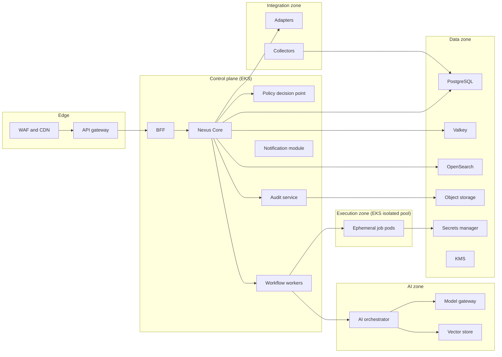

## 6.5 Technology Selection

| Area | Selected (recommendation) | Why | Alternatives considered | Operational overhead | Dependencies and notes |
|---|---|---|---|---|---|
| Frontend | React with Next.js (TypeScript) | Mature, strong accessibility tooling, server rendering, large talent pool | Angular, Vue | Low to medium | Node build chain, design system |
| Backend | **Python FastAPI** for the core and AI services | Fast delivery, typed APIs, strongest ecosystem for AI, automation and cloud SDKs | Java Spring Boot (stronger enterprise typing, mature ops, many enterprise teams) | Medium | Needs strict typing, linting and module boundary tests. Choose Java if the organization's skills strongly favor it (OD-01). |
| Infrastructure as Code | Terraform (with a plan to evaluate OpenTofu) | Widest provider and module ecosystem, plan-and-apply model fits approval gates | OpenTofu, Pulumi, CloudFormation or CDK | Medium | Licensing review, provider mirroring, state management (OD-05) |
| Cloud | AWS | Stated initial target | Other clouds later | n/a | Provider seams for future clouds |
| Container orchestration | Kubernetes on EKS | Needed for isolated worker pools, standard operations | ECS or Fargate (simpler), Lambda for glue | Medium to high | Platform cluster is separate from target clusters |
| Relational database | PostgreSQL (Aurora PostgreSQL-compatible or RDS) | Strong consistency, JSON support, row-level security, extensions | MySQL, others | Low (managed) | Backup and DR design in Part 5 |
| Cache | Valkey (managed, Redis-compatible) | Open governance, API compatibility, managed option | Redis | Low | No authoritative data |
| Messaging and events | EventBridge for events, SQS for work queues, SNS for fan-out | Managed, durable, native AWS integration, least operations | Kafka or MSK (heavier, justified only for high-volume streaming), RabbitMQ | Low | Dead-letter queues, schema registry discipline |
| Object storage | S3 | Durable, versioning, object lock, replication | None needed | Low | Bucket policies and key design |
| Search | OpenSearch (managed) | Search and log analytics, vector capability | Elasticsearch, Postgres full text for early stages | Medium | Index lifecycle management |
| Vector store | Start with PostgreSQL pgvector in a separate database or cluster. Move to OpenSearch vector search if scale or hybrid search needs it | Fewer new components for MVP | Dedicated vector databases | Low to medium | Evaluate at P6 (OD-10) |
| Secrets | AWS Secrets Manager | Rotation integration, IAM control, replication | HashiCorp Vault (richer, more operations) | Low | Rotation functions |
| Encryption | AWS KMS with customer-managed keys | Standard, auditable, multi-Region keys | HSM-backed custom key stores if required | Low | Key policy governance |
| Monitoring | Prometheus-compatible metrics, Grafana, CloudWatch, OpenTelemetry | Open standards, portability | Commercial APM suites | Medium | Managed Prometheus and Grafana can reduce overhead |
| AI | Pluggable model gateway. Managed model service on AWS as the default endpoint. Controlled orchestrator (own thin layer or a vetted framework) | Private connectivity, IAM auth, provider choice, auditability | Direct provider SDKs, large agent frameworks | Medium | Model contracts, evaluation harness |
| Authentication | OIDC (primary), SAML where required, SCIM | Enterprise standard | Local accounts (rejected) | Low | IdP availability, fallback break-glass |
| Workflow | **Temporal** (self-hosted or managed) as primary | Durable execution, human-in-loop waits, versioning, compensation, testable code | AWS Step Functions (lowest operations, AWS-specific, weaker local testing), Argo Workflows, custom | Medium to high (self-hosted) | Own persistence. Decision OD-02 with Step Functions as fallback |
| Policy engine | Open Policy Agent (Rego) | Flexible, policy as code, ecosystem (plan checks, admission) | Cedar (strong for application authorization), Kyverno (Kubernetes-focused) | Low to medium | Policy test discipline. Possible split: OPA for platform and IaC, Kyverno for cluster admission |
| GitOps | Argo CD (or Flux) | Declarative delivery and drift correction | Pipeline-only deploy | Medium | Git repositories as source of truth |
| CI for the platform | Existing enterprise CI | Do not add a new CI | n/a | n/a | Pipeline templates |

## 6.6 Cloud Infrastructure Architecture

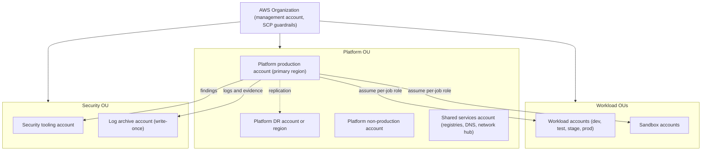

| Layer | Design |
|---|---|
| Accounts | Separate accounts for management, security tooling, log archive, shared services, platform production, platform non-production and DR. Workload accounts are created by the platform. |
| Regions | Primary region with three availability zones. One secondary region for DR. Additional regions only by decision. |
| Network | Hub-and-spoke. Private subnets for all platform services. Private endpoints to AWS services. Controlled egress via inspection. No public IPs on workers. |
| Compute | EKS for the platform (system, application, isolated execution and AI node pools). Managed services for data and messaging. |
| Data | Multi-AZ managed databases. Cross-region replicas. Object storage with replication. |
| Edge | CDN, WAF and DDoS protection. |
| Identity | Workforce SSO to platform and cloud. Workload identity inside clusters. Cross-account roles for execution. |
| Security | Logging to the log archive account, posture and threat detection in the security account, guardrail SCPs. |

## 6.7 Deployment Architecture

| Aspect | Design |
|---|---|
| Environments | Local, development, test, staging (production-like), production, DR. |
| Delivery | Git as source of truth. CI builds signed images and SBOMs. GitOps deploys. Infrastructure for the platform is Terraform code deployed by a **separate bootstrap pipeline**. |
| Release strategy | Canary or blue-green for the core. Feature flags for risky features. Database migrations follow expand and contract. |
| Config | Environment configuration as code, secrets via secrets manager. |
| Platform upgrades | Kubernetes, add-ons, database and dependency upgrades scheduled and rehearsed in staging first. Rollback plans documented. |
| Capacity | Autoscaling with limits. Load tests before major releases. |
| Observability | Every component exposes metrics, logs and traces. Synthetic probes for the portal and key workflows. |

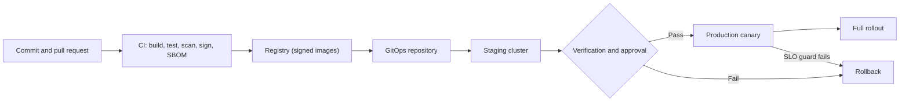

## 6.8 AI Multi-Agent Architecture

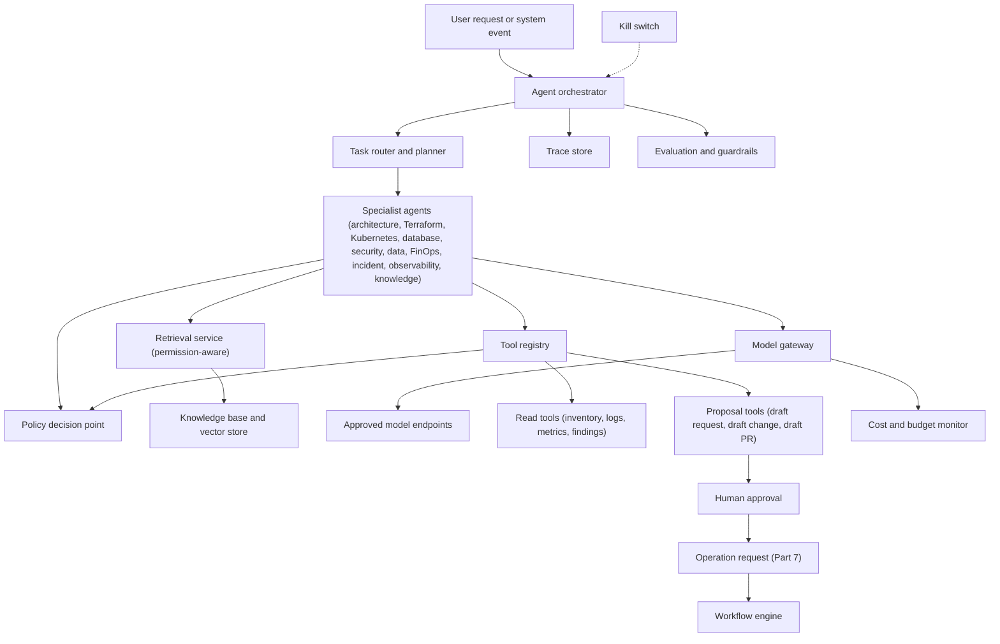

Key properties: (1) agents hold no direct credentials, (2) every tool call is policy-checked for user and agent identity, (3) write actions only through operation requests and approvals, (4) retrieval is permission-aware, (5) every run is traced and costed, (6) evaluation gates every prompt, model or tool change.

## 6.9 Automation Engine Architecture

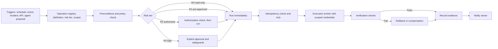

## 6.10 Disaster Recovery and Platform Continuity

| Topic | Design |
|---|---|
| Strategy | **Warm standby for data, pilot light for compute** in a secondary region. Stateless components are redeployed from GitOps. Data is replicated continuously. |
| Failure scenarios | Component failure, AZ loss, region loss, data corruption, ransomware or destructive action, credential compromise, loss of the identity provider, loss of the workflow engine. |
| Region failover | Declared by incident commander. Steps: freeze changes, verify replication lag, promote database replica, scale up compute, repoint DNS, verify, communicate. Orchestrated by a runbook that **does not depend on the platform being up**. |
| Bootstrap | The platform can be rebuilt from source control and the bootstrap pipeline in an empty account. Tested (TC-DR-03). |
| Corruption and ransomware | Immutable backups in a separate account, restore to clean environment, credential rotation, audit review. |
| IdP outage | Break-glass local access path with sealed credentials, strictly alerted and reviewed. |
| Workflow engine outage | In-flight workflows resume after recovery because history is durable. Operations paused safely (fail closed for high-risk). |
| Dependencies | DR plan lists every dependency (IdP, DNS, registry, source control, secrets) and their own recovery targets. |
| Exercises | Quarterly component failure drills, semi-annual regional failover, annual full rebuild (proposed). Evidence stored in the ledger. |

| Platform tier | Components | Proposed RTO | Proposed RPO |
|---|---|---|---|
| Tier 0 | Identity integration, audit ledger, policy service, secrets and keys | 30 min | Near zero in region, 15 min cross-region |
| Tier 1 | Core API, portal, workflow engine, PostgreSQL | 60 min | 5 min |
| Tier 2 | Execution workers, integration adapters, collectors | 4 h | 15 min |
| Tier 3 | AI services, search, reporting | 8 h | Rebuildable |

*These are recommendations requiring business approval.*

## 6.11 Platform Self-Management

| Topic | Design |
|---|---|
| Self-hosting rule | The platform manages workloads through itself. It does **not** depend on itself to recover itself. A small bootstrap path stays outside the platform. |
| Observability | The platform monitors itself with SLOs, plus an external probe so that "platform down" is noticed. |
| Upgrades | Versioned releases, canary, automated rollback, change notices to users. |
| Feature governance | Feature flags with owner and expiry. |
| Platform configuration | In source control. Four-eyes review. |
| Data hygiene | Retention jobs, index lifecycle, partition management run as operations. |
| Capacity | Quotas, load tests, scaling policies, cost budgets for the platform itself. |
| Emergency operation | Documented manual procedures to operate critical cloud resources if the platform is unavailable, using break-glass access. |

# Part 7: Operational Control Framework

Every automated operation in FDE Nexus is a **registered operation**. Nothing runs from a script, a schedule or an AI agent unless it exists in the operation registry with a complete record. An operation with an incomplete record **cannot be enabled**.

## 7.1 The Operation Record (mandatory fields)

| # | Field | Meaning |
|---|---|---|
| 1 | Operation identifier | Stable ID such as `OP-DB-004`, plus semantic version |
| 2 | Business purpose | Why this operation exists and what outcome it delivers |
| 3 | Trigger | Schedule, event, incident, API call, agent proposal or manual |
| 4 | Input parameters | Typed schema with validation and allowed values |
| 5 | Preconditions | Checks that must pass before execution (health, backup exists, window open, no conflicting change) |
| 6 | Target scope | Which accounts, environments, resources or tags. Maximum blast radius per run |
| 7 | Required permissions | Cloud and platform permissions, mapped to a scoped execution role |
| 8 | Risk classification | R0 to R3 (7.2) |
| 9 | Approval policy | Who must approve, when, and how many people |
| 10 | Execution engine | Workflow, worker job or platform service |
| 11 | Timeout | Hard limit per attempt and overall |
| 12 | Retry behavior | Which errors retry, how often, with backoff and jitter. Non-retryable errors listed |
| 13 | Idempotency key | Expression that makes repeated execution safe (for example `operation + target + intent hash`) |
| 14 | Verification checks | Post-conditions that prove the outcome |
| 15 | Rollback or compensating operation | How to undo or neutralize. If impossible, the record states so and raises the risk tier |
| 16 | Audit evidence | Events and artifacts recorded (plan hash, approvals, logs, verification results) |
| 17 | Owner | Accountable team and on-call |
| 18 | Operational SLO | Expected completion time and success rate |

## 7.2 Risk-Based Execution Policy

| Tier | Name | Definition | Execution policy | Safeguards |
|---|---|---|---|---|
| **R0** | Read-only | No change to any system | **Automatic**. Allowed for authorized identities, including agents | Rate limits, audit, data classification checks on what is returned |
| **R1** | Low-risk, reversible | Small, bounded, easily undone, non-production or low-impact | **Pre-approved policy**. Runs automatically within policy limits | Owner notification, undo path, blast-radius cap, daily volume limit |
| **R2** | Medium-risk | Meaningful change, reversible with effort, limited blast radius | **Requires authorization** by an entitled role (requester entitlement plus owner or team approver) | Plan review, verification, rollback plan, change window |
| **R3** | High-risk | Destructive, privilege-changing, production-impacting, data-affecting or hard to reverse | **Explicit approval** by named approver(s). Often two-person | Fresh backup or snapshot, change window, enhanced verification, rehearsed rollback, incident-commander awareness, session recording, post-action review |

**Escalation rules.** An operation's tier can be raised automatically (never lowered automatically): production target, Restricted data, privileged identity, missing rollback, recent failure of the same operation, open high-severity incident, change freeze.

## 7.3 Risk Scoring Inputs

| Factor | Examples |
|---|---|
| Environment | Sandbox, non-production, production |
| Blast radius | Number of resources, accounts, users affected |
| Reversibility | Fully reversible, partly, irreversible |
| Data impact | None, internal, confidential, restricted |
| Privilege | Standard, elevated, administrative |
| Change size | Count and type of resource changes in the plan |
| Context | Open incidents, freeze, history of failures, off-hours |
| Initiator | Human, scheduled automation, AI agent (agents are scored more conservatively until proven) |

## 7.4 Operation Catalog

Legend: **Engine** WF = durable workflow, WK = ephemeral worker job, SV = platform service. **Approval:** None = automatic, PA = pre-approved policy, TA = team approver, OA = owner approval, SEC = security approval, 2P = two-person approval, IC = incident commander. Timeouts and retries are starting values to tune. Rollback column: R = reversible, C = compensating action, N = not reversible (requires R3 safeguards).

### Read-only and low-risk

| ID | Operation | Trigger | Risk | Approval | Engine | Timeout | Retry | Idempotency key | Rollback | Owner | SLO |
|---|---|---|---|---|---|---|---|---|---|---|---|
| OP-INV-001 | Sync inventory from cloud | Schedule, event | R0 | None | WK | 15 min | 3x backoff | account + region + run window | n/a | Platform Eng. | 99% complete within 15 min |
| OP-INV-002 | Drift detection (plan only) | Schedule | R0 | None | WK | 30 min | 2x | environment + state version | n/a | Platform Eng. | Daily |
| OP-SEC-001 | Posture assessment | Schedule | R0 | None | SV | 30 min | 3x | account + ruleset version + day | n/a | Security | Daily |
| OP-FIN-001 | Ingest cost data | Daily | R0 | None | SV | 30 min | 3x | billing period + file id | n/a | FinOps | By 08:00 daily |
| OP-OBS-001 | Collect diagnostics bundle | Incident, user | R0 | None | WK | 5 min | 2x | incident + target + minute | n/a | SRE | 95% in 5 min |
| OP-K8S-001 | Pod diagnostics (state, events, logs) | Incident, user, agent | R0 | None | WK | 2 min | 2x | pod uid + minute | n/a | Platform Eng. | 95% in 2 min |
| OP-INF-002 | Add missing mandatory tags | Finding | R1 | PA | WK | 10 min | 3x | resource + tag set | R (remove added tags) | Platform Eng. | 99% success |
| OP-DB-002 | Create manual snapshot | User, pre-change | R1 | PA | WK | 60 min | 3x | database + purpose + hour | R (delete snapshot after retention) | DRE | 95% in 30 min |
| OP-DB-009 | Backup validation (restore to isolated instance) | Schedule | R1 | PA | WF | 4 h | 2x | database + backup id | R (delete test instance) | DRE | Monthly per database |
| OP-CERT-001 | Renew certificate | Expiry event | R1 | PA | WF | 30 min | 5x | cert id + validity period | C (re-issue previous) | Security | 100% before expiry minus 14 days |
| OP-K8S-002 | Restart a deployment (non-production) | Incident, user | R1 | PA | WK | 10 min | 2x | deployment + revision + hour | C (previous revision) | Platform Eng. | 95% in 10 min |
| OP-K8S-003 | Create namespace with quota and policies | Request | R1 | PA | WF | 10 min | 3x | team + name | R (delete if empty) | Platform Eng. | 95% in 5 min |
| OP-FIN-002 | Stop idle non-production resource | Recommendation | R1 | PA with owner notice and grace | WF | 15 min | 2x | resource + utilization window | R (start resource) | FinOps | 95% in 15 min |
| OP-SEC-002 | Close public exposure (non-production) | Finding | R1 | PA | WF | 15 min | 3x | resource + finding | R (re-open by exception) | Security | 95% in 15 min |

### Medium-risk

| ID | Operation | Trigger | Risk | Approval | Engine | Timeout | Retry | Idempotency key | Rollback | Owner | SLO |
|---|---|---|---|---|---|---|---|---|---|---|---|
| OP-INF-001 | Provision standard environment baseline | Request | R2 | TA | WF + WK | 60 min | 2x on transient | request id + plan hash | C (destroy if new) or previous version | Platform Eng. | 90% in 60 min after approval |
| OP-INF-004 | Provision network (VPC) | Request | R2 | TA + OA | WF + WK | 60 min | 2x | request id + plan hash | C (destroy if unused) | Platform Eng. | 90% in 60 min |
| OP-INF-003 | Clean up expired sandbox resources | Schedule | R2 | OA notice, grace expiry | WF | 2 h | 2x | account + expiry list hash | C (restore from retained snapshots, 7 days) | Platform Eng. | Weekly |
| OP-K8S-004 | Change node pool or autoscaling limits | Request | R2 | TA | WF + WK | 60 min | 2x | cluster + pool + desired spec hash | R (previous spec) | Platform Eng. | 90% in 60 min |
| OP-DB-003 | Provision database (non-production) | Request | R2 | TA | WF + WK | 90 min | 2x | request id + plan hash | C (destroy if new) | DRE | 90% in 90 min |
| OP-DB-004 | Restore database (PITR) to new instance | Request, incident | R2 | OA | WF + WK | 4 h | 1x | database + target time + purpose | R (delete restored instance) | DRE | 90% within RTO tier |
| OP-DB-005 | Apply minor patch (ring 1 non-production) | Schedule | R2 | TA | WF | 2 h | 1x | database + patch id | C (restore snapshot) | DRE | Per window |
| OP-SEC-003 | Rotate application secret | Schedule, finding | R2 | PA for standard, TA otherwise | WF | 30 min | 3x | secret + version stage | R (previous version for grace period) | Security | 100% on schedule |
| OP-FIN-003 | Apply rightsizing to non-production | Recommendation | R2 | OA | WF + WK | 60 min | 1x | resource + target size | R (previous size) | FinOps | 90% in 60 min |

### High-risk

| ID | Operation | Trigger | Risk | Approval | Engine | Timeout | Retry | Idempotency key | Rollback | Owner | SLO |
|---|---|---|---|---|---|---|---|---|---|---|---|
| OP-DEP-001 | Deploy application release to production | Change | R3 | OA + change approver, window | WF | 60 min | None automatic | release id + environment | C (roll back to previous release) | Platform Eng. | Per window |
| OP-DB-003P | Provision production database | Request | R3 | OA + DRE | WF + WK | 120 min | 1x | request id + plan hash | C | DRE | 90% in 2 h |
| OP-DB-007 | Production schema migration | Change | R3 | OA + DRE, window | WF | Per change | None | migration id + database | C (compensating script) | DRE | Within window |
| OP-DB-006 | Major version upgrade | Change | R3 | OA + DRE + 2P | WF | Per change | None | database + target version | C (blue/green fallback or restore) | DRE | Within window |
| OP-DB-008 | Decommission database (delete data) | Request | R3 | OA + steward + 2P | WF | 4 h | None | database + final backup id | N after retention window | DRE | Per request |
| OP-K8S-007 | Upgrade Kubernetes (production) | Change | R3 | OA + SRE + window | WF + WK | 8 h | None automatic | cluster + target version + phase | C (roll back node pools, restore) | Platform Eng. | Within window |
| OP-INF-005 | Decommission environment or resources | Request | R3 | OA + 2P | WF | 4 h | None | environment + inventory hash | N after recovery window | Platform Eng. | Per request |
| OP-IAM-001 | Create or change cloud IAM role or policy | Request | R3 | OA + SEC | WF | 30 min | 1x | role + policy hash | R (previous policy version) | Security | 90% in 30 min after approval |
| OP-IAM-002 | Grant administrative access | Request | R3 | OA + SEC | WF | Access duration | None | user + role + window | R (revoke) | Security | Per request |
| OP-IAM-003 | JIT elevation to production role | Request | R3 | OA (SEC for admin) | WF | Max 8 h by default | None | user + role + ticket | R (auto-revoke) | Security | Grant within 5 min after approval |
| OP-SEC-005 | Rotate shared production secret or root key | Schedule, incident | R3 | SEC + OA | WF | 60 min | None automatic | secret + rotation id | C (previous version retained for grace period) | Security | Per schedule |
| OP-SEC-006 | Close public exposure (production) | Finding | R3 | OA + SEC (emergency path with after-action review) | WF | 30 min | 1x | resource + finding | R | Security | 95% in 30 min after approval |
| OP-STATE-001 | Break state lock or repair state | Request | R3 | Platform lead + 2P | WK | 30 min | None | state id + lock id | C (state backup restore) | Platform Eng. | Per request |
| OP-DR-001 | Restore into production (overwrite) | Incident | R3 | OA + IC | WF | Per plan | None | resource + recovery point | C (pre-restore snapshot) | SRE | Within RTO tier |
| OP-DR-002 | Regional failover | Incident | R3 | IC + business authority | WF | Per runbook | None | service + disaster id | C (failback) | SRE | Within RTO tier |
| OP-DR-003 | Failback | Planned | R3 | IC + OA | WF | Per runbook | None | service + failback id | C | SRE | Planned window |
| OP-AI-001 | Raise an agent's autonomy level or release the kill switch | Request | R3 | AI platform owner + SEC | WF | n/a | None | agent + level | R (lower level) | AI platform | Per request |

## 7.5 Detailed Operation Cards

The six cards below show every field filled in. They are the **template standard**. All other catalog operations must reach this level of detail before being enabled (acceptance criterion for Phases 2 to 5).

### OP-INF-001: Provision standard environment baseline

| Field | Value |
|---|---|
| Identifier | OP-INF-001 v1 |
| Business purpose | Give a team a compliant, ready-to-use environment: network attachment, logging, security tooling, IAM boundary, budgets, tags |
| Trigger | Catalog request approved |
| Inputs | Team, environment type, region (allow-listed), classification ceiling, cost center, budget |
| Preconditions | Requester entitled. Account registered. Budget available. Policy pre-check passed. No active freeze. State lock free |
| Target scope | One account, one environment. Maximum resource count per plan from policy |
| Required permissions | Provisioning role for the target account (permission-bounded), state bucket access, key access |
| Risk | R2 (R3 if production) |
| Approval | Team approver. Production adds owner and security |
| Engine | Workflow with worker job for plan and apply |
| Timeout | 15 min plan, 45 min apply |
| Retry | Transient cloud errors up to 2 times with backoff. Policy or validation errors not retried |
| Idempotency key | `request_id + plan_hash` |
| Verification | Resources exist and match plan. Logging and security agents active. Tags present. Policy re-evaluation clean. Cost alerts set |
| Rollback | New environment: destroy created resources. Existing: re-apply previous module version |
| Audit evidence | Request, policy decisions, plan hash and artifact, approvals, execution log, verification report, inventory entries |
| Owner | Platform Engineering |
| SLO | 90% complete within 60 minutes of approval |

### OP-DB-004: Restore database to a point in time (new instance)

| Field | Value |
|---|---|
| Identifier | OP-DB-004 v1 |
| Business purpose | Recover from data loss or corruption without overwriting the source |
| Trigger | Request or incident runbook |
| Inputs | Database, target timestamp within retention, reason, target instance class |
| Preconditions | Point in time within retention. Capacity and quota available. Requester entitled. Classification allows target location |
| Target scope | One database. Creates one new instance. No change to the source |
| Permissions | Database operations role (restore, create instance), key access |
| Risk | R2 (cutover is a separate R3 change) |
| Approval | Resource owner |
| Engine | Workflow with worker job |
| Timeout | 4 hours (size dependent, tuned per tier) |
| Retry | One retry on transient error |
| Idempotency key | `database + target_time + purpose` |
| Verification | Instance available. Row-count and checksum samples. Application read test. Encryption and network settings match policy |
| Rollback | Delete the restored instance (nothing else changed) |
| Audit evidence | Request, approvals, recovery point details, restore log, validation results, deletion record |
| Owner | DRE |
| SLO | Within the RTO of the database's tier in 90% of cases |

### OP-K8S-007: Upgrade Kubernetes version (production cluster)

| Field | Value |
|---|---|
| Identifier | OP-K8S-007 v1 |
| Business purpose | Keep clusters in supported versions safely |
| Trigger | Approved change (scheduled window) |
| Inputs | Cluster, target minor version, add-on versions, node rotation strategy |
| Preconditions | Non-production rehearsal passed. Deprecated API usage scan clean. Add-on compatibility confirmed. Backups current. PodDisruptionBudgets present. No open high incident. Capacity buffer available |
| Target scope | One cluster. Phased: control plane, add-ons, node pools |
| Permissions | Kubernetes operations role for the account |
| Risk | R3 |
| Approval | Owner, SRE, change approver |
| Engine | Workflow with phased worker jobs |
| Timeout | Per phase limits, overall 8 hours |
| Retry | No automatic retry of a failed phase. Operator decision |
| Idempotency key | `cluster + target_version + phase` |
| Verification | Control plane healthy. Nodes ready on target version. Workload readiness and SLO guard. Add-ons healthy. Synthetic checks pass |
| Rollback | Node pools can be rolled back to the previous version while control plane compatibility allows. Control plane is not downgraded: recover by restoring or rebuilding per runbook. This is why the tier is R3 |
| Audit evidence | Pre-check report, approvals, phase logs, verification results, post-change summary |
| Owner | Platform Engineering |
| SLO | Completed within the window in 95% of upgrades |

### OP-IAM-003: Just-in-time elevation to a production role

| Field | Value |
|---|---|
| Identifier | OP-IAM-003 v1 |
| Business purpose | Give engineers production access only when needed, for a limited time |
| Trigger | Access request, or incident-linked request |
| Inputs | User, target role, duration, reason, linked ticket or incident |
| Preconditions | User in an eligible group. MFA fresh. Linked ticket valid. SoD check. Duration within role maximum |
| Target scope | One user, one role, one account or environment |
| Permissions | Platform identity service permission to assign time-bound role |
| Risk | R3 |
| Approval | Resource owner. Security for administrative roles. Automatic for incident-linked requests with incident commander confirmation (policy decision OD-14) |
| Engine | Workflow with timer |
| Timeout | Grant window ends at expiry. Approval wait times out after a configured period |
| Retry | Grant call retried 3 times |
| Idempotency key | `user + role + ticket` |
| Verification | Access active only for the window. Session logging confirmed |
| Rollback | Revoke immediately on expiry, on request, or on policy trigger (for example incident closed, user role change) |
| Audit evidence | Request, approvals, session start and end, actions performed, revocation record |
| Owner | Security |
| SLO | Access granted within 5 minutes of approval. Revocation within 1 minute of expiry |

### OP-SEC-003: Rotate an application secret

| Field | Value |
|---|---|
| Identifier | OP-SEC-003 v1 |
| Business purpose | Limit the value and lifetime of stolen credentials |
| Trigger | Schedule, finding or manual |
| Inputs | Secret identifier, rotation strategy (single user or alternating users) |
| Preconditions | Consumers registered. Secret not in a freeze exception. Dual-version support confirmed for the consumer |
| Target scope | One secret and its registered consumers |
| Permissions | Secrets manager rotation role, database or service permission to change the credential |
| Risk | R2 (R3 for shared or root credentials: OP-SEC-005) |
| Approval | Pre-approved for scheduled rotation. Otherwise team approver |
| Engine | Workflow |
| Timeout | 30 minutes |
| Retry | 3 times with backoff on transient errors |
| Idempotency key | `secret + target_version_stage` |
| Verification | New credential works from a test connection. Consumers healthy after refresh. Old credential retained for the grace period, then disabled |
| Rollback | Reinstate previous version during grace period |
| Audit evidence | Rotation events, verification results, consumer health |
| Owner | Security |
| SLO | 100% of secrets rotated on schedule |

### OP-DR-002: Regional failover

| Field | Value |
|---|---|
| Identifier | OP-DR-002 v1 |
| Business purpose | Restore service in the secondary region when the primary is unavailable |
| Trigger | Declared disaster by incident commander |
| Inputs | Service or service group, target region, acceptable data-loss decision |
| Preconditions | Disaster declared. Replication lag measured and recorded. Target capacity and dependencies available. Changes frozen in the primary |
| Target scope | Defined service group |
| Permissions | Recovery role in target region. DNS and traffic control permissions |
| Risk | R3 |
| Approval | Incident commander and business authority |
| Engine | Workflow driven by a runbook that runs from outside the affected region |
| Timeout | Per step, overall per tier |
| Retry | Steps idempotent. Failed step reported to commander |
| Idempotency key | `service + disaster_id + step` |
| Verification | Data layer promoted and consistent. Service health checks and synthetic transactions pass. Traffic served from the secondary region |
| Rollback | Failback (OP-DR-003) as a planned change |
| Audit evidence | Declaration, decisions, timestamps per step, data-loss window, verification |
| Owner | SRE |
| SLO | Within the RTO of the service tier |

## 7.6 Execution Semantics

| Topic | Rule |
|---|---|
| Idempotency | Each run carries an idempotency key. A duplicate with the same key returns the existing run. Operations must be safe to repeat. |
| Concurrency | One concurrent run per target and operation class, enforced by locks. Conflicting operations queue or are rejected. |
| Timeouts | Every step has a timeout. On timeout the run enters "unknown", triggers verification, then compensation or operator decision. |
| Retries | Only for errors marked retryable. Exponential backoff with jitter and a retry budget. |
| Compensation | Saga style: each step with side effects has a compensating step. Failure runs compensations in reverse order. |
| Verification | Mandatory. A run is "succeeded" only after verification passes. |
| Blast radius | Per-run and per-day caps by tier. Exceeding a cap pauses automation and alerts. |
| Dry run | Supported for all R2 and R3 operations where technically possible. |
| Approval binding | Approval is bound to the exact inputs and plan hash. Any change invalidates it. |
| Expiry | Approvals and scheduled R3 operations expire if not executed within the allowed time. |
| Kill switch | Global and per-operation pause, usable by SRE and Security. |
| Observability | Every run emits metrics, logs and traces with the correlation id. |
| Auditing | Start, decision, approval, execution, verification, compensation and end are recorded in the ledger. |

## 7.7 Rules for AI-Initiated Operations

1. An agent can start R0 operations within the permissions of the user it acts for.
2. An agent can **propose** R1 to R3 operations. R1 may run under pre-approved policy only if the operation's record explicitly allows agent initiation and the agent's autonomy level is A3 or higher.
3. R2 and R3 initiated by agents always create a human approval step.
4. The approval screen shows the agent's evidence, the exact plan and the risk factors.
5. An agent's recent error rate raises the effective risk tier (tightening only).

---

# Part 8: Non-Functional Requirements

All targets below are **initial design recommendations requiring business approval**. They must be baselined, load-tested and adjusted.

## 8.1 Requirements and Validation

| ID | Category | Requirement | Proposed target | Validation method |
|---|---|---|---|---|
| NFR-AVL-01 | Availability | Portal and API (Tier 1) | 99.9% monthly (about 43 minutes of downtime) | Synthetic probes, SLO dashboards, error budget reports |
| NFR-AVL-02 | Availability | Policy decision service and audit write path (Tier 0) | 99.95% monthly | Same, plus fail-closed behavior test |
| NFR-AVL-03 | Availability | Execution plane | 99.5% monthly | Job success and queue latency SLOs |
| NFR-SCA-01 | Scalability | Concurrent users | At least 1,000 concurrent portal users without breaching latency targets (to be re-sized to the organization) | Load test TC-PERF-01 |
| NFR-SCA-02 | Scalability | Inventory size | At least 1 million resource records and 100 tenants with p95 latency maintained | Scale test TC-PERF-02 |
| NFR-SCA-03 | Scalability | Concurrent executions | At least 200 concurrent worker jobs, scaling from zero | Scale test, queue-depth SLO |
| NFR-LAT-01 | Latency | Read API | p95 under 500 ms, p99 under 1.5 s | Load test, production SLI |
| NFR-LAT-02 | Latency | Dashboard first meaningful render | Under 2 s p95 | Real-user monitoring |
| NFR-LAT-03 | Latency | Policy decision | p95 under 50 ms | Load test |
| NFR-LAT-04 | Latency | Search | p95 under 1 s | Load test |
| NFR-LAT-05 | Latency | Plan generation start after submit | Under 60 s p95 | Workflow metrics |
| NFR-REL-01 | Reliability | No lost approvals or requests | Zero acknowledged requests lost | Chaos tests, restore tests |
| NFR-REL-02 | Reliability | Workflow durability | In-flight workflows survive worker and node loss | TC-CHAOS-01 |
| NFR-REL-03 | Reliability | Execution success rate | At least 98% excluding policy rejections | Execution metrics |
| NFR-REL-04 | Reliability | Idempotent operations | Duplicate execution causes no duplicate effect | TC-OPS-01 |
| NFR-SEC-01 | Security | Authentication | 100% of human access via SSO with MFA | Config audit, test |
| NFR-SEC-02 | Security | Long-lived cloud keys | Zero in platform and execution paths | Automated scan |
| NFR-SEC-03 | Security | Vulnerability remediation | Critical in platform components fixed within a set number of days (for example 7), high within 30 | Scan reports |
| NFR-SEC-04 | Security | Penetration testing | Before go-live and at least annually | Third-party report, tracked fixes |
| NFR-SEC-05 | Security | Encryption | 100% of stores and links encrypted | Config scan |
| NFR-DAT-01 | Data consistency | Platform metadata | Strong consistency within PostgreSQL. No dual write without an outbox | Design review, tests |
| NFR-DAT-02 | Data consistency | Search and inventory projections | Eventually consistent within 60 s (search), 15 min (cloud inventory sync) | Freshness metrics |
| NFR-DAT-03 | Data consistency | Reconciliation | Daily inventory-to-cloud reconciliation with discrepancy reports | Reports |
| NFR-BKP-01 | Backup | Platform database | Continuous backup with PITR. Daily snapshots. Copies in a second region and an isolated account | Config and restore tests |
| NFR-BKP-02 | Backup | Restore validation | Automated restore test at least monthly | TC-DR-01 |
| NFR-REC-01 | Recovery | Tier objectives | Per tier in Part 6.10 | DR exercises |
| NFR-DR-01 | Disaster recovery | Regional failover exercise | Semi-annual, with evidence | TC-DR-02 |
| NFR-DR-02 | Disaster recovery | Full rebuild exercise | Annual, from empty account | TC-DR-03 |
| NFR-ACC-01 | Accessibility | Portal | Conformance target WCAG 2.2 AA, keyboard and screen-reader support | Automated checks and manual audit, TC-A11Y-01 |
| NFR-OBS-01 | Observability | Coverage | 100% of services emit metrics, logs and traces with correlation ids | Platform checks |
| NFR-OBS-02 | Observability | Alert quality | Every paging alert has an owner, runbook link and is reviewed quarterly | Alert review |
| NFR-AUD-01 | Audit completeness | State-changing actions | 100% recorded with actor, decision and outcome | TC-SEC-05, reconciliation |
| NFR-AUD-02 | Audit integrity | Hash chain verification | Daily, with alert on break | Job reports |
| NFR-AI-01 | AI safety | Unauthorized tool execution | Zero | TC-AI-02 |
| NFR-AI-02 | AI safety | Prompt injection resilience | At or above an agreed pass rate on the red-team suite, with no state-changing success | TC-AI-01 |
| NFR-AI-03 | AI safety | Groundedness | Answers cite sources. Target score above threshold set per agent | TC-AI-03 |
| NFR-AI-04 | AI safety | Data leakage | No Restricted data in prompts to unapproved endpoints | TC-AI-04 |
| NFR-AI-05 | AI safety | Cost control | Per-team and per-agent budgets enforced with hard stop | TC-AI-05 |
| NFR-OPS-01 | Operational efficiency | Automation rate | Rising share of standard requests with no manual step | Request analytics |
| NFR-OPS-02 | Operational efficiency | Toil | Platform on-call toil below an agreed share of time | Time tracking |
| NFR-OPS-03 | Operational efficiency | Platform cost | Platform run cost tracked per request and per tenant | FinOps reports |

## 8.2 Proposed Service Tiers

| Tier | Typical examples | Availability SLO | RTO | RPO |
|---|---|---|---|---|
| Tier 0 | Audit, policy, identity integration | 99.95% | 30 min | Near zero (region), 15 min (cross-region) |
| Tier 1 | Portal, API, workflows, core database | 99.9% | 60 min | 5 min |
| Tier 2 | Execution, integrations, collectors | 99.5% | 4 h | 15 min |
| Tier 3 | AI services, reporting, search | 99.0% | 8 h | Rebuildable |

---

# Part 9: Implementation Roadmap

**Planning assumptions (to validate, OD-20):** a dedicated cross-functional team, platform product management in place, an existing enterprise IdP, an AWS Organization already established, and decision on the open items (Part 10) taken before the dependent phase. Durations are **indicative sequencing estimates, not commitments**. Phases overlap where dependencies allow.

```mermaid
gantt
    title Indicative sequencing (months from start)
    dateFormat  X
    axisFormat  M%s
    section Foundation
    P1 Platform foundation            :p1, 0, 4
    section Infrastructure
    P2 Core infrastructure automation :p2, 3, 6
    section Governance
    P3 Security and governance        :p3, 7, 5
    section Data
    P4 Database and data management   :p4, 10, 6
    section Operations
    P5 Operations automation          :p5, 13, 6
    section Intelligence
    P6 AI engineering                 :p6, 16, 6
    P7 Intelligent enterprise         :p7, 21, 9
```

## Phase 1: Platform Foundation

| Item | Detail |
|---|---|
| Objective | A secure, usable foundation with identity, audit and the first catalog and request experience |
| Scope | M07 SSO, MFA, SCIM, RBAC. M01 dashboard, role-based navigation, catalog, request management, notifications (basic). M02 cloud account inventory and onboarding. M16 IdP and ITSM adapters. Audit ledger. Tenant model. Platform observability baseline. Platform backups |
| Dependencies | IdP access, AWS Organization access, platform accounts, decisions OD-01, OD-03, OD-13, networking and landing zone, source control and CI |
| Deliverables | Running portal and API, identity integration, tenant and RBAC model, audit ledger with verification, account inventory, request lifecycle with approvals (no automation yet), CI/CD for the platform, bootstrap pipeline, initial runbooks |
| Ownership | Platform Product (scope), Platform Engineering (build), Security (identity and audit review), SRE (observability) |
| Acceptance criteria | SSO and MFA enforced for all users. RBAC enforced at API with deny by default (TC-API-01). Audit chain verified daily (TC-SEC-05). Existing accounts discovered and registered. A request can be submitted, approved and recorded end to end. Platform restore from backup tested once |
| Risks | IdP integration delays (R-03). Scope creep into automation (R-08). Tenant model changes later (R-12) |

## Phase 2: Core Infrastructure Automation

| Item | Detail |
|---|---|
| Objective | Governed provisioning from request to verified resource |
| Scope | M03 Terraform registry, plan, policy gate, scan, cost estimate, apply, state, locking, rollback. M02 environment creation, networking, compute, storage, load balancing, DNS, decommissioning. M04 cluster and namespace basics. M13 change requests, windows, pipeline integration. M10 engine core and operation registry. M12 cost estimate and budgets. M16 CI/CD and CMDB sync |
| Dependencies | Phase 1 complete. Execution worker design reviewed. Policy engine selected (OD-08). Workflow engine decided (OD-02). Module standards |
| Deliverables | Execution worker platform, module registry with first modules, three MVP catalog items live, workflow engine with approval flows, plan review UI, cost estimate, change calendar, operation registry with enforced mandatory fields, first operation cards completed |
| Ownership | Platform Engineering (workers, modules), Security (policy review), FinOps (estimates), SRE (verification and rollback) |
| Acceptance criteria | MVP catalog items deploy through plan, policy, approval, apply and verify (TC-E2E-01). Rejection and rollback paths work (TC-E2E-02, 03). Worker isolation tests pass (TC-SEC-03). No operation can be enabled with an incomplete record (TC-OPS-01). Decommissioning works with recovery window (TC-E2E-08) |
| Risks | Worker security flaws (R-05). State corruption (R-06). Module quality (R-09) |

**MVP release (R1) is declared when Phase 1 and the first three catalog items of Phase 2 meet their acceptance criteria.**

## Phase 3: Security and Governance

| Item | Detail |
|---|---|
| Objective | Make policy, access and compliance first-class and continuous |
| Scope | M08 policy engine at scale, CSPM, scanning, secrets, certificates, findings, risk scoring, remediation, compliance monitoring and evidence. M07 ABAC, JIT, PAM, access reviews, session audit. M15 registry, signing, SBOM, provenance, baselines. IaC drift. M04 image scanning and admission. M06 compliance evidence (initial). M12 reporting |
| Dependencies | Phase 2 operation framework. Compliance scope decision (OD-09). Scanner selection |
| Deliverables | Policy lifecycle (author, test, shadow, enforce), normalized finding model, remediation workflows, JIT and access review campaigns, signed artifact enforcement, evidence packages |
| Ownership | Security, Platform Engineering, Compliance |
| Acceptance criteria | Policy changes follow test and staged rollout (TC-POL-02). JIT grants expire automatically (TC-E2E-07). SoD rules enforced (TC-SEC-02). Public exposure detected and tracked to closure. Evidence packages accepted by internal audit as a trial |
| Risks | Policy false positives block delivery (R-10). Scanner noise (R-11) |

## Phase 4: Database and Data Management

| Item | Detail |
|---|---|
| Objective | Govern the database fleet and the data it holds |
| Scope | M05 catalog, provisioning, backup, PITR, HA, credentials, patching basics, decommissioning. M06 classification, ownership, catalog, lineage, quality, retention, residency, masking, access approval, deletion. M14 backup policies and validation |
| Dependencies | Phase 3 (secrets, policy). Engine support matrix decided. Data governance council operating (OD-15) |
| Deliverables | Database catalog items for each category (relational first, then others), backup and restore automation with validation, metadata catalog, classification scanning, retention and deletion engine, data access approval |
| Ownership | DRE, Data Governance Council, Security |
| Acceptance criteria | Provision, backup, restore and decommission tested per supported engine (TC-E2E-06). Classification coverage report. Retention and deletion verified (TC-DATA-02). Lineage completeness measured (TC-DATA-03) |
| Risks | Scope breadth across engines (R-13). Data quality of discovered metadata (R-14) |

## Phase 5: Operations Automation

| Item | Detail |
|---|---|
| Objective | Run the estate with controlled automation and proven recovery |
| Scope | M11 metrics, logs, traces, alerts, incidents, SLOs, RCA. M10 full operation library (patching, rotation, renewal, cleanup, recovery). M14 DR orchestration and exercises. M05 performance and forecasting, upgrades, migrations. M04 upgrades and backup. M12 optimization reporting. Platform DR |
| Dependencies | Phases 2 to 4. SLO definitions. DR tier agreements (OD-16) |
| Deliverables | Observability stack integrated, incident workflow, runbook automation, scheduled and event-driven operations, DR runbooks, first regional failover exercise with evidence |
| Ownership | SRE, DRE, Platform Engineering |
| Acceptance criteria | Operations meet SLOs with verification and rollback (TC-OPS-01). Regional failover exercise passes within tier objectives (TC-DR-02). Full rebuild test passes (TC-DR-03). Alert quality review completed |
| Risks | Automation causing harm (R-04). Alert fatigue (R-15). DR gaps found late (R-07) |

## Phase 6: AI Engineering

| Item | Detail |
|---|---|
| Objective | Safe AI assistance inside the governed platform |
| Scope | M09 model gateway, orchestrator, tool registry, RAG, knowledge base, evaluation, guardrails, tracing, cost controls. First agents: knowledge retrieval, Kubernetes troubleshooting, Terraform assistant, infrastructure assistant. M06 governance of AI data |
| Dependencies | Phases 3 and 5 (policy, operations). Model provider agreements and data terms (OD-10, OD-11). Knowledge sources curated |
| Deliverables | Assistant in the portal, agents at A0 to A2, evaluation sets and harness, red-team results, kill switch tested, AI data retention implemented |
| Ownership | Platform Engineering, Security, Data Governance |
| Acceptance criteria | Zero unauthorized tool executions in test (TC-AI-02). Prompt injection suite meets threshold (TC-AI-01). Groundedness meets threshold (TC-AI-03). Budgets enforced (TC-AI-05). Kill switch verified |
| Risks | Hallucinated actions (R-16). Data leakage (R-17). Cost overrun (R-18) |

## Phase 7: Intelligent Enterprise Platform

| Item | Detail |
|---|---|
| Objective | Multi-agent workflows and earned autonomy, plus optimization at scale |
| Scope | Multi-agent flows, FinOps intelligence (forecasting, anomaly, rightsizing at scale), controlled autonomous operations (A3 and A4 for selected operations), predictive capacity and reliability, multi-cloud expansion (provider seam implementation for a second cloud, if approved) |
| Dependencies | Evidence of safe operation from Phase 6. Business decision on multi-cloud (OD-18) |
| Deliverables | Supervised multi-agent incident and optimization workflows, autonomy promotion process, second-provider proof of concept (if approved), predictive analytics |
| Ownership | Platform Engineering, SRE, FinOps, Security |
| Acceptance criteria | Autonomy promotion requires measured evidence (success rate, zero harmful actions, rollback proven). Each autonomous operation has a kill switch and blast-radius caps. Cost and reliability gains measured against baseline |
| Risks | Over-automation (R-04). Multi-cloud complexity (R-19). Model drift (R-20) |

# Part 10: Final Architecture Deliverables

## 10.1 API Specifications

### Conventions

| Topic | Specification |
|---|---|
| Style | REST over HTTPS with JSON. Resource-oriented. Custom actions use a `:action` suffix. Base path `/api/v1`. An OpenAPI description is the contract, kept in source control. |
| Authentication | OIDC bearer tokens for users. Short-lived workload tokens for services and automations. Webhooks use signatures (below). |
| Authorization | Every call is evaluated by the policy decision point. Deny by default. Decisions are logged with correlation id. |
| Identifiers | UUIDs. Human-readable references in addition for requests and changes. |
| Idempotency | `Idempotency-Key` header required on create and action calls that start work. Same key and same body returns the original result. |
| Concurrency | `ETag` and `If-Match` for updates (optimistic locking). |
| Asynchronous work | Long operations return `202 Accepted` with a link to a run or request resource. Clients poll or subscribe to events. |
| Pagination and filtering | Cursor pagination, maximum page size, filters by documented fields. No unbounded list. |
| Errors | Problem Details style (type, title, status, detail, correlation id, field errors). Stable error codes. |
| Rate limits | Per user, per tenant and per integration. `429` with `Retry-After`. Heavier limits on expensive endpoints. |
| Correlation | `X-Correlation-Id` accepted and returned. Propagated to workflows, workers and audit. |
| Versioning | Major version in path. Additive changes are non-breaking. Deprecations announced with `Deprecation` and `Sunset` headers and a documented period. |
| Contract testing | Consumers and providers verified in CI (TC-INT-01). |

### Endpoint catalog

| Area | Method and path | Purpose | Permission (policy) | Async |
|---|---|---|---|---|
| Identity | `GET /me` | Current user, roles, teams | authenticated | no |
| Identity | `GET /teams`, `POST /teams/{id}/members` | List teams, manage membership | team admin | no |
| Catalog | `GET /catalog/items`, `GET /catalog/items/{id}` | Browse and read items | catalog.read | no |
| Catalog | `POST /catalog/items` | Create item (author) | catalog.author | no |
| Catalog | `POST /catalog/items/{id}/versions` | Add version | catalog.author | no |
| Catalog | `POST /catalog/items/{id}/versions/{v}:publish` | Publish after review | catalog.publish | no |
| Requests | `POST /requests` | Submit a request | request.create | yes |
| Requests | `GET /requests`, `GET /requests/{id}` | List and read | request.read (scoped) | no |
| Requests | `POST /requests/{id}:cancel` | Cancel | requester or admin | no |
| Requests | `GET /requests/{id}/plan` | Plan summary, policy results, cost | request.read | no |
| Approvals | `GET /approvals?assignee=me` | My approvals | authenticated | no |
| Approvals | `POST /approvals/{id}:decide` | Approve or reject | approver, SoD enforced | no |
| Deployments | `GET /deployments`, `GET /deployments/{id}` | Status and history | deployment.read | no |
| Deployments | `POST /deployments/{id}:rollback` | Roll back | deployment.rollback (R2/R3) | yes |
| Inventory | `GET /resources`, `GET /resources/{id}` | Inventory with relationships | inventory.read (scoped) | no |
| Accounts | `GET /accounts` | List accounts | account.read | no |
| Accounts | `POST /accounts:register` | Onboard existing account | account.admin | yes |
| Accounts | `POST /accounts/{id}:decommission` | Start decommission | account.admin (R3) | yes |
| Operations | `GET /operations`, `GET /operations/{id}` | Registry | operation.read | no |
| Operations | `POST /operations/{id}/runs` | Start a run | per operation permission and risk tier | yes |
| Operations | `GET /runs/{id}`, `POST /runs/{id}:cancel` | Track or cancel | run.read, run.cancel | no |
| Policy | `GET /policies`, `POST /policies/{id}/versions` | Read and propose | policy.read, policy.author | no |
| Policy | `POST /policy:evaluate` | Decision API (internal) | service identity | no |
| Policy | `POST /exceptions` | Request exception | exception.request | no |
| Findings | `GET /findings`, `PATCH /findings/{id}` | List and update status | finding.read, finding.triage | no |
| Findings | `POST /findings/{id}:remediate` | Start remediation | by operation tier | yes |
| Access | `POST /access-requests` | Request access (JIT) | authenticated | yes |
| Access | `GET /access-grants`, `POST /access-grants/{id}:revoke` | View and revoke | access.read, access.revoke | no |
| Access | `GET /access-reviews`, `POST /access-reviews/{id}:certify` | Reviews | reviewer | no |
| Databases | `GET /databases`, `GET /databases/{id}/backups` | Inventory and backups | database.read | no |
| Databases | `POST /databases/{id}:restore` | Restore to new instance | database.operate (R2) | yes |
| Data governance | `GET /data-assets`, `PATCH /data-assets/{id}/classification` | Catalog and classify | data.read, data.steward | no |
| Data governance | `POST /data-access-requests` | Request data access | authenticated | yes |
| AI | `POST /assistant/conversations`, `POST /assistant/conversations/{id}/messages` | Chat | assistant.use | no (stream) |
| AI | `GET /agents`, `GET /agent-runs/{id}/trace` | Catalog and trace | agent.read, trace.read | no |
| AI | `POST /agents/{id}:set-autonomy` | Change autonomy | agent.admin (R3) | no |
| AI | `POST /agents:kill-switch` | Pause agents | sre or security | no |
| Cost | `GET /costs`, `POST /budgets` | Cost and budgets | cost.read, budget.manage | no |
| Cost | `GET /recommendations`, `POST /recommendations/{id}:accept` | Optimization | cost.read, operation tier | yes |
| Observability | `GET /incidents`, `POST /incidents`, `GET /slos` | Incidents and SLOs | incident.read, incident.create | no |
| Audit | `GET /audit/events`, `POST /audit/exports`, `GET /audit/verify` | Search, export, verify chain | audit.read (separate role) | exports async |
| Integration | `POST /webhooks/{source}` | Receive external events | signature | no |
| Integration | `GET /integrations`, `POST /integrations/{id}:test` | Health and test | integration.admin | no |

### Event contract

Events use a common envelope (CloudEvents-style): `id`, `source`, `type`, `specversion`, `time`, `tenant_id`, `correlation_id`, `subject`, `schema_version`, `data`. Events are immutable, versioned and documented in a schema registry. Consumers must tolerate additional fields.

| Event type | Emitted when |
|---|---|
| `request.created`, `request.approved`, `request.rejected` | Request lifecycle |
| `plan.ready`, `plan.policy_failed` | Plan results |
| `deployment.started`, `deployment.succeeded`, `deployment.failed`, `deployment.rolled_back` | Execution |
| `resource.created`, `resource.changed`, `resource.deleted` | Inventory changes |
| `finding.opened`, `finding.closed`, `exception.granted` | Security |
| `access.granted`, `access.revoked`, `access.review_due` | Access |
| `operation.run.started`, `operation.run.succeeded`, `operation.run.failed` | Automation |
| `backup.completed`, `backup.validation_failed` | Recovery |
| `incident.opened`, `incident.resolved`, `slo.burn_alert` | Reliability |
| `agent.run.completed`, `agent.guardrail_blocked`, `agent.killswitch_enabled` | AI |
| `policy.version.activated`, `catalog.version.published` | Governance |

### Webhooks and integration contracts

| Aspect | Specification |
|---|---|
| Inbound webhooks | HMAC signature over body and timestamp. Reject old timestamps (replay window). Allow-list sources. Treat as a hint: fetch authoritative state from the source before acting. |
| Outbound webhooks | Signed. Retried with exponential backoff and jitter for a bounded period. Then dead-letter queue and alert. Consumers de-duplicate on event id. |
| Rate limits | Respect source limits. Token bucket per integration. Back off on `429`. |
| Authentication | Secrets from the secrets manager, rotated. Prefer OIDC or short-lived tokens. |
| Failure handling | Circuit breaker per adapter. Degraded mode (for example ticket creation queued when ITSM is down). Health shown in the integrations page. Poison messages to DLQ with replay tool. |

| Integration | Direction | Mechanism | Notes |
|---|---|---|---|
| Identity provider | Both | OIDC or SAML for login, SCIM for users and groups | Deprovisioning must remove access within a defined time |
| ITSM and change | Both | REST API, webhooks | Create and update tickets and changes. Link ids. Sync status |
| CMDB | Platform to CMDB (source of truth decision OD-21) | REST or bulk sync | Reconcile daily |
| CI/CD | Both | Webhook, API | Pipeline triggers deployment requests. Status returned |
| Source control | Both | App or token, webhooks | Pull requests for catalog, policy and templates |
| Monitoring and paging | Both | Webhook, API | Alerts in, incidents out |
| Chat and email | Out, plus approvals | Bot or API | Actionable approvals with signed links |
| Security tools | In | API, finding import | Normalized into findings |
| Cost tools | In | Export ingestion | Daily |
| Documentation | In | Sync | Knowledge ingestion with owners |

## 10.2 Operational Runbooks

Runbooks are maintained as code, linked to alerts, and where safe, executable through the operation registry. Each has an owner, a last-tested date and an exercise cadence.

| ID | Runbook | Trigger | Key steps | Escalation and verification |
|---|---|---|---|---|
| RB-01 | Portal or API outage | Availability alert | 1. Check edge and gateway health. 2. Check core service and database. 3. Roll back last release if correlated. 4. Scale or fail over per dependency. 5. Post status update | Incident commander for more than 15 minutes. Verify with synthetic transactions |
| RB-02 | Platform database failover | Writer failure or high replication lag | 1. Confirm automatic failover happened. 2. Check connection errors and retries. 3. Verify replication and backups. 4. Review for data loss | DBA on-call. Verify writes, workflow health |
| RB-03 | Workflow backlog or stuck workflows | Queue depth or age alerts | 1. Check worker health and recent deploys. 2. Identify blocked workflows by type. 3. Pause the offender operation. 4. Scale or restart workers. 5. Resume with rate limit | Platform on-call, then engineering |
| RB-04 | Suspected execution worker compromise | Egress or runtime anomaly | 1. Trigger global execution pause. 2. Revoke job role sessions. 3. Isolate the node pool. 4. Collect evidence. 5. Rotate affected credentials and rebuild images | Security incident process |
| RB-05 | Credential or secret leak | Scanner or report | 1. Identify secret and scope. 2. Rotate immediately (OP-SEC-005). 3. Review audit for use. 4. Remove from source. 5. Post-incident review | Security on-call |
| RB-06 | AI agent misbehavior | Guardrail alerts, user report | 1. Enable kill switch for the agent or tool. 2. Preserve traces. 3. Review actions and approvals. 4. Fix prompt, tool or policy. 5. Re-evaluate before re-enable | AI platform owner and Security |
| RB-07 | Regional failover (platform) | Regional disruption | Follow OP-DR-002 steps. Freeze changes, verify lag, promote database, scale compute, repoint DNS, verify, communicate | Incident commander plus business authority |
| RB-08 | Audit chain break | Verification alert | 1. Freeze high-risk operations (fail closed). 2. Identify the break range from archive. 3. Determine cause (fault or tampering). 4. Restore from write-once copy. 5. Security investigation | Security and compliance |
| RB-09 | Failed deployment and rollback | Verification failure | 1. Confirm automatic rollback status. 2. Execute rollback operation if not automatic. 3. Validate service health. 4. Open incident if impact | Service owner and SRE |
| RB-10 | Stuck state lock or suspected state corruption | Lock timeout, apply errors | 1. Confirm no running job. 2. Restore state backup or version. 3. Use OP-STATE-001 with two-person approval. 4. Re-plan to confirm | Platform lead |
| RB-11 | Identity provider outage | Login failures | 1. Confirm IdP status. 2. Use break-glass accounts for critical operations only. 3. Alert on every use. 4. Review after recovery | Security and IAM team |
| RB-12 | Cost anomaly | Anomaly alert | 1. Identify service and team. 2. Contact owner. 3. Apply budget action if policy allows. 4. Record cause | FinOps |
| RB-13 | Policy bundle regression | Spike in denials or failed deployments | 1. Compare decisions by policy version. 2. Roll back to previous bundle. 3. Fix and test in shadow mode. 4. Re-release | Security and platform on-call |

## 10.3 Test Strategy

| Layer | Purpose | Approach |
|---|---|---|
| Unit | Logic correctness | Automated, in CI, with coverage targets |
| Contract | API and event compatibility | Provider and consumer contract tests in CI |
| Integration | Component interaction | Ephemeral environments with real dependencies where practical |
| Policy | Policy correctness | Policy unit tests, scenario tests, shadow mode in production before enforcement |
| End to end | Business flows | Automated scenarios in staging, plus synthetic probes in production |
| Security | Resilience against attack | Static and dynamic analysis, dependency scans, annual or pre-release penetration tests, worker escape tests, tenant isolation tests |
| AI | Safety and quality | Evaluation suites per agent, red-team prompts, regression on every prompt, model or tool change |
| Performance and scale | Targets in Part 8 | Load, soak and scale tests with production-like data volumes |
| Resilience | Failure handling | Chaos experiments and dependency failure injection |
| Recovery | RTO and RPO | Backup restore tests, failover and rebuild exercises |
| Accessibility | WCAG conformance | Automated scans plus manual audits |
| Upgrade | Safe releases | Upgrade and rollback rehearsals in staging |

**Release gates:** all automated tests green, no open critical or high security finding without approved exception, policy tests green, performance within thresholds, DR status current, runbooks updated, change approved.

### Test case catalog

| ID | Test case | Covers |
|---|---|---|
| TC-API-01 | Authorization matrix on every endpoint (allowed, denied, cross-tenant) | RBAC, ABAC, tenant isolation |
| TC-API-02 | Idempotency and concurrency (duplicate keys, If-Match conflicts) | API semantics |
| TC-E2E-01 | Catalog request to verified resource | Core lifecycle |
| TC-E2E-02 | Approval rejection and expiry paths | Approval |
| TC-E2E-03 | Failed deployment triggers rollback | Rollback |
| TC-E2E-04 | Existing account onboarding and baseline | Account lifecycle |
| TC-E2E-05 | Kubernetes namespace and workload deployment | Container platform |
| TC-E2E-06 | Database provision, backup, restore, decommission | Database lifecycle |
| TC-E2E-07 | JIT access grant, use and automatic expiry | Access |
| TC-E2E-08 | Decommission with dependency and retention checks | Decommissioning |
| TC-POL-01 | Policy denial blocks deployment with clear reason | Policy gate |
| TC-POL-02 | Policy bundle versioning, shadow mode, rollback | Policy lifecycle |
| TC-SEC-01 | Penetration test | Overall security |
| TC-SEC-02 | Separation of duties enforcement | SoD |
| TC-SEC-03 | Worker isolation and escape attempts | Execution security |
| TC-SEC-04 | Secret rotation without outage | Secrets |
| TC-SEC-05 | Audit completeness and tamper detection | Audit |
| TC-SEC-06 | Tenant isolation (database, search, cache, RAG) | Multi-tenancy |
| TC-IAM-01 | SCIM deprovisioning removes access within target time | Identity |
| TC-SUP-01 | Unsigned or unprovenanced artifact is rejected | Supply chain |
| TC-DATA-01 | Classification accuracy on labeled dataset | Governance |
| TC-DATA-02 | Retention and secure deletion with evidence | Governance |
| TC-DATA-03 | Lineage completeness for sample flows | Governance |
| TC-DATA-04 | Schema migration forward and backward | Data management |
| TC-DR-01 | Backup restore validation | Backup |
| TC-DR-02 | Regional failover exercise | DR |
| TC-DR-03 | Rebuild platform from empty account | Platform recovery |
| TC-AI-01 | Prompt injection red-team suite | AI safety |
| TC-AI-02 | Tool authorization bypass attempts | AI safety |
| TC-AI-03 | Groundedness and hallucination evaluation | AI quality |
| TC-AI-04 | Data leakage and redaction tests | AI safety |
| TC-AI-05 | Budget enforcement and kill switch | AI controls |
| TC-PERF-01 | Load test for concurrent users and API latency | Performance |
| TC-PERF-02 | Inventory and tenant scale test | Scale |
| TC-CHAOS-01 | Dependency and node failure during workflows | Resilience |
| TC-OBS-01 | Alerting, SLO burn and runbook linkage | Observability |
| TC-INT-01 | Integration contract tests | Integrations |
| TC-INT-02 | Retry, rate-limit, DLQ and degraded mode | Integrations |
| TC-FIN-01 | Cost estimate accuracy versus actual | FinOps |
| TC-A11Y-01 | Accessibility audit (WCAG 2.2 AA) | Accessibility |
| TC-UPG-01 | Platform upgrade and rollback rehearsal | Releases |
| TC-OPS-01 | Operation preconditions, timeouts, idempotency, mandatory record fields | Automation |

## 10.4 Implementation Backlog

Sizing: S (days), M (1 to 3 weeks), L (more than 3 weeks). Priority: P0 must-have for phase, P1 important, P2 later.

| ID | Item | Phase | Priority | Size |
|---|---|---|---|---|
| BL-P1-01 | Landing zone and platform accounts | P1 | P0 | L |
| BL-P1-02 | Core service skeleton, API gateway, CI/CD, bootstrap pipeline | P1 | P0 | L |
| BL-P1-03 | OIDC login, MFA integration, SCIM sync | P1 | P0 | M |
| BL-P1-04 | Tenant, team and RBAC model with deny-by-default | P1 | P0 | L |
| BL-P1-05 | Audit ledger with hash chain and write-once archive | P1 | P0 | L |
| BL-P1-06 | Portal shell, role-based navigation, dashboard | P1 | P0 | M |
| BL-P1-07 | Catalog service and item lifecycle | P1 | P0 | M |
| BL-P1-08 | Request and approval workflow (no execution) | P1 | P0 | L |
| BL-P1-09 | Account discovery and inventory sync | P1 | P0 | L |
| BL-P1-10 | ITSM and notification adapters | P1 | P1 | M |
| BL-P1-11 | Platform observability baseline and SLOs | P1 | P1 | M |
| BL-P1-12 | Platform backup and restore procedure | P1 | P1 | M |
| BL-P2-01 | Execution worker platform (ephemeral, isolated) | P2 | P0 | L |
| BL-P2-02 | Workflow engine integration and approval flows | P2 | P0 | L |
| BL-P2-03 | Policy decision service and first policy bundle | P2 | P0 | L |
| BL-P2-04 | Terraform module registry and standards | P2 | P0 | L |
| BL-P2-05 | Plan, scan, cost estimate and review UI | P2 | P0 | L |
| BL-P2-06 | Apply, verify, rollback and state locking | P2 | P0 | L |
| BL-P2-07 | Catalog items: environment baseline, network, namespace | P2 | P0 | L |
| BL-P2-08 | Quota and limit increase workflow | P2 | P2 | M |
| BL-P2-09 | Operation registry with mandatory field enforcement | P2 | P0 | M |
| BL-P2-10 | Change requests, windows and calendar | P2 | P1 | M |
| BL-P2-11 | Decommissioning workflow | P2 | P1 | M |
| BL-P2-12 | CI/CD and CMDB integrations | P2 | P1 | M |
| BL-P3-01 | Policy lifecycle (test, shadow, enforce, exceptions) | P3 | P0 | L |
| BL-P3-02 | Findings model, posture and scanner imports | P3 | P0 | L |
| BL-P3-03 | JIT, PAM brokering and access reviews | P3 | P0 | L |
| BL-P3-04 | Secrets and certificate lifecycle operations | P3 | P0 | M |
| BL-P3-05 | Registry, signing, SBOM and provenance enforcement | P3 | P0 | L |
| BL-P3-06 | Drift detection and remediation workflow | P3 | P1 | M |
| BL-P3-07 | Compliance control library and evidence export | P3 | P1 | L |
| BL-P4-01 | Database catalog items (relational first) | P4 | P0 | L |
| BL-P4-02 | Backup, PITR and restore validation automation | P4 | P0 | L |
| BL-P4-03 | Credential rotation and database user management | P4 | P0 | M |
| BL-P4-04 | Metadata catalog, ownership and classification | P4 | P0 | L |
| BL-P4-05 | Retention, deletion and legal hold engine | P4 | P0 | L |
| BL-P4-06 | Data access approval workflow | P4 | P1 | M |
| BL-P4-07 | Lineage and data quality checks | P4 | P1 | L |
| BL-P4-08 | Cache, search, warehouse and streaming catalog items | P4 | P2 | L |
| BL-P5-01 | Observability integration, alert-as-code, SLO engine | P5 | P0 | L |
| BL-P5-02 | Incident management workflow and post-incident reports | P5 | P0 | L |
| BL-P5-03 | Operation library: patching, renewal, cleanup, rotation | P5 | P0 | L |
| BL-P5-04 | DR orchestration, runbooks and exercise tooling | P5 | P0 | L |
| BL-P5-05 | Kubernetes upgrades and cluster backup | P5 | P1 | L |
| BL-P5-06 | Database performance, forecasting, upgrade and migration | P5 | P1 | L |
| BL-P5-07 | Platform DR: cross-region replication and rebuild test | P5 | P0 | L |
| BL-P6-01 | Model gateway with redaction, budgets and logging | P6 | P0 | L |
| BL-P6-02 | Tool registry and per-call authorization | P6 | P0 | L |
| BL-P6-03 | Knowledge ingestion and permission-aware retrieval | P6 | P0 | L |
| BL-P6-04 | Evaluation harness and red-team suite | P6 | P0 | L |
| BL-P6-05 | Assistant and first agents (knowledge, Kubernetes, Terraform) | P6 | P0 | L |
| BL-P6-06 | Agent tracing, kill switch and cost reporting | P6 | P0 | M |
| BL-P6-07 | AI data retention and deletion | P6 | P1 | M |
| BL-P7-01 | Multi-agent orchestration with supervisor pattern | P7 | P1 | L |
| BL-P7-02 | FinOps intelligence (forecast, anomaly, rightsizing at scale) | P7 | P1 | L |
| BL-P7-03 | Autonomy promotion process and A3 operations | P7 | P1 | L |
| BL-P7-04 | Predictive capacity and reliability analytics | P7 | P2 | L |
| BL-P7-05 | Second cloud provider proof of concept | P7 | P2 | L |

## 10.5 Release Gates and Definition of Done

| Gate | Criteria |
|---|---|
| Definition of done (any item) | Code reviewed, tests added and passing, policy and security checks passed, documentation and runbook updated, observability added, audit events emitted, accessibility checked for UI, feature flag defined if risky |
| Release candidate | All phase acceptance criteria evidence collected. No open critical defects. Performance and security gates met |
| Go-live | Business approval of SLO, RTO and RPO. Support model staffed. Rollback rehearsed. Communication sent |
| Post-release | Hypercare period, defect review, metrics compared to targets |

## 10.6 Risk Register

Likelihood and impact: L (low), M (medium), H (high). Ratings are initial and must be reviewed by the steering group.

| ID | Risk | L | I | Mitigation | Owner |
|---|---|---|---|---|---|
| R-01 | Scope of 16 modules overwhelms delivery | H | H | Strict phasing, MVP definition, modular core, scope control board | Platform Product |
| R-02 | Low adoption by engineering teams | M | H | FDE embedding, paved-road quality, feedback loops, adoption metrics | Platform Product |
| R-03 | Identity provider integration delays | M | M | Early engagement, interim test IdP, parallel work | Security |
| R-04 | Automation causes damage (wrong target, bad change) | M | H | Risk tiers, blast-radius caps, verification, rollback, kill switch, staged autonomy | SRE |
| R-05 | Execution worker compromise or over-privilege | L | H | Isolation, per-job scoped roles, signed images, egress control, tests | Security |
| R-06 | Terraform state corruption or loss | L | H | Versioned encrypted state, locking, backups, restore drill | Platform Engineering |
| R-07 | DR gaps discovered only during an incident | M | H | Early DR design, regular exercises, evidence | SRE |
| R-08 | Scope creep into bespoke automation | H | M | Operation registry gate, backlog discipline | Platform Product |
| R-09 | Low module quality causes insecure or unstable infrastructure | M | H | Module standards, tests, reviews, deprecation process | Platform Engineering |
| R-10 | Policy false positives block delivery | M | M | Shadow mode, exceptions with expiry, policy tests | Security |
| R-11 | Scanner noise and finding fatigue | H | M | Risk scoring, dedupe, ownership routing, SLAs | Security |
| R-12 | Tenant and org model changes after launch | M | H | Decide early (OD-13), keep tenant_id universal, migration plan | Platform Product |
| R-13 | Breadth of database engines exceeds capacity | H | M | Prioritize engines, support tiers, defer low-use categories | DRE |
| R-14 | Poor metadata and lineage quality | H | M | Start with owners and classification, measure coverage, steward process | Data Governance |
| R-15 | Alert fatigue | M | M | Alert quality review, SLO-based alerting, correlation | SRE |
| R-16 | AI hallucination leads to wrong action | M | H | Grounding, validation, approvals, evaluation, autonomy ladder | AI platform owner |
| R-17 | Data leakage through AI prompts or retrieval | M | H | Redaction, classification routing, permission-aware retrieval, DLP | Security |
| R-18 | AI cost overrun | M | M | Budgets, hard stops, model routing, caching | AI platform owner |
| R-19 | Multi-cloud complexity creeps into the MVP | M | M | Provider seams only, decision gate (OD-18) | Architecture |
| R-20 | Model drift or provider change degrades quality | M | M | Evaluation on every change, model pinning, fallback | AI platform owner |
| R-21 | Workflow engine operational complexity | M | H | Managed option, runbooks, capacity testing, fallback decision OD-02 | Platform Engineering |
| R-22 | Skills and key-person dependency | H | M | Training, pairing, documentation, bench of backups | Engineering manager |
| R-23 | Licensing or ecosystem change in a core tool (for example IaC tool) | L | M | Abstraction, evaluate alternatives (OD-05) | Architecture |
| R-24 | Compliance interpretation differences | M | M | Early auditor review, control mapping, evidence samples | Compliance |
| R-25 | Platform cost exceeds value | M | M | Cost tracking per request, tiered services, review each quarter | FinOps |

## 10.7 Open Decisions, Assumptions and Dependencies

### Open decisions

| ID | Decision needed | Options | Needed by | Owner |
|---|---|---|---|---|
| OD-01 | Backend language and framework | Python FastAPI (recommended), Java Spring Boot | Before P1 build | Architecture |
| OD-02 | Workflow engine | Temporal (recommended), AWS Step Functions | Before P2 | Architecture |
| OD-03 | PostgreSQL service type | Aurora PostgreSQL-compatible, RDS Multi-AZ | Before P1 | Architecture, DRE |
| OD-04 | Account vending method | Control Tower with account factory, Terraform-based factory | Before P2 | Platform Engineering |
| OD-05 | IaC tool | Terraform, OpenTofu | Before P2 | Architecture, Legal |
| OD-06 | Kubernetes node scaling | Managed node groups with autoscaler, Karpenter | Before P2 | Platform Engineering |
| OD-07 | Platform cluster topology | One cluster with isolated pools, separate clusters per environment | Before P2 | Platform Engineering |
| OD-08 | Policy engines | OPA only, OPA plus Kyverno, Cedar for application authorization | Before P2 | Security |
| OD-09 | Compliance frameworks in scope | CIS, NIST CSF, ISO 27001, SOC 2, others | Before P3 | Compliance |
| OD-10 | Vector store | pgvector, OpenSearch vector, dedicated | Before P6 | Architecture |
| OD-11 | Model providers and data terms | Managed model service on AWS, others | Before P6 | Security, Legal |
| OD-12 | Incident system of record | Existing ITSM, platform-native | Before P5 | SRE |
| OD-13 | Tenant and organization model | Business unit, team and environment hierarchy | Before P1 | Platform Product |
| OD-14 | Automatic JIT for incident-linked requests | Allow with incident commander confirmation, always require owner | Before P3 | Security |
| OD-15 | Data governance council and steward roles | Define membership and decision rights | Before P4 | Data Governance |
| OD-16 | Business approval of tiers, RTO and RPO | Accept, adjust | Before P5 | Business owners |
| OD-17 | Support model and severity definitions | Hours and tiers | Before R1 | Platform Product |
| OD-18 | Multi-cloud commitment | Defer, proof of concept in P7 | Before P7 | Executive sponsor |
| OD-19 | DR region and residency constraints | Region pair per legal requirements | Before P5 design | Security, Legal |
| OD-20 | Team size, funding and planning assumptions | Confirm | Before planning | Executive sponsor |
| OD-21 | CMDB authority and sync direction | Platform authoritative for cloud resources, or CMDB authoritative | Before P2 | Enterprise architecture |
| OD-22 | Integration depth with ITSM and chat | Minimal, full bidirectional | Before P1 | Platform Product |
| OD-23 | Retention periods and privacy obligations (including requests concerning personal data of platform users) | Per legal | Before P1 data design | Legal, Data Governance |
| OD-24 | SLO targets approval | Accept proposed or adjust | Before R1 | Business owners |
| OD-25 | Which production operations developers can self-serve | Policy matrix | Before P2 | Security, Engineering leadership |

### Assumptions

| ID | Assumption | If false |
|---|---|---|
| AS-01 | An enterprise IdP supports OIDC or SAML and SCIM | Add identity bridge, adds time to P1 |
| AS-02 | An AWS Organization with a landing zone exists or will be created before P1 | Add landing zone workstream |
| AS-03 | A CI/CD system and source control exist | Provide minimal pipelines |
| AS-04 | An ITSM tool with an API exists | Reduce to platform-native approval records |
| AS-05 | Teams have Terraform skills or will be trained | Increase FDE and training effort |
| AS-06 | Approved managed model access on AWS is permitted by policy | Use self-hosted models, increases cost and effort |
| AS-07 | Platform data may be stored in the chosen primary and DR regions | Revisit region choices (OD-19) |
| AS-08 | Existing cloud resources can be discovered and tagged | Add remediation program |
| AS-09 | English-only user interface is acceptable for MVP | Add localization work (not specified in this document) |
| AS-10 | A central log and security account structure is acceptable | Adapt to the organization's structure |

### External dependencies

IdP team, network and landing zone team, security architecture review, legal and privacy review, procurement for managed services and tooling, ITSM team, finance (cost data), audit and compliance, existing monitoring owners.

### Explicitly not specified (not assumed to exist)

Localization, mobile applications, customer-facing (external) portals, on-premises or private cloud provisioning, a general application PaaS, a custom CI system, software license management, and bring-your-own-model training pipelines. If needed, each requires a separate decision and scope.

## 10.8 Ownership Matrix (RACI)

R = responsible, A = accountable, C = consulted, I = informed. PP Platform Product, PE Platform Engineering, SRE, SEC Security, DRE database reliability, DG Data Governance, FO FinOps, FDE forward deployed engineering, SO service owners, CMP compliance and audit.

| Activity | PP | PE | SRE | SEC | DRE | DG | FO | FDE | SO | CMP |
|---|---|---|---|---|---|---|---|---|---|---|
| Platform roadmap and prioritization | A, R | C | C | C | C | C | C | C | C | I |
| Portal and catalog operation | A | R | C | C | I | I | I | C | C | I |
| Catalog item creation | C | R | C | C | C | I | C | R | A | I |
| Terraform modules and templates | I | A, R | C | C | C | I | I | R | I | I |
| Policy-as-code content | C | C | I | A, R | C | C | C | I | I | C |
| Policy exceptions | I | C | I | A | C | C | C | I | R | I |
| Identity, roles and access reviews | I | C | I | A, R | C | C | I | I | R | C |
| Execution worker security | I | R | C | A | I | I | I | I | I | C |
| Kubernetes platform | I | A, R | C | C | I | I | C | C | I | I |
| Database standards and operations | I | C | C | C | A, R | C | C | I | R | I |
| Data classification and retention | I | I | I | C | C | A, R | I | I | R | C |
| Platform reliability and SLOs | I | R | A | C | C | I | I | I | I | I |
| Incident response | I | R | A | C | C | I | I | I | R | I |
| DR planning and exercises | I | R | A | C | R | C | I | I | R | C |
| Operation registry and automations | C | A, R | R | C | R | I | C | C | R | C |
| AI platform and agent approvals | C | A, R | C | A | C | C | C | R | I | C |
| Cost governance and optimization | I | C | C | I | C | I | A, R | I | R | I |
| Supply chain and baselines | I | R | C | A | I | I | I | I | R | C |
| Audit evidence and compliance reporting | I | R | C | R | C | R | I | I | I | A |
| Integrations | C | A, R | C | C | I | I | I | R | I | I |
| Platform release and upgrade | C | A, R | R | C | C | I | I | I | I | I |
| Support and user communication | A | R | R | I | I | I | I | R | I | I |

## 10.9 Final Quality Gate: Completeness Review

This review was performed against the brief's checklist. "Addressed" means a specification exists in this document. It does not mean the capability is built.

| Check | Result | Where addressed | Gaps found and how handled |
|---|---|---|---|
| Missing platform capabilities | Mostly complete | Parts 1, 2 | Added: tenant model (OD-13), notification preferences, deprecation process for catalog items, quota workflow (BL-P2-08). Not specified: localization (AS-09) |
| Missing infrastructure lifecycle operations | Complete | M02, M03, Part 7 | Added decommission safeguards, IPAM, state recovery. Quota management is a backlog item |
| Missing security controls | Complete for scope | Part 4, SC-01 to SC-22 | Added security controls for the platform's own supply chain (SC-22). Vulnerability disclosure program not specified |
| Missing data governance requirements | Complete | M06, Part 5 | Added legal hold, residency enforcement, AI data governance. Privacy rights process depends on OD-23 |
| Missing database management features | Complete for relational. Partial depth for other categories | M05 | Streaming and warehouse operations are lighter. Tracked as R-13 |
| Missing operational automation | Complete | M10, Part 7 | Added owner-must-be-active rule for registry hygiene. Remaining operation cards to be completed in P2 to P5 |
| Missing approval and rollback mechanisms | Complete | Parts 3, 7 | Added emergency change path and post-action review |
| Missing disaster recovery controls | Complete | M14, Part 6 | Clarified: platform DR (Part 6) versus service DR for workloads (M14) |
| Missing AI governance | Complete | M09, Part 4, Part 5 | Added model change evaluation, kill switch, AI data retention, AI runbook RB-06 |
| Missing integrations | Complete | M16, 10.1 | Tenant-specific integrations and depth are open (OD-22) |
| Missing ownership and support models | Mostly complete | 1.5, 10.8 | Severity and SLA definitions pending (OD-17) |
| Missing audit and compliance requirements | Complete | 4.5, M08, M06 | Added auditor read-only role and export API |
| Missing non-functional requirements | Complete | Part 8 | No baselines exist yet. All targets need measurement and approval |
| Missing testing and release management | Complete | 10.3, 10.5 | Added contract tests, upgrade rehearsals and release gates |
| Missing platform self-management and recovery | Complete | 6.10, 6.11 | Added bootstrap path outside the platform and break-glass procedures |

**Unresolved items:** all open decisions in 10.7 and the assumptions list. **No feature is assumed to exist unless listed in this document.**

## 10.10 Traceability Matrix

Columns: requirement, owning module, architecture component (Part 6.4), phase, security control (4.9), test cases (10.3), acceptance criterion (testable statement).

### Functional requirements

| Requirement | Module | Component | Phase | Security control | Test case | Acceptance criterion |
|---|---|---|---|---|---|---|
| REQ-PRT-01 Role-based navigation and dashboard | M01 | C01, C02, C03 | P1 | SC-02 | TC-API-01, TC-E2E-01 | Users see only permitted modules. The API denies the rest. |
| REQ-PRT-02 Catalog browse and guided requests | M01 | C01, C03 | P1 | SC-02, SC-11 | TC-E2E-01 | A valid request is created from schema-driven form. Invalid input is rejected with field errors. |
| REQ-PRT-03 Request tracking and approval center | M01 | C03, C04 | P1 | SC-17, SC-20 | TC-E2E-02, TC-SEC-02 | Approvers decide from one inbox. Self-approval is blocked. |
| REQ-PRT-04 Global search with permission trimming | M01 | C03, C13 | P2 | SC-21 | TC-SEC-06 | Search never returns objects the caller cannot read. |
| REQ-PRT-05 Notifications | M01 | C16 | P1 | SC-11 | TC-INT-02 | Users receive configured notifications. Failures retry and do not block workflows. |
| REQ-PRT-06 AI assistant with scoped answers | M01, M09 | C07, C08 | P6 | SC-14, SC-15 | TC-AI-01, TC-AI-02 | Assistant answers use only caller-permitted data. State changes use normal approvals. |
| REQ-INF-01 Account onboarding and registration | M02 | C03, C10 | P1 | SC-04, SC-10 | TC-E2E-04 | Existing account is discovered, registered with owner and baseline checked. |
| REQ-INF-02 Environment creation from templates | M02 | C03, C04, C05 | P2 | SC-04, SC-09 | TC-E2E-01 | Environment is created, verified and registered in inventory. |
| REQ-INF-03 Region and AZ policy | M02 | C06 | P2 | SC-04 | TC-POL-01 | Deployments to disallowed regions are denied. |
| REQ-INF-04 Decommissioning with safeguards | M02 | C04, C05 | P2 | SC-20 | TC-E2E-08 | Dependency and retention checks run. Recovery window honored. Certificate recorded. |
| REQ-IAC-01 Module registry, versioning, deprecation | M03 | C03 | P2 | SC-22 | TC-E2E-01 | Only registered module versions are usable. Deprecated versions show usage. |
| REQ-IAC-02 Plan, policy, scan and cost before approval | M03 | C05, C06 | P2 | SC-04, SC-13 | TC-POL-01, TC-FIN-01 | Approval screen shows plan diff, policy and scan results and cost delta. |
| REQ-IAC-03 State management and locking | M03 | C05, C13 | P2 | SC-05, SC-09 | TC-E2E-03 | Concurrent applies are blocked. State is encrypted and backed up. |
| REQ-IAC-04 Drift detection and remediation | M03 | C10 | P3 | SC-04 | TC-OPS-01 | Drift is detected on schedule and routed to a workflow. |
| REQ-IAC-05 Rollback and recovery of deployments | M03, M13 | C04, C05 | P2 | SC-20 | TC-E2E-03 | Failed verification triggers rollback per policy with evidence. |
| REQ-K8S-01 Cluster lifecycle | M04 | C04, C05 | P2, P5 | SC-09, SC-20 | TC-E2E-05, TC-UPG-01 | Cluster is created and upgraded one minor version at a time with verification. |
| REQ-K8S-02 Namespace, RBAC, quotas, network policy | M04 | C03, C05 | P2 | SC-10, SC-02 | TC-E2E-05 | Namespace is created with default-deny network policy and quota. |
| REQ-K8S-03 Workload deployment and health insight | M04, M13 | C03, C05 | P2 | SC-12 | TC-E2E-05 | Workload deploys and health, restarts and scheduling reasons appear in the portal. |
| REQ-K8S-04 Image scanning and admission | M04, M15 | C05 | P3 | SC-12, SC-13 | TC-SUP-01 | Unsigned or critical-vulnerable images are blocked per policy. |
| REQ-K8S-05 Cluster backup and restore | M04 | C05 | P5 | SC-18 | TC-DR-01 | Cluster restore test completes within target. |
| REQ-DB-01 Catalog and provisioning for database categories | M05 | C03, C05 | P4 | SC-05, SC-16 | TC-E2E-06 | Each supported engine provisions with encryption, backup and metadata. |
| REQ-DB-02 Credential rotation and user management | M05 | C05, C12 | P4 | SC-07 | TC-SEC-04 | Rotation completes without consumer outage. No shared admin accounts. |
| REQ-DB-03 Backup, PITR and restore validation | M05, M14 | C05 | P4 | SC-18 | TC-DR-01, TC-E2E-06 | Restore to a new instance succeeds and is validated. |
| REQ-DB-04 HA, replication and failover | M05, M14 | C05 | P4 | SC-18 | TC-DR-02 | Failover meets tier targets in exercise. |
| REQ-DB-05 Patching, upgrades and migration | M05 | C04, C05 | P4, P5 | SC-20 | TC-DATA-04 | Changes run with backup, verification and rollback. |
| REQ-DB-06 Performance, query analysis, index and capacity insights | M05 | C10, C15 | P5 | SC-19 | TC-OBS-01 | Recommendations are produced and never applied without a change. |
| REQ-DB-07 Archival and secure decommissioning | M05, M06 | C04, C05 | P4 | SC-16, SC-18 | TC-DATA-02 | Final backup, approval, deletion and certificate are recorded. |
| REQ-GOV-01 Classification, ownership and stewardship | M06 | C03 | P4 | SC-16 | TC-DATA-01 | Assets have owner and classification. Coverage is reported. |
| REQ-GOV-02 Catalog, lineage and discovery | M06 | C03, C10 | P4 | SC-16 | TC-DATA-03 | Sample flows show correct lineage. |
| REQ-GOV-03 Retention, residency, archival, deletion, legal hold | M06 | C04, C05 | P4 | SC-05, SC-16 | TC-DATA-02 | Rules enforced. Legal hold blocks deletion. Evidence recorded. |
| REQ-GOV-04 Sensitive-data detection and masking | M06 | C10 | P4 | SC-16 | TC-DATA-01 | Detection meets agreed precision and recall on labeled data. |
| REQ-GOV-05 Data access approval | M06, M07 | C03, C04 | P4 | SC-02, SC-03 | TC-E2E-07 | Data access is time-bound, approved by owner and logged. |
| REQ-GOV-06 Governance of AI data | M06, M09 | C07, C08, C13 | P6 | SC-16, SC-14 | TC-AI-04, TC-DATA-02 | AI conversation retention and deletion work. Embeddings follow source classification. |
| REQ-GOV-07 Compliance evidence | M06, M08 | C03, C11 | P3 | SC-08 | TC-SEC-05 | Evidence package covers in-scope controls and is exportable. |
| REQ-IAM-01 SSO, MFA, SCIM | M07 | C02, C03 | P1 | SC-01 | TC-IAM-01 | Only SSO logins with MFA. Deprovisioning removes access within the target time. |
| REQ-IAM-02 RBAC, ABAC and SoD | M07 | C06 | P1, P3 | SC-02, SC-17 | TC-API-01, TC-SEC-02 | Deny by default. SoD violations are blocked. |
| REQ-IAM-03 JIT, privileged access, auto-revoke | M07 | C04 | P3 | SC-03 | TC-E2E-07 | Elevated access expires automatically with session audit. |
| REQ-IAM-04 Access reviews | M07 | C03 | P3 | SC-03 | TC-E2E-07 | Review campaigns complete. Unreviewed access is revoked. |
| REQ-IAM-05 Service and workload identity | M07 | C03, C05 | P1, P3 | SC-02, SC-09 | TC-SEC-03 | No long-lived keys in platform paths. |
| REQ-IAM-06 Session auditing | M07 | C11 | P3 | SC-08 | TC-SEC-05 | Privileged sessions are logged with identity and actions. |
| REQ-SEC-01 Policy engine and policy-as-code lifecycle | M08 | C06 | P2, P3 | SC-04 | TC-POL-02 | Policies are versioned, tested, shadowed, enforced and rollbackable. |
| REQ-SEC-02 Posture management and public exposure detection | M08 | C10 | P3 | SC-10, SC-19 | TC-OBS-01 | Public exposure creates a finding and tracks to closure. |
| REQ-SEC-03 Scanning, findings and risk scoring | M08 | C10 | P3 | SC-13 | TC-SEC-01 | Findings are normalized, scored, owned and tracked to SLA. |
| REQ-SEC-04 Secrets and certificate lifecycle | M08 | C04, C12 | P3 | SC-07 | TC-SEC-04 | Rotation and renewal run on schedule without outage. |
| REQ-SEC-05 Remediation workflows | M08, M10 | C04 | P3 | SC-20 | TC-OPS-01 | Fixes follow approval by tier and are verified. |
| REQ-SEC-06 Compliance monitoring and audit evidence | M08 | C11 | P3 | SC-08, SC-19 | TC-SEC-05 | Control status is current and exportable. |
| REQ-AI-01 Agent orchestration and tool registry | M09 | C07 | P6 | SC-15 | TC-AI-02 | Only registered tools are callable. Each call is authorized for user and agent. |
| REQ-AI-02 Model gateway, selection, cost control | M09 | C08 | P6 | SC-14, SC-16 | TC-AI-05 | Budgets are enforced with hard stop. Restricted data routes only to approved endpoints. |
| REQ-AI-03 RAG over approved knowledge | M09 | C07, C13 | P6 | SC-16, SC-21 | TC-SEC-06, TC-AI-03 | Retrieval respects caller permissions and cites sources. |
| REQ-AI-04 Prompt versioning and evaluation | M09 | C07 | P6 | SC-22 | TC-AI-03 | Changes are blocked unless evaluation passes. |
| REQ-AI-05 Guardrails against injection, hallucination and leakage | M09 | C07, C08 | P6 | SC-14 | TC-AI-01, TC-AI-04 | Red-team suite meets threshold. No state change from untrusted content. |
| REQ-AI-06 Human approval for state-changing actions | M09 | C04, C07 | P6 | SC-15, SC-17 | TC-AI-02 | Agent-initiated R2 and R3 operations always wait for a human. |
| REQ-AI-07 Tracing and kill switch | M09 | C07, C11 | P6 | SC-08 | TC-AI-05 | Every run has a trace. Kill switch halts agents within the target time. |
| REQ-OPS-01 Operation registry with mandatory fields | M10 | C03, C04 | P2 | SC-20 | TC-OPS-01 | Operations with incomplete records cannot be enabled. |
| REQ-OPS-02 Triggers, timeouts, retries, idempotency | M10 | C04, C05 | P2, P5 | SC-09 | TC-OPS-01 | Duplicate runs produce no duplicate effect. Timeouts trigger verification. |
| REQ-OPS-03 Verification and compensation | M10 | C04 | P5 | SC-20 | TC-OPS-01, TC-E2E-03 | Runs succeed only after verification. Failures compensate. |
| REQ-OPS-04 Patch, rotation, renewal and cleanup automations | M10 | C04, C05 | P5 | SC-07, SC-13 | TC-OPS-01 | Automations meet SLOs and are auditable. |
| REQ-OBS-01 Metrics, logs, traces, alerts | M11 | C15 | P1, P5 | SC-19 | TC-OBS-01 | All services emit signals. Paging alerts have owners and runbooks. |
| REQ-OBS-02 Incident management and RCA | M11 | C03, C04 | P5 | SC-19 | TC-OBS-01 | Incidents link alerts, changes and timelines. |
| REQ-OBS-03 SLOs and error budgets | M11 | C15 | P5 | SC-19 | TC-OBS-01 | SLO burn alerts fire correctly in test. |
| REQ-OBS-04 Dependency mapping and runbook automation | M11 | C10, C04 | P5 | SC-19 | TC-OPS-01 | Runbook steps use registered operations only. |
| REQ-OBS-05 Post-incident reporting | M11 | C03 | P5 | SC-19 | TC-OBS-01 | Reports are produced and actions tracked to closure. |
| REQ-FIN-01 Cost estimate, budgets, allocation, tagging | M12 | C03, C10 | P2 | SC-04 | TC-FIN-01 | Estimate accuracy is reported. Missing mandatory tags are blocked. |
| REQ-FIN-02 Forecasting, anomalies, optimization recommendations | M12 | C10 | P5, P7 | SC-20 | TC-FIN-01 | Recommendations are explainable. Accepted ones execute through the registry. |
| REQ-FIN-03 Unit economics and cost governance | M12 | C03 | P7 | SC-02 | TC-FIN-01 | Cost per service or request is reported with documented method. |
| REQ-CHG-01 Change requests with risk classification | M13 | C03, C04 | P2 | SC-20 | TC-E2E-02 | Risk tier is computed and approvals follow policy. |
| REQ-CHG-02 Windows, scheduling, conflict detection | M13 | C03 | P2 | SC-20 | TC-E2E-01 | Conflicting or out-of-window changes are blocked or rescheduled. |
| REQ-CHG-03 CI/CD integration, verification, rollback | M13, M16 | C09, C04 | P2 | SC-12, SC-20 | TC-INT-01, TC-E2E-03 | Pipeline status is tracked. Failed verification rolls back. |
| REQ-CHG-04 Release management and change history | M13 | C03, C11 | P2 | SC-08 | TC-SEC-05 | Change history is immutable and traceable to artifacts. |
| REQ-DR-01 Backup policies and validation | M14 | C04, C05 | P4, P5 | SC-18 | TC-DR-01 | Restore validation runs on schedule with reports. |
| REQ-DR-02 RTO and RPO management | M14 | C03 | P5 | SC-18 | TC-DR-02 | Tiers assigned. Measured results compared to targets. |
| REQ-DR-03 Cross-region replication, failover, failback | M14 | C04, C05 | P5 | SC-18 | TC-DR-02 | Failover meets tier objectives in exercise. |
| REQ-DR-04 DR exercises and evidence | M14 | C04, C11 | P5 | SC-08 | TC-DR-02 | Exercise evidence is stored and reviewed. |
| REQ-DR-05 Platform-level DR | M14 | All | P5 | SC-18 | TC-DR-02, TC-DR-03 | Platform fails over and can be rebuilt within targets. |
| REQ-SCM-01 Registries, signing, provenance | M15 | C05 | P3 | SC-12 | TC-SUP-01 | Unsigned artifacts cannot be deployed. |
| REQ-SCM-02 SBOM and dependency scanning | M15 | C05 | P3 | SC-13, SC-22 | TC-SUP-01 | SBOM exists for every deployed artifact and is queryable. |
| REQ-SCM-03 Baselines, drift and patch compliance | M15 | C10 | P3, P5 | SC-13 | TC-OPS-01 | Baseline deviations and patch status are reported by asset. |
| REQ-INT-01 Contracts, events and webhooks | M16 | C09, C14 | P1 | SC-11 | TC-INT-01 | Contract tests pass for each integration. Webhooks verify signatures. |
| REQ-INT-02 Retry, rate limits, DLQ, degraded mode | M16 | C09 | P1 | SC-11 | TC-INT-02 | An integration outage does not stop core flows. Messages are replayable. |
| REQ-INT-03 ITSM and CMDB sync | M16 | C09 | P2 | SC-11 | TC-INT-01 | Records are linked and reconciled daily. |
| REQ-AUD-01 Immutable audit of all state changes | Core | C11 | P1 | SC-08 | TC-SEC-05 | Chain verifies daily. Tampering is detected. |
| REQ-TEN-01 Tenant isolation | Core | C03, C13 | P1 | SC-21 | TC-SEC-06 | No cross-tenant read or write in any store. |
| REQ-SELF-01 Platform self-management, upgrade and recovery | Core | All | P1, P5 | SC-22, SC-18 | TC-UPG-01, TC-DR-03 | Upgrades and rollbacks rehearsed. Rebuild from source succeeds. |

### Non-functional requirements

| Requirement | Module | Component | Phase | Security control | Test case | Acceptance criterion |
|---|---|---|---|---|---|---|
| NFR-AVL-01 to 03 Availability | All | C02 to C06 | P1 onward | SC-19 | TC-CHAOS-01, TC-OBS-01 | SLOs met over agreed window. |
| NFR-SCA-01 to 03 Scalability | All | C03, C04, C05 | P2 onward | SC-11 | TC-PERF-01, TC-PERF-02 | Scale targets met without breaching latency. |
| NFR-LAT-01 to 05 Latency | All | C02, C03, C06 | P1 onward | SC-11 | TC-PERF-01 | Percentile targets met. |
| NFR-REL-01 to 04 Reliability | M10 | C04, C05 | P2 onward | SC-09 | TC-CHAOS-01, TC-OPS-01 | No lost approvals. Workflows survive failures. Operations are idempotent. |
| NFR-SEC-01 to 05 Security | All | All | P1 onward | SC-01 to SC-22 | TC-SEC-01 to TC-SEC-06 | No unresolved critical findings. Controls verified. |
| NFR-DAT-01 to 03 Data consistency | Core | C03, C13 | P1 onward | SC-21 | TC-DATA-04, TC-PERF-02 | Consistency and freshness targets met. |
| NFR-BKP-01 to 02 Backup | M14 | C13 | P1, P4 | SC-18 | TC-DR-01 | Restore tests succeed monthly. |
| NFR-REC-01, NFR-DR-01 to 02 Recovery and DR | M14 | All | P5 | SC-18 | TC-DR-02, TC-DR-03 | Objectives met in exercises. |
| NFR-ACC-01 Accessibility | M01 | C01 | P1 onward | n/a | TC-A11Y-01 | WCAG 2.2 AA target met for core flows. |
| NFR-OBS-01 to 02 Observability | M11 | C15 | P1 onward | SC-19 | TC-OBS-01 | Full signal coverage. Alerts owned. |
| NFR-AUD-01 to 02 Audit completeness | Core | C11 | P1 | SC-08 | TC-SEC-05 | All state changes recorded. Chain verified. |
| NFR-AI-01 to 05 AI safety | M09 | C07, C08 | P6 | SC-14, SC-15, SC-16 | TC-AI-01 to TC-AI-05 | Thresholds met. Zero unauthorized tool execution. |
| NFR-OPS-01 to 03 Operational efficiency | M10, M12 | C04 | P5 onward | SC-20 | TC-OPS-01, TC-FIN-01 | Automation rate and platform cost reported against targets. |

---

> **Closing statement.** FDE Nexus is specified as one governed platform: self-service in front, policy and approvals in the middle, isolated automation underneath, and AI that works only through the same controls. What remains is business approval of the open decisions, baseline measurement of every target, and phased delivery with evidence at each gate.
