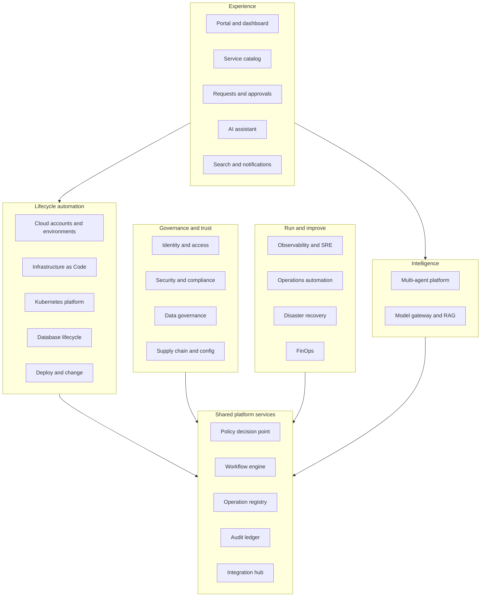

# FDE Nexus: Enterprise AI-Powered Cloud Engineering, Self-Service and Operations Automation Platform

**Author:** Ashish Gajjar
**Document type:** Product and architecture specification (design only, no implementation)
**Version:** 0.1 draft for architecture and business review
**Initial cloud:** AWS. Designed for future multi-cloud extensibility.
**Status of numbers:** Every target, SLO, RTO, RPO, duration and cost-saving figure in this document is a **design recommendation that requires business approval and baseline measurement**. Nothing here has been built, measured or validated yet.

> **Guiding principle:** *One platform. Complete lifecycle automation. Governed self-service. Intelligent engineering. Secure operations.*

## How to Use This Document

This specification answers the ten parts of the FDE Nexus brief and produces the 28 requested deliverables. The table below shows where each deliverable lives.

| # | Deliverable | Where |
|---|---|---|
| 1 | Complete PRD | Part 1, Part 2, Part 8 and the requirements catalog in Part 10 |
| 2 | Enterprise architecture document | This whole document (Parts 1 to 10) |
| 3 | Platform capability map | Part 1, Capability Map |
| 4 | Functional module specifications | Part 2 (modules M01 to M16) |
| 5 | System context diagram | Part 6, System Context |
| 6 | High-level architecture diagram | Part 6, High-Level Architecture |
| 7 | Detailed component architecture | Part 6, Component Architecture |
| 8 | Cloud infrastructure architecture | Part 6, Cloud Infrastructure Architecture |
| 9 | AI multi-agent architecture | Part 2 (M09) and Part 6, AI Multi-Agent Architecture |
| 10 | Security architecture | Part 4 |
| 11 | Data governance architecture | Part 5, Data Governance Architecture |
| 12 | Database architecture | Part 5, Database Architecture |
| 13 | Automation engine architecture | Part 6, Automation Engine Architecture |
| 14 | End-to-end operational workflows | Part 3 |
| 15 | API specifications | Part 10, API Specifications |
| 16 | Database ER diagrams | Part 5, Entity Relationship Model |
| 17 | IAM permission model | Part 4, IAM Permission Model |
| 18 | Threat model | Part 4, Threat Model |
| 19 | Disaster recovery design | Part 6, Disaster Recovery and Platform Continuity |
| 20 | Deployment architecture | Part 6, Deployment Architecture |
| 21 | Operational runbooks | Part 10, Operational Runbooks |
| 22 | Test strategy | Part 10, Test Strategy |
| 23 | Implementation backlog | Part 10, Implementation Backlog |
| 24 | Release roadmap | Part 9 |
| 25 | Acceptance criteria | Part 9 (per phase) and Part 10 (traceability matrix) |
| 26 | Risk register | Part 10, Risk Register |
| 27 | Open decisions and dependencies | Part 10, Open Decisions, Assumptions and Dependencies |
| 28 | Operational ownership matrix | Part 10, Ownership Matrix |

**Conventions.** Modules are `M01` to `M16`. Architecture components are `C01` to `C16`. Phases are `P1` to `P7`. Security controls are `SC-xx`. Requirements are `REQ-…` and `NFR-…`. Test cases are `TC-…`. Operations are `OP-…`. Risks are `R-xx`, open decisions are `OD-xx` and assumptions are `AS-xx`. Terminology is generic: no company, customer or product branding, and no account identifiers, are used anywhere.

---

# Part 1: Product Strategy

## 1.1 Product Vision

FDE Nexus is the single governed control plane through which engineers request, build, operate, secure and retire cloud services. Automation is the default, AI assistance is built in, and humans stay in control of risk.

It is not a dashboard, a provisioning tool or a chatbot. It is an engineering platform that connects the whole lifecycle: **request, validate, approve, provision, deploy, operate, recover, optimize, retire, evidence.**

The platform exists so that the secure, compliant and cost-aware way of doing things is also the easiest way. Teams get a "paved road". Central teams get policy, visibility and audit. Everyone gets less ticket-driven waiting.

## 1.2 Business Objectives

Targets are proposals. They need a measured baseline before they can be committed.

| ID | Objective | Why it matters | Proposed target (to be baselined) |
|---|---|---|---|
| BO-1 | Faster delivery of standard infrastructure | Waiting on tickets slows teams | A large majority of standard requests fully automated, with lead time measured in hours instead of days |
| BO-2 | Lower change failure rate | Manual change is error-prone | Measurable reduction in failed or rolled-back changes versus baseline |
| BO-3 | Audit readiness by default | Evidence gathering is slow and manual | Evidence for in-scope controls generated automatically and continuously |
| BO-4 | Reduce cloud waste | Idle and oversized resources cost money | Reduction in addressable waste, validated by FinOps |
| BO-5 | Faster recovery from incidents | Downtime hurts customers | Lower mean time to detect and recover versus baseline |
| BO-6 | Consistent security and compliance posture | Unmanaged accounts and public exposure are risks | Zero unmanaged accounts, policy compliance rate above an agreed threshold |
| BO-7 | Better engineering experience | Tool sprawl drains focus | Improved developer satisfaction, measured by survey |
| BO-8 | Safe adoption of AI in engineering | AI without governance is a liability | AI assistance available only through governed, audited, authorized paths |

## 1.3 Technical Objectives

| ID | Objective |
|---|---|
| TO-1 | Everything is declarative and version-controlled: infrastructure, policy, catalog items, automations and agent definitions. |
| TO-2 | One policy decision point (PDP) for authorization and guardrails, used by humans, automations and AI agents alike. |
| TO-3 | Long-running operations run as durable workflows with approvals, retries, compensation and full history. |
| TO-4 | Execution runs with least privilege: ephemeral workers, short-lived credentials, per-job scope. |
| TO-5 | Every action produces tamper-evident audit evidence. |
| TO-6 | API-first. The portal, the AI assistant and external tools use the same governed APIs. |
| TO-7 | Modular monolith first. Split into services only where isolation, scaling or release cadence justifies it. |
| TO-8 | AI agents are first-class identities with narrow tools. They cannot bypass authorization, policy or approval. |
| TO-9 | The platform can recover and rebuild itself, including from a total loss of its primary region. |
| TO-10 | Cloud-specific logic sits behind provider interfaces, so a second cloud can be added later without rewriting the core. |

## 1.4 Target Users and Personas

| Persona | Goals | Main modules | Typical access tier |
|---|---|---|---|
| Application developer | Get environments, databases and deployments quickly and safely | M01, M13, M04, M05 | Self-service within own team scope |
| Forward Deployed Engineer (FDE) | Embed with product teams, build catalog items and integrations, feed lessons back to the platform | M01, M03, M09, M16 | Elevated authoring rights in sandbox and non-production |
| Platform engineer | Build and operate modules, templates and the platform itself | M02, M03, M04, M10 | Platform maintainer rights, production via approval |
| SRE / operations engineer | Keep services healthy, respond to incidents, run automations | M11, M10, M14 | Operational rights, JIT for production |
| Security engineer | Define policy, review findings, drive remediation | M08, M07, M15 | Policy author, finding triage |
| Data steward / governance lead | Classify, own, retain and protect data | M06 | Governance administration |
| Database reliability engineer (DRE) | Run database fleet reliably | M05, M14 | Database operations, JIT for production |
| FinOps analyst | Understand and reduce cost | M12 | Cost visibility and recommendation rights |
| Engineering manager / approver | Approve requests and changes, review access | M01, M13, M07 | Approver for own scope |
| Auditor / compliance officer | Verify controls and collect evidence | M08, M06, audit views | Read-only, evidence export |
| Platform administrator | Manage tenants, roles, integrations, platform settings | All | Break-glass only for sensitive actions |
| Executive sponsor | See outcomes, cost and risk | Dashboards | Read-only summary views |

## 1.5 Enterprise Operating Model

**Platform as a product.** A product team owns the roadmap, backlog and adoption. Success is measured by use and outcomes, not by features shipped.

**Federated governance, centralized guardrails.** Central teams own policy, identity, audit and the platform core. Domain teams own their catalog items and the resources they request.

| Team | Owns | Decides |
|---|---|---|
| Platform Product | Roadmap, catalog strategy, adoption | What is built and in what order |
| Platform Engineering | Core services, Terraform modules, Kubernetes platform | Technical design, release readiness |
| FDE team | Embedded delivery, catalog items, integrations, field feedback | What is learned in the field and fed back |
| SRE | Platform reliability, runbooks, on-call | SLOs, incident response |
| Security | Policy-as-code, security controls, findings | Security policy and exceptions |
| Data Governance Council | Classification, retention, residency | Data policy |
| FinOps | Cost policy, budgets, optimization | Cost governance |
| Service / domain owners | Their catalog items and resources | How their services are run within policy |

**Governance forums:** Architecture Review Board (design standards), Policy Council (monthly review of policy-as-code and exceptions), Platform Steering (priorities and funding), Change Advisory (risk-based, light-touch for standard changes).

**Autonomy ladder.** Automation and AI are introduced in steps, never all at once.

| Level | Name | Behavior |
|---|---|---|
| A0 | Advise | Reads and explains. No actions. |
| A1 | Draft | Prepares plans, code and requests for a human to submit. |
| A2 | Act with approval | Executes after explicit human approval. |
| A3 | Act within policy | Executes pre-approved, low-risk, reversible actions automatically. |
| A4 | Bounded autonomy | Handles a defined class of work end to end, with limits, verification and kill switch. |

The platform launches at A0 to A2. A3 is earned per operation with evidence. A4 is reserved for a few well-understood operations, in the last phase.

**Support model.** L1: portal help and chat. L2: platform on-call. L3: engineering. Severity-based response targets are defined during onboarding (open decision OD-17).

## 1.6 Product Boundaries

**In scope:** governed self-service, infrastructure and Kubernetes lifecycle, database lifecycle, data governance metadata, access governance, security policy and findings, AI-assisted engineering, operations automation, change and deployment governance, FinOps, DR orchestration, software supply chain, integrations, and the platform's own self-management.

**Integrates with but does not replace:** the enterprise identity provider, ITSM and CMDB, source control and CI/CD systems, observability backends, cloud-native services (the platform orchestrates them), security scanners, and cost management tools.

**Out of scope for the MVP and early phases:** a general-purpose application PaaS, end-user application hosting concerns, building a new CI system, replacing the ITSM, a custom observability backend, and active multi-cloud operation. Multi-cloud is a design seam only (TO-10).

**Build, buy or integrate rule.** Integrate or buy for commodity capabilities (identity, scanning, metrics storage). Build what makes the platform distinctive: the governed workflow, the policy and approval spine, the catalog, the operation registry and the agent governance.

## 1.7 Functional and Non-Functional Scope

**Functional scope:** 16 modules (Part 2) plus shared platform services: audit ledger, policy decision point, workflow engine, operation registry, notification service and platform self-management.

**Non-functional scope:** availability, scalability, latency, reliability, security, data consistency, backup, recovery, disaster recovery, accessibility, observability, audit completeness, AI safety and operational efficiency (Part 8).

## 1.8 MVP and Subsequent Releases

**MVP (Release 1)** is Phase 1 plus a thin slice of Phase 2. The goal is one complete, governed, end-to-end path that proves the model.

| In the MVP | Not in the MVP |
|---|---|
| SSO with MFA, RBAC, tenant model, audit ledger | ABAC at scale, JIT/PAM (Phase 3) |
| Portal with role-based navigation, service catalog, request tracking | Global search beyond basic, AI assistant |
| Cloud account inventory and onboarding of existing accounts | Automated account vending at scale |
| Approval workflow with risk tiers | Advanced change calendar |
| Terraform execution for three catalog items (standard environment baseline, network, Kubernetes namespace) | Full Kubernetes cluster lifecycle |
| Policy gate, security scan and cost estimate on every plan | Drift auto-remediation |
| Notifications and ITSM ticket link | Database lifecycle, data catalog |
| Platform backups and a documented recovery procedure | Automated platform DR failover |

| Release | Phase | Theme |
|---|---|---|
| R1 (MVP) | P1 + P2 slice | Foundation and first governed provisioning path |
| R2 | P2 | Core infrastructure automation |
| R3 | P3 | Security and governance |
| R4 | P4 | Database and data management |
| R5 | P5 | Operations automation, reliability and DR |
| R6 | P6 | AI engineering |
| R7 | P7 | Intelligent enterprise platform |

## 1.9 Product Success Metrics

| Metric | Definition | Proposed target (to be baselined) |
|---|---|---|
| Self-service adoption | Share of eligible requests created through the platform | Rising quarter on quarter, high steady state |
| Provisioning lead time | Request approved to resource ready (standard items) | Hours, measured at p50 and p90 |
| Automation rate | Requests completed with no manual step | Most standard items |
| Approval cycle time | Request submitted to decision | Within agreed SLA by risk tier |
| Change failure rate | Changes causing incident or rollback | Below baseline and trending down |
| Policy compliance rate | Resources compliant with active policy | Above an agreed threshold |
| Unmanaged resources | Resources outside inventory or tagging policy | Trending to zero |
| Audit evidence coverage | In-scope controls with automatic evidence | Near complete for in-scope controls |
| MTTR | Time to restore service | Below baseline |
| Platform availability | Portal and API availability | See NFR-AVL-01 |
| Waste reduced | Savings from accepted optimizations | Validated by FinOps |
| User satisfaction | Survey score | Above target and rising |
| AI usefulness | Share of agent suggestions accepted | Tracked per agent |
| AI safety | Guardrail blocks, groundedness score, policy violations by agents | No agent-caused policy violation reaching production |

## 1.10 Platform Ownership and Operating Responsibilities

| Area | Accountable owner | On-call | Decision rights |
|---|---|---|---|
| Portal and catalog | Platform Product | Platform on-call | Catalog structure, UX |
| Workflow, execution, registry | Platform Engineering | Platform on-call | Technical design |
| Policy and security controls | Security | Security on-call | Policy content and exceptions |
| Database service | DRE lead | DB on-call | Database standards |
| Data governance | Data Governance Council | n/a (business hours) | Classification and retention |
| AI platform | Platform Engineering with Security | AI platform on-call | Model, tool and agent approvals |
| Reliability and DR | SRE | SRE on-call | SLOs, DR exercises |
| Cost governance | FinOps | n/a | Budgets and cost policy |
| Integrations | Platform Engineering | Platform on-call | Contract changes |

The full responsibility matrix is in Part 10 (Ownership Matrix).

---

## Platform Capability Map

| Capability domain | Level-1 capabilities | Modules |
|---|---|---|
| Experience | Dashboard, catalog, requests, approvals, inventory view, search, notifications, assistant | M01, M09 |
| Infrastructure | Account lifecycle, networking, compute, storage, load balancing, DNS, certificates, decommissioning | M02 |
| Delivery as code | Module registry, plan, policy check, scan, cost estimate, apply, state, drift, rollback | M03 |
| Container platform | Cluster, node pools, namespaces, RBAC, network policy, ingress, storage, upgrades, backup | M04 |
| Data platform | Database provisioning, backup, HA, patching, performance, migration, archival | M05 |
| Data governance | Classification, ownership, catalog, lineage, quality, retention, residency, masking, deletion | M06 |
| Identity and access | SSO, MFA, RBAC, ABAC, JIT, PAM, reviews, service and workload identity | M07 |
| Security and compliance | Policy engine, posture, scanning, secrets, certificates, findings, evidence | M08 |
| Intelligence | Agents, model gateway, RAG, evaluation, guardrails, tracing | M09 |
| Automation | Scheduled, event and incident-driven operations with controls | M10 |
| Reliability | Metrics, logs, traces, alerts, incidents, SLOs, RCA, capacity | M11 |
| Financial | Estimates, budgets, allocation, anomalies, rightsizing, unit economics | M12 |
| Change and release | Change requests, windows, pipelines, verification, rollback | M13 |
| Continuity | Backup policy, RTO and RPO, replication, failover, DR exercises | M14 |
| Supply chain | Registries, SBOM, signing, provenance, baselines, patch compliance | M15 |
| Integration | Contracts, webhooks, events, retries, rate limits | M16 |
| Platform core | Policy, workflow, registry, audit, notifications, self-management | Shared |

## Module Overview

| ID | Module | Primary owner | Main phase |
|---|---|---|---|
| M01 | Platform Experience and Self-Service Portal | Platform Product | P1 |
| M02 | Cloud Account and Infrastructure Lifecycle | Platform Engineering | P1 to P2 |
| M03 | Infrastructure as Code and Automation | Platform Engineering | P2 |
| M04 | Kubernetes and Container Platform Management | Platform Engineering | P2 |
| M05 | Database Lifecycle and Management | DRE | P4 |
| M06 | Enterprise Data Governance | Data Governance Council | P4 |
| M07 | Identity and Access Management | Security | P1, P3 |
| M08 | Security and Compliance Management | Security | P3 |
| M09 | AI Engineering and Multi-Agent Platform | Platform Engineering and Security | P6 |
| M10 | Operations Automation Engine | Platform Engineering and SRE | P2, P5 |
| M11 | Observability and SRE | SRE | P5 |
| M12 | FinOps and Resource Optimization | FinOps | P2 to P7 |
| M13 | Deployment and Change Management | Platform Engineering | P2 |
| M14 | Disaster Recovery and Business Continuity | SRE | P5 |
| M15 | Software Supply Chain and Configuration Management | Security and Platform Engineering | P3 |
| M16 | Enterprise Integration Hub | Platform Engineering | P1 onward |
