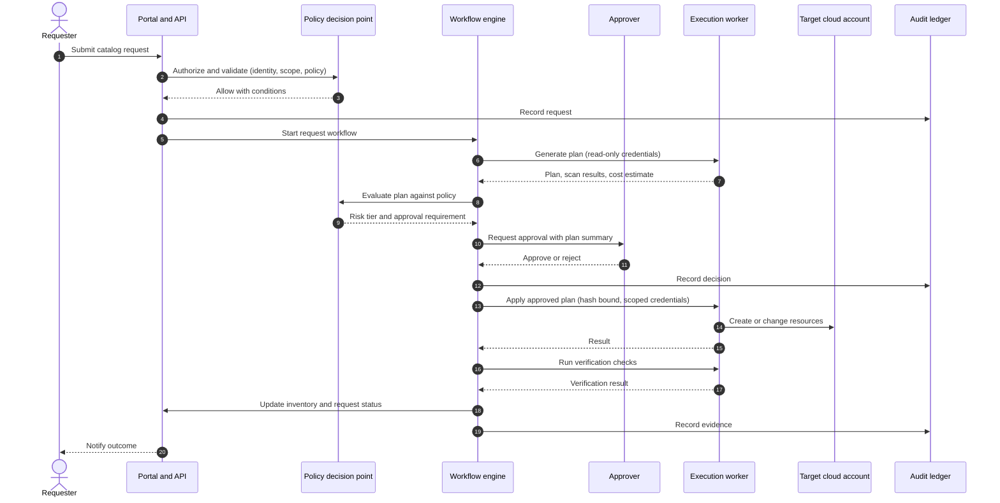
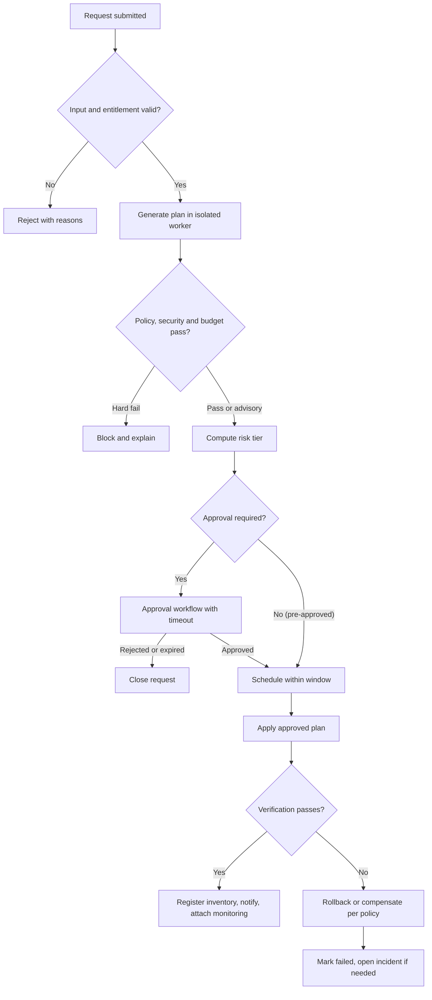
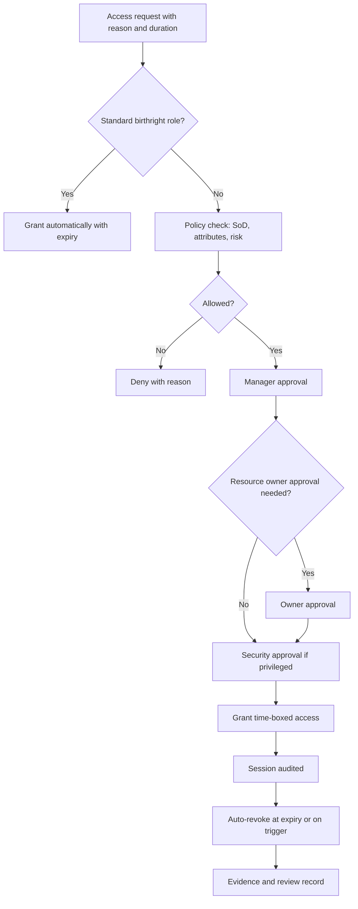
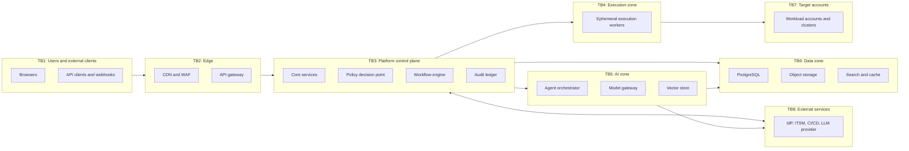

# Part 3: Platform Operating Model

## 3.1 End-to-End Lifecycle

| # | Step | Actor | Platform component | Gates and controls | Evidence produced |
|---|---|---|---|---|---|
| 1 | User onboarding | New user, IdP | M07 (SCIM) | User created by the IdP, never by hand. Default role: none. | Provisioning event |
| 2 | Identity verification | User | M07 (OIDC or SAML) | MFA, session policy, device posture where available. | Login event |
| 3 | Role assignment | Manager, resource owner | M07 | Role requested, approved by manager and owner. SoD check. | Approval and grant record |
| 4 | Service registration | Service owner | M01 catalog, M16 | Owner, tier, data classification, runbook link and on-call required. | Service record |
| 5 | Catalog publication | Platform product, security | M01, M03 | Item reviewed: inputs, policies, cost hints, tests passed. | Publication record, version |
| 6 | Self-service request | Requester | M01 | Form validated against schema. Quota and entitlement checked. | Request record |
| 7 | Requirement validation | Platform | C03, C06 | Required fields, naming, tags, allowed regions, classification ceiling. | Validation result |
| 8 | Security and cost evaluation | Platform | C06, M08, M12 | Policy decision, security pre-check, cost estimate against budget. | Policy decision log, estimate |
| 9 | Approval | Approver(s) | M01 approval center | Tiered approval by risk. No self-approval. Timeouts and escalation. | Approval record |
| 10 | IaC plan creation | Execution worker | M03, C05 | Isolated worker, scoped credentials, plan hashed and stored. | Plan artifact, hash |
| 11 | Deployment scheduling | Platform, requester | M13 | Window, freeze and conflict checks. | Schedule record |
| 12 | Controlled execution | Execution worker | C04, C05 | Plan hash match, lock, idempotency key, timeout, retries. | Execution log |
| 13 | Post-deployment validation | Platform | M13, M11 | Health, config and policy verification. Failure triggers rollback policy. | Verification report |
| 14 | Inventory and CMDB sync | Platform | M02, M16 | Resource registered with owner and tags. CMDB updated. | Inventory entry, sync record |
| 15 | Monitoring and operations | SRE, owners | M11, M10 | Default alerts and SLOs attached. Maintenance automations scheduled. | Alert and automation configs |
| 16 | Incident and remediation | SRE, agents | M11, M10, M09 | Runbook steps by risk tier. Human approval where required. | Incident record |
| 17 | Continuous optimization | FinOps, owners | M12, M08 | Recommendations, accepted or rejected with reason. | Recommendation decisions |
| 18 | Resource decommissioning | Owner | M02, M05, M06 | Dependency, retention and legal-hold checks. Recovery window. | Decommission certificate |
| 19 | Audit and compliance reporting | Auditor, security | M08, C11 | Evidence by control, immutable ledger. | Evidence package |

## 3.2 Governed Request Sequence

## 3.3 Infrastructure Provisioning Workflow

| Step | Failure behavior | Rollback |
|---|---|---|
| Plan generation | Retry up to the configured limit. Then fail and notify. | None needed (read-only). |
| Apply | Partial apply recorded. State is the source of truth. | Re-apply previous known-good version or destroy created resources if the request is new and has no data. |
| Verification | Fail closed. Resource marked "unverified" and not handed over. | Same as above. |
| Notification | Retry. Does not block the workflow. | None. |

## 3.4 Database Workflows

**Provision a database**

1. Requester selects a catalog item (engine, size, environment).
2. Mandatory metadata: owner, classification, backup policy, retention class, RTO and RPO tier.
3. Policy check: encryption, network placement, allowed region, classification versus environment (no Restricted data in a sandbox).
4. Cost estimate and approval by tier (production needs owner and DRE approval).
5. Plan, apply and verification: connectivity, encryption on, backup job created, monitoring attached, credentials stored in secrets manager.
6. Register in the data catalog (M06) with owner and classification.
7. Hand over credentials by reference (secret path), never by value in tickets or chat.

**Change or migrate a database (schema, version, parameter)**

1. Submit change with migration script and rollback script.
2. Automated checks: syntax, lock impact estimate, dry run on a recent copy where available.
3. Risk tier from size, criticality and reversibility. Production changes need DRE approval and a window.
4. Pre-checks: fresh backup or snapshot confirmed, replication healthy.
5. Execute with timeout and abort criteria.
6. Verify: application health checks, error rates, replication lag.
7. Roll back or compensate on failure. Record evidence.

**Restore (point in time)**

1. Request with target time and reason.
2. Restore into a **new** instance. Never overwrite the source by default.
3. Validate data. Owner approves cutover.
4. Cutover through a change. Keep the old instance for the retention window.

## 3.5 Access Request Workflow

Rules: maximum durations per role, mandatory reason for production, break-glass is a separate flow with immediate alert and mandatory post-use review within one business day (design recommendation).

## 3.6 Security Remediation Workflow

1. A finding is created (scan, posture check, vulnerability feed) and normalized.
2. The finding is enriched with asset owner, environment, classification and exposure, then risk-scored.
3. The finding is assigned to the owner with an SLA by risk score.
4. Remediation options are offered: platform operation (for example close a public bucket), IaC pull request, or manual guidance.
5. Low-risk reversible fixes can run automatically under pre-approved policy (A3). Others follow approval.
6. Verification re-scans the asset.
7. Closure requires verification, or an exception with an approver, an expiry date and compensating controls.
8. Aged or breached SLAs escalate automatically.

## 3.7 Application Deployment Workflow

1. A pipeline produces a signed artifact with SBOM and provenance (M15).
2. The pipeline requests deployment through the platform (change request or pre-approved standard change).
3. Admission checks: signature valid, no critical vulnerabilities per policy, image from approved registry.
4. Risk tier decides the approvals and the window.
5. Progressive delivery (for example canary or rolling) with an SLO guard.
6. Automated verification. On failure the rollback policy runs.
7. Release record links the commit, artifact, SBOM, approvals and results.

## 3.8 Recovery Workflows

**Backup restore (single resource):** identify the recovery point, restore to a new resource, validate, cut over by approved change.

**Regional failover (service tier with cross-region recovery):**

1. Declare disaster (incident commander plus business authority).
2. Pre-checks: replication lag within RPO tolerance, target region capacity and secrets available.
3. Freeze changes in the primary region.
4. Execute the failover runbook in order: data layer, platform dependencies, compute, traffic.
5. Verify service health from the secondary region.
6. Communicate status.
7. Failback later as a separate planned change, with data reconciliation.

Every step is an operation with timeout, verification and evidence. Recovery workflows are rehearsed in DR exercises (M14).

---

# Part 4: Security Architecture

## 4.1 Security Principles

| Principle | How it is applied |
|---|---|
| Zero trust | No implicit trust from network location. Every request is authenticated and authorized by the policy decision point, including service-to-service. |
| Defense in depth | Layers: edge, API, authorization, workflow, worker isolation, cloud IAM boundaries, data encryption, detection. |
| Least privilege | Narrow roles, short-lived credentials, per-job scope, permission boundaries. |
| Separation of duties | The requester cannot approve. The author of a policy cannot approve its exception. Key administrators are not key users. |
| Privileged access management | JIT elevation, brokered sessions, break-glass with review. |
| Workload identity | Platform components and agents use their own scoped, short-lived identities. |
| Network isolation | Separate networks for control plane, workers, data stores and AI. Default deny, egress allow-lists. |
| Encryption | At rest with customer-managed keys, in transit with TLS (mutual TLS between internal services). |
| Secrets rotation | No static secrets in code or images. Rotation automated. |
| Immutable audit | Append-only, hash-chained, stored with write-once retention. |
| Fail closed | Policy engine or audit unavailable means high-risk operations pause, not proceed. |
| Secure by default | Templates and catalog items start from hardened baselines. |

## 4.2 Trust Boundaries

| Boundary | What crosses it | Control at the boundary |
|---|---|---|
| TB1 to TB2 | Requests, webhooks | TLS, WAF, rate limiting, webhook signature verification |
| TB2 to TB3 | Authenticated API calls | Token validation, authorization per request, input validation |
| TB3 to TB4 | Job definitions | Signed job spec, hash-bound plan, per-job role, no inbound access to workers |
| TB4 to TB7 | Cloud API calls | Assumed role per account, permission boundary, SCP guardrails, CloudTrail |
| TB3 to TB5 | Agent tasks, tool calls | Policy check on every tool call, no direct data store access for agents |
| TB5 to TB8 | Model requests | Model gateway only, redaction, allow-listed endpoints, budget limits |
| TB3 to TB6 | Data access | Service identity, row-level security, encryption, network isolation |
| TB3 and TB8 | Integration calls | Authenticated adapters, schema validation, rate limits, DLQ |

## 4.3 Secure Execution Workers

Workers are the most sensitive component: they hold temporary power over target accounts.

| Control | Specification |
|---|---|
| Ephemeral | One job per worker. The worker is destroyed after the job. No state is kept on disk. |
| Isolation | Dedicated node pool or sandboxed containers in a separate network zone. No access to the control plane database or other jobs. |
| Credentials | Short-lived cloud credentials obtained for the job from a scoped role for the **target account and operation type**. Duration capped by the timeout. |
| Inputs | Signed job specification. The apply step accepts only a plan whose hash was approved. |
| Network | No inbound. Egress allow-listed to the cloud APIs, the module registry, and the artifact store. |
| Supply chain | Worker images are signed, minimal and rebuilt on a schedule. Terraform providers are pinned and mirrored. |
| Code from users | Custom modules are not executed unless from the approved registry. Arbitrary code execution paths (for example local-exec) are blocked by policy. |
| Observability | Worker logs stream to the audit and logging pipeline with secrets masked. |

## 4.4 Identity, Keys, Secrets and Network

| Area | Specification |
|---|---|
| API authentication | OIDC tokens for users. Short-lived workload tokens for services. Mutual TLS inside the cluster. |
| Authorization enforcement | Central policy decision point, called on every request. Deny by default. Decisions logged. |
| Secrets | Secrets manager as the source. Rotation schedules by secret type. Access only via workload identity. Secret scanning in code and logs. |
| Key management | Customer-managed keys per data class and per environment. Separate key administrators and key users. Key rotation. Multi-Region keys where DR needs them. |
| Encryption at rest | All stores. Database, object storage, search, cache, backups and snapshots. |
| Encryption in transit | TLS 1.2 or higher, preferably 1.3. Internal mTLS. |
| Network | Private subnets for all services. Private endpoints to cloud services. Separate segments for control plane, workers, data and AI. |
| Edge | WAF, DDoS protection, rate limiting, bot controls on public endpoints. |

## 4.5 Immutable Audit Design

| Element | Specification |
|---|---|
| What is recorded | Authentication, authorization decisions, requests, approvals, plans, executions, agent runs and tool calls, configuration changes, secret and key operations, data access approvals, break-glass use. |
| Format | Structured events with actor, on-behalf-of, action, target, decision, policy version, correlation id, time, outcome and hash of the previous event. |
| Storage | Append-only table with hash chaining, shipped continuously to object storage with write-once retention (for example S3 Object Lock in compliance mode) in a separate log-archive account. |
| Integrity | Periodic verification job re-computes the chain. Break in the chain raises a critical alert. |
| Access | Read via audit API with its own permission. No delete or update path exists for anyone, including administrators. |
| Retention | Per policy (Part 5). Legal hold supported. |

## 4.6 AI Agent Isolation

- Agents run in their own network zone and service identity. They have **no direct credentials** to cloud accounts or data stores.
- Agents reach the world only through the **tool registry**. Each tool call is authorized for both the human principal and the agent identity.
- Model requests go only through the **model gateway** with redaction, budgets and logging.
- Retrieval applies the caller's permissions. Embeddings carry access labels.
- A tool call that changes state is an **operation request** and follows Part 7. Agents cannot approve their own requests.
- Kill switch at agent, tool and global levels.
- Per-run limits: steps, time, tokens, cost, tool call count.

## 4.7 Threat Model

**Method:** STRIDE for platform components, plus AI-specific threats (aligned in spirit with common LLM application risk lists). Residual risk ratings are design-time estimates and must be validated by the security team.

| ID | Threat | Component | STRIDE | Example attack | Mitigations | Detection | Residual |
|---|---|---|---|---|---|---|---|
| T-01 | Stolen user session | Portal | S | Attacker reuses a token from a compromised laptop | Short token life, MFA and step-up for risky actions, device and IP anomaly checks, token binding where possible | Impossible-travel and anomaly alerts | Medium |
| T-02 | Privilege escalation through role assignment | IAM | E | User adds themselves to an admin group | SoD policy, approvals, IdP-managed groups, audit | Alerts on role changes | Low |
| T-03 | Approval bypass | Workflow | T, E | Call apply API directly without approval | Apply accepts only workflow-issued, hash-bound jobs. Policy check in the worker. | Mismatch alerts | Low |
| T-04 | Self-approval or collusion | Approvals | R | Requester approves with a second account | SoD, identity linkage, high-risk needs independent approver, periodic collusion analytics | Approval graph analytics | Medium |
| T-05 | Malicious Terraform module | IaC | T | Module with hidden resource or exfiltration | Approved registry only, code review, pinned versions, provider allow-list, plan policy that blocks risky resources | Plan diff review, runtime detection | Medium |
| T-06 | Compromised execution worker | Execution | E | Exploit in the worker image | Ephemeral, isolated, no inbound, per-job role, signed images | Egress anomalies, runtime security | Medium |
| T-07 | Over-privileged cloud role | Target accounts | E | Execution role with admin rights | Permission boundaries, SCPs, per-operation roles, periodic access analysis | IAM analyzer findings | Medium |
| T-08 | State file exposure | IaC | I | Secrets inside state | Encrypted remote state, restricted access, avoid secrets in state, secret scanning | Access logs | Low |
| T-09 | Audit tampering | Audit | T, R | Admin alters or deletes records | Hash chain, write-once storage, separate account, separate keys | Chain verification | Low |
| T-10 | Secrets leakage in logs | All | I | Token printed in a log line | Secret masking, log scanning, short-lived secrets | Secret scanner on logs | Medium |
| T-11 | Cross-tenant data access | Core, search | I | Query returns another team's resources | Row-level security, tenant-scoped indexes, permission-trimmed search, tests | Anomaly detection, test suite | Low |
| T-12 | API abuse or denial of service | Edge, API | D | Flood of requests or heavy queries | WAF, rate limits, quotas, pagination limits, autoscaling | Rate and latency alerts | Low |
| T-13 | Webhook spoofing | Integrations | S | Fake event triggers an action | Signature verification, allow-lists, replay protection, treat events as hints, re-fetch state | Signature failure alerts | Low |
| T-14 | Dependency or supply chain compromise of the platform | Platform build | T | Malicious library in the platform | Pinned dependencies, SBOM, signing, scanning, build isolation, provenance | Scanner alerts, provenance checks | Medium |
| T-15 | Insider data exfiltration | Data | I | Bulk export by authorized user | Export limits and approvals, DLP, audit, anomaly detection | Volume anomalies | Medium |
| T-16 | Prompt injection via logs or documents | AI | T, E | A log line instructs the agent to run a destructive tool | Content marked untrusted, tool allow-lists, per-call authorization, no state change without approval, output validation | Guardrail blocks, review of flagged runs | Medium |
| T-17 | Excessive agency | AI | E | Agent chains tools beyond intended scope | Narrow tools, step limits, risk-tiered approvals, simulation before action | Run tracing, anomaly alerts | Medium |
| T-18 | Data leakage to model provider | AI | I | Restricted data sent in a prompt | Classification-aware redaction, model routing rules, no-training terms, private endpoints, output scan | DLP on prompts, gateway logs | Medium |
| T-19 | Knowledge base poisoning | AI | T | Malicious document added to the knowledge base | Curated sources with owners, ingestion review, provenance, access labels, periodic re-evaluation | Source drift checks | Medium |
| T-20 | Hallucinated action or advice | AI | T | Agent invents a resource or command | Grounding, citations, schema validation, existence checks against inventory, human approval | Evaluation sets, user feedback | Medium |
| T-21 | Denial of wallet | AI | D | Runaway agent loop burns budget | Token and cost budgets, run limits, alerts, hard stop | Cost anomaly alerts | Low |
| T-22 | Loss of control plane region | Platform | D | Regional outage | DR design and exercises (Part 6) | Health checks | Medium |

### Attack scenarios (end to end)

| Scenario | Path | Where it should be stopped | Residual note |
|---|---|---|---|
| A1: Stolen admin session creates a public database | Token theft, approve own request, deploy | MFA and step-up (T-01), SoD (T-04), policy blocks public database, audit alert | Requires validation of step-up coverage |
| A2: Poisoned module exfiltrates data | PR adds a resource that copies data out | Registry review (T-05), plan policy blocks unapproved resource types and egress | Review quality is a human factor |
| A3: Log line makes the troubleshooting agent delete a namespace | Untrusted log content in agent context | Delete is not a read tool. Agent identity has no write. Tool call needs approval (T-16, T-17) | Low if write tools remain gated |
| A4: Worker compromise targets other accounts | Exploit in worker | Per-job scoped role limited to one account and operation (T-06, T-07) | Depends on role scoping discipline |
| A5: Insider wipes audit trail | Admin deletes records | Write-once storage, separate account, chain check (T-09) | Low |
| A6: RAG returns another team's confidential runbook | Retrieval without permissions | Permission-aware retrieval, access labels (T-11, T-19) | Needs testing with real data |

## 4.8 IAM Permission Model

### Platform roles

| Role | Scope | Intent |
|---|---|---|
| Requester | Own team | Browse catalog, submit and track requests, view own resources |
| Team approver | Own team | Approve requests within limits |
| Resource owner | Own resources | Approve access, change, decommission |
| Developer | Own team, non-production | Self-service in non-production |
| Platform engineer | Platform modules | Author modules, templates, automations in non-production. Production by JIT |
| SRE operator | Production operations | Run approved operations. Elevated actions by JIT |
| Database engineer | Database fleet | Run database operations. Production by JIT |
| Security analyst | Findings | Read findings, triage, request remediation |
| Policy author | Policy repo | Propose policy. Cannot approve own exceptions |
| Data steward | Data domain | Classify, approve data access |
| FinOps analyst | Cost data | View cost, create budgets, recommend |
| Auditor | Read-only | Read evidence and audit logs. Cannot change anything |
| Tenant administrator | Tenant | Manage team membership and settings |
| Platform administrator | Platform | Configure platform. No access to approve own changes. No access to secrets values. |
| Break-glass | Emergency | Time-limited, heavily audited |

### Permission matrix (V view, R request, A approve, E execute, M manage)

| Capability | Requester | Developer | Platform eng. | SRE | DB eng. | Security | Data steward | FinOps | Auditor | Admin |
|---|---|---|---|---|---|---|---|---|---|---|
| Catalog browse | V | V | V, M | V | V | V | V | V | V | M |
| Request resources | R | R | R | R | R | V | V | R | V | R |
| Approve requests (own scope) | A (team) | no | A | A | A | A | A | A | no | no |
| Run approved operations | no | E (non-prod) | E | E | E | E (security ops) | no | no | no | no |
| Production change | R | R | R | R, E (JIT) | R, E (JIT) | R | no | no | no | no |
| Policy author or edit | no | no | propose | no | no | M | no | no | no | no |
| Security findings | no | V (own) | V | V | V (own) | M | V | no | V | no |
| Data classification | no | no | no | no | propose | V | M | no | V | no |
| Cost data | V (own) | V (own) | V | V | V | V | V | M | V | V |
| Audit logs | no | no | no | no | no | V | no | no | V | no |
| Secrets values | no | no | no | no | no | no | no | no | no | no (accessed only by workloads) |
| Platform configuration | no | no | M (limited) | no | no | no | no | no | no | M |

*The matrix expresses intent. Final permission sets are approved by Security and tested by TC-SEC-02 and TC-API-01.*

### ABAC attributes

User: team, role, location, employment type, clearance. Resource: owner team, environment, classification, criticality, tags. Action: risk tier, destructive flag, bulk flag. Context: time, change window, incident status, device posture, network zone. Example rule: *deny deployment to production if the change window is closed and the incident severity is high, unless emergency change approval exists.*

### Separation-of-duties rules

| Rule | Enforcement |
|---|---|
| Requester cannot approve own request | Policy deny when requester equals approver or shares a delegation chain |
| Policy author cannot approve exceptions to own policy | Policy deny |
| Module author cannot be sole approver for production use of that module | Approval rule |
| Key administrator cannot use keys for data access | Key policy and IAM |
| Platform administrator cannot approve their own configuration change | Four-eyes on platform configuration |
| An agent cannot approve | Approvals accept human identities only |
| Auditor roles are read-only and separated from operational roles | Role exclusion |

### Cloud-side IAM model (AWS)

| Layer | Design |
|---|---|
| Organization | Multi-account structure with guardrail SCPs (deny disabling logging, deny leaving the organization, region restrictions, deny public exposure of selected services). |
| Platform accounts | Dedicated accounts for platform control plane, non-production platform, shared services, security tooling and log archive. |
| Target accounts | A **platform execution role** per account and per operation class (read-only discovery, provisioning, database operations, Kubernetes operations, recovery). Each has a permission boundary and trust only for the platform's workers, with an external condition. |
| People | Access through the workforce identity service and JIT roles. No IAM users with long-lived keys. |
| Workloads | Workload identity (for Kubernetes, IRSA or Pod Identity). |
| Break-glass | Separate emergency roles, alerting on use, credentials sealed and tested. |
| Review | Periodic IAM analysis for unused permissions and external access. |

## 4.9 Security Control Catalog

| ID | Control | Used by |
|---|---|---|
| SC-01 | SSO and MFA enforcement, step-up for risky actions | M01, M07 |
| SC-02 | Central authorization (RBAC and ABAC) at the policy decision point, deny by default | All |
| SC-03 | JIT access and privileged session management | M07 |
| SC-04 | Policy-as-code gates on requests, plans and deployments | M02, M03, M08, M13 |
| SC-05 | Encryption at rest with customer-managed keys and key separation | M05, M06, stores |
| SC-06 | TLS everywhere, mTLS between services | All |
| SC-07 | Secrets management with automated rotation, secret scanning | M05, M08 |
| SC-08 | Immutable, hash-chained audit ledger | All |
| SC-09 | Ephemeral, isolated execution workers with per-job scoped credentials | M03, M04, M10 |
| SC-10 | Network segmentation, private endpoints, egress allow-lists | All |
| SC-11 | API protection: WAF, validation, rate limits, quotas | M01, M16 |
| SC-12 | Artifact signing, provenance and admission verification | M04, M15 |
| SC-13 | Vulnerability, IaC and container scanning with risk-based gating | M03, M04, M08, M15 |
| SC-14 | AI guardrails: injection defense, output validation, grounding | M09 |
| SC-15 | AI tool authorization and human approval for state change | M09 |
| SC-16 | Classification enforcement, masking and redaction | M05, M06, M09 |
| SC-17 | Separation of duties | M07, M13 |
| SC-18 | Immutable backups and recovery controls | M05, M14 |
| SC-19 | Security monitoring and detection engineering | M08, M11 |
| SC-20 | Risk-based change control and approvals | M02, M03, M13 |
| SC-21 | Tenant isolation (row-level security, scoped indexes, scoped caches) | Core, stores |
| SC-22 | Secure development and supply chain controls for the platform itself | Platform build |
