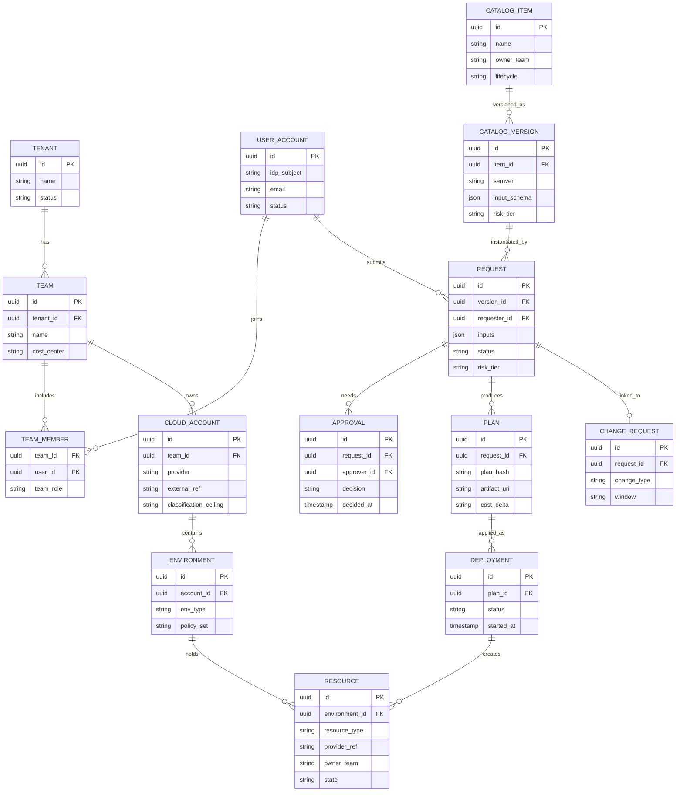
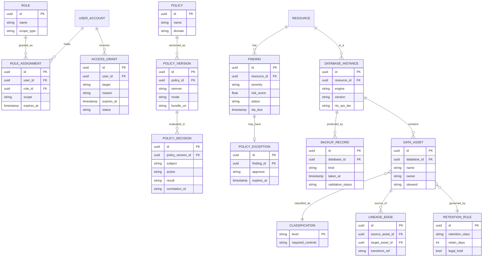
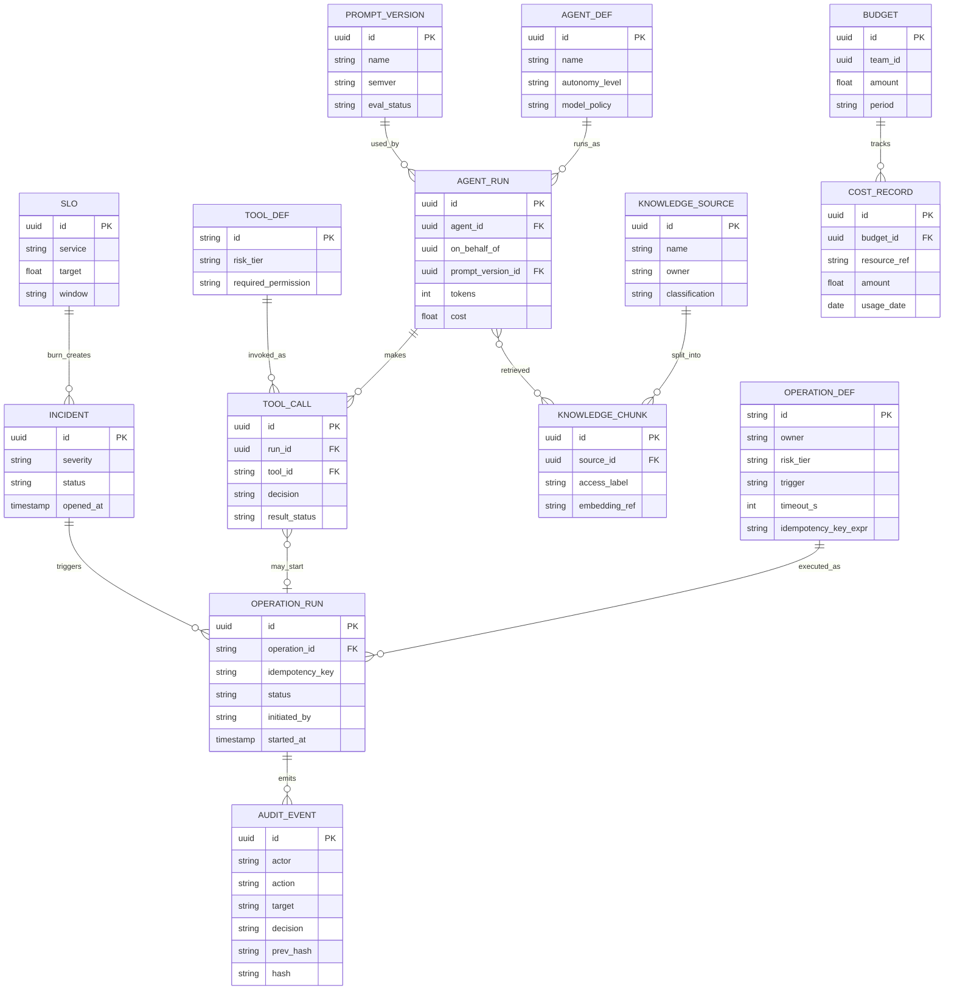
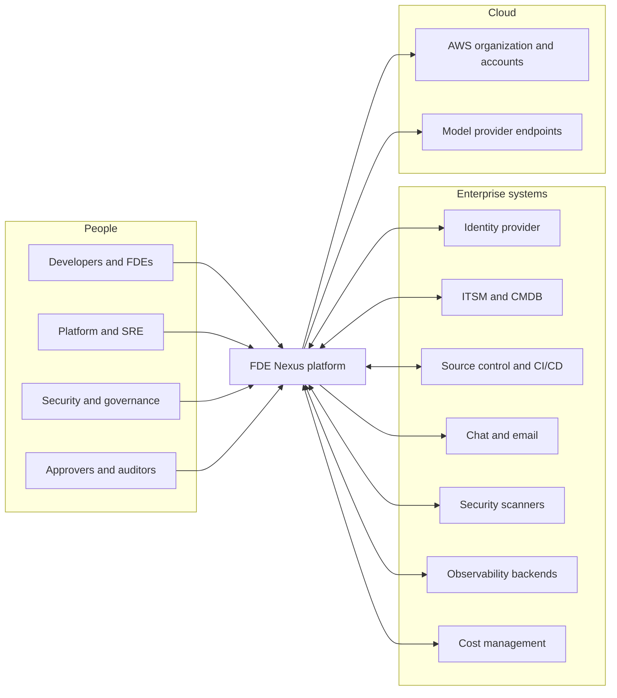
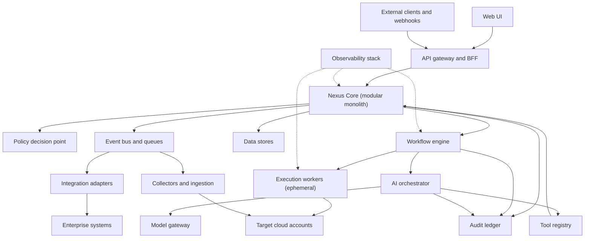
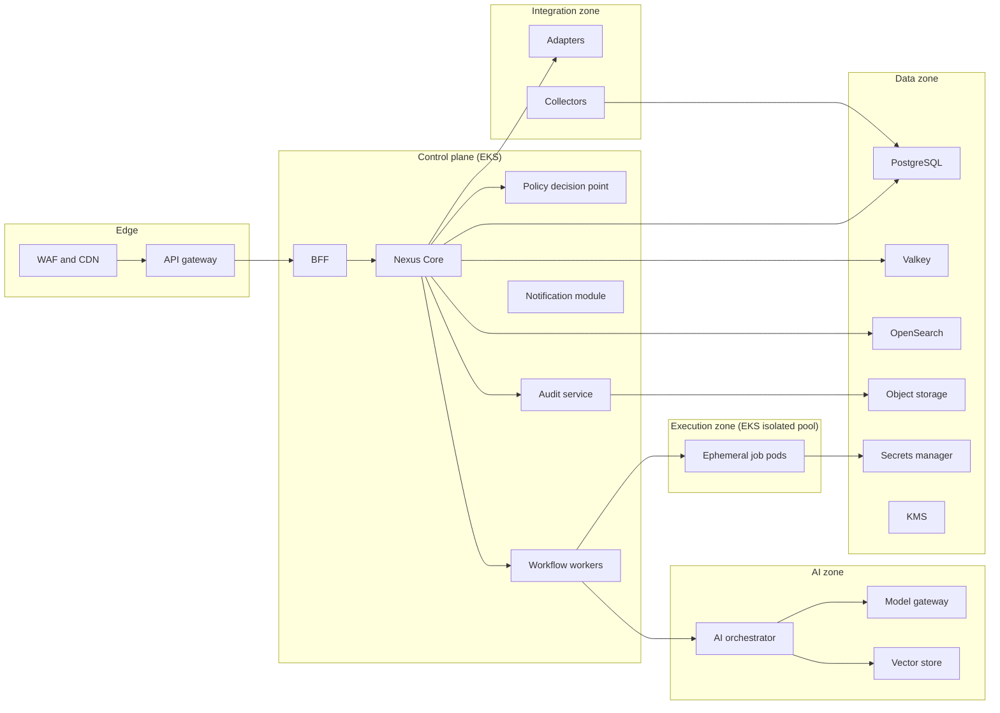
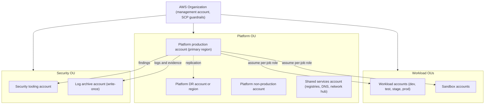
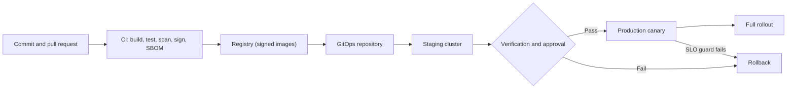
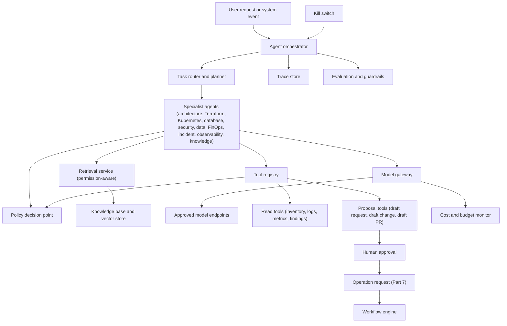
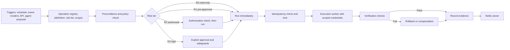

# Part 5: Data and Database Architecture

## 5.1 Role of Each Data Store

| Store | Role | What lives here | What must **not** live here |
|---|---|---|---|
| Relational database (PostgreSQL) | **System of record** for transactional platform metadata | Tenants, users, roles, catalog, requests, approvals, plans metadata, deployments, inventory, policies metadata, operation registry, runs, findings, incidents, agent definitions | Large blobs, raw logs, metrics, secrets values |
| Object storage (S3) | Durable artifacts and documents | Plan files, state backups, evidence packages, reports, exports, backups, archived audit and logs, knowledge documents | Data needing transactional updates |
| Cache (Valkey or Redis) | Temporary state and speed | Sessions, rate-limit counters, short-lived locks, hot lookups, idempotency fast path | Anything not safely rebuildable. Never the only copy of a record. |
| Search engine (OpenSearch) | Search and log analytics | Searchable projections of inventory and requests, platform logs, audit search index | System of record (it is a projection, rebuildable) |
| Vector database | Retrieval over approved knowledge | Embeddings of approved documents with access labels and source references | Source of truth for documents. Restricted data without approval. |
| Event bus and queues (EventBridge, SQS, SNS) | Asynchronous workflows and events | Domain events, work queues, dead-letter queues | Long-term storage |
| Workflow persistence | Durable workflow history | Workflow state and history (owned by the workflow engine) | Business records (those stay in PostgreSQL) |
| Time-series storage (Prometheus-compatible) | Metrics | Platform and service metrics, SLO data | Logs, events |
| Secrets manager | Secrets | Credentials, tokens, keys material references | Configuration without secrets |
| Audit ledger | Tamper-evident action record | Append-only audit events and hash chain, plus write-once archive | Anything editable |

## 5.2 Data Domains, Ownership and Source of Truth

| Domain | Authoritative source | Stored in | Classification | Owner | Retention (proposed) |
|---|---|---|---|---|---|
| Identity and membership | Enterprise IdP (users, groups). Platform holds a synchronized copy. | PostgreSQL | Confidential | Security | Life of employment plus policy period |
| Roles, grants, access reviews | Platform | PostgreSQL | Confidential | Security | Per audit policy (for example 7 years) |
| Catalog and templates | Source control (templates). Platform holds published versions. | Git, PostgreSQL | Internal | Platform Product | Life of item plus period |
| Requests and approvals | Platform | PostgreSQL | Internal | Platform Product | Per audit policy |
| Plans and execution artifacts | Platform | S3 with metadata in PostgreSQL | Confidential | Platform Engineering | Per audit policy, then archive |
| Cloud resources (actual state) | **Cloud provider** is truth for what exists. Platform inventory is a synchronized projection. | PostgreSQL, OpenSearch | Internal to Confidential | Resource owner | Current plus history |
| Infrastructure desired state | Terraform code in source control and state | Git, S3 state | Confidential | Platform Engineering | Versioned |
| Policy | Source control (policy repo) | Git, PostgreSQL (active set) | Internal | Security | Versioned |
| Findings | Platform (normalized from scanners) | PostgreSQL | Confidential | Security | Per policy |
| Data catalog metadata | Platform | PostgreSQL | Internal | Data Governance | Life of asset |
| Incidents | Incident tool or platform (per decision OD-12) | PostgreSQL | Internal | SRE | Per policy |
| Metrics | Metrics store | Time-series | Internal | SRE | Short (high resolution) to long (aggregated) |
| Audit events | Audit ledger | PostgreSQL (hot), S3 write-once (archive) | Restricted | Security | Per compliance requirement |
| Cost data | Cloud billing exports (truth). Platform holds aggregates. | S3, PostgreSQL | Confidential | FinOps | Per finance policy |
| AI conversations and runs | Platform | PostgreSQL, S3 | Confidential | AI platform owner | Short by default (see 5.6) |
| Embeddings and knowledge | Source documents (truth). Embeddings are derived. | Vector store, S3 | By source classification | Knowledge owners | Rebuildable |
| Secrets | Secrets manager | Secrets manager | Restricted | Security | Rotated |

## 5.3 Entity Relationship Model

The model is split into three views. All tables carry `tenant_id`, `created_at`, `updated_at`, `created_by`, and a `version` column for optimistic locking. These common columns are omitted from the diagrams for readability.

### View 1: Core platform, catalog, requests and infrastructure

### View 2: Access, policy, security and data governance

### View 3: Operations, AI, observability, cost and audit

## 5.4 Schema Versioning and Data Migration

| Topic | Specification |
|---|---|
| Migration tooling | Versioned, ordered migration scripts in source control, applied by the pipeline. No manual schema edits in production. |
| Compatibility | **Expand and contract**: add (expand), deploy code that works with both, migrate data, then remove (contract) in a later release. Rolling deploys never see an incompatible schema. |
| Testing | Every migration is tested forward on a production-like copy and, where feasible, backward. Duration and lock behavior are measured. |
| Large changes | Online techniques (batching, concurrent index builds). Maintenance windows only when unavoidable. |
| Rollback | Prefer roll-forward fixes. Destructive migrations require a snapshot and an explicit approval. |
| API versioning | APIs are versioned. Events carry schema versions with a compatibility policy. |
| Data migration between stores | Idempotent, resumable jobs with reconciliation counts and checksums before cutover. |

## 5.5 Database Architecture

| Aspect | Design |
|---|---|
| Engine | PostgreSQL, managed (for example Aurora PostgreSQL-compatible or RDS Multi-AZ). Final choice OD-03. |
| Topology | One writer, multiple readers across availability zones. Read replicas for reporting. |
| Logical layout | One database, schemas per module (for example `catalog`, `request`, `iam`, `inventory`, `policy`, `ops`, `ai`). Cross-module access through APIs or defined views, not ad-hoc table joins. This keeps a later service split cheap. |
| Tenancy | `tenant_id` on every table with **row-level security** enforced in the database. Application roles cannot bypass it. |
| High availability | Multi-AZ with automatic failover. Connection retry and idempotent writes in clients. |
| Failover | Automatic within the region. Cross-region failover is orchestrated and approved (Part 6, DR). |
| Backup | Continuous backup with point-in-time recovery, daily snapshots, copies to a second region and an isolated account. Restore tests monthly. |
| Replication | Cross-region replica (for example global database) for DR. Lag monitored and alerted against the RPO. |
| Encryption | Customer-managed keys at rest. TLS in transit. Column-level encryption for specific Restricted fields. |
| Partitioning | Time partitioning for audit, events, runs and decisions. Old partitions detach and archive to object storage. |
| Performance | Connection pooling, query budgets per API, slow query log, index review each release, no unbounded queries (pagination mandatory), cache for hot read paths. |
| Capacity | Storage and connection forecasts reviewed monthly. Load tests before releases that change data shape. |
| Operations | Patching in windows with blue/green where available. Parameter changes through code. |
| Access | No human access in production except JIT with approval and session audit. Application credentials rotate automatically. |

## 5.6 Data Governance Architecture

The platform applies to its **own** data the same governance it offers to others.

### Classification levels

| Level | Examples | Required controls |
|---|---|---|
| Public | Published docs | Integrity |
| Internal | Catalog, request metadata | Authentication, tenant isolation |
| Confidential | Plans, findings, cost, conversations | Encryption, role-based access, audit, masked in non-production |
| Restricted | Audit ledger, secrets references, personal data, keys | Strong encryption with dedicated keys, approval for access, no use for AI by default, strict retention and deletion |

### AI and platform data governance

| Data | Classification | Where | Retention (proposed) | Rules |
|---|---|---|---|---|
| Operational data (inventory, requests) | Internal to Confidential | PostgreSQL | Per audit policy | Normal controls |
| Application data touched by platform | By source | Not stored (referenced) | n/a | Platform does not copy application data. Database operations act in place. |
| Audit records | Restricted | Ledger and write-once archive | Compliance-driven | Immutable. Legal hold supported. |
| AI conversations | Confidential | PostgreSQL, S3 | Short by default (for example 30 to 90 days) with user and admin deletion on request | Not used to train models. Redacted before storage where sensitive patterns are detected. Owner can delete. |
| Prompts and system instructions | Internal | Git, PostgreSQL | Versioned, kept for audit | Reviewed. No secrets or customer data in prompts. |
| Embeddings | Same as source | Vector store | Rebuilt when source changes or expires | Carry access labels. Deleted when source is deleted or restricted. Embeddings of Restricted data not created without approval. |
| Generated content (plans, code, reports) | Confidential | Git, S3, PostgreSQL | Per artifact type | Marked as AI-generated with the run id. Human review before use. |
| Agent traces | Confidential | S3, search | Short to medium | Access limited. Redaction on ingest. |
| Model gateway logs | Confidential | Search, S3 | Short | Metadata by default. Full payload logging only where policy allows. |

### Governance mechanics

| Topic | Specification |
|---|---|
| Data quality | Constraints in the database. Validation at APIs. Reconciliation jobs compare inventory with cloud truth and report drift and freshness. Quality scorecards by domain. |
| Lineage | Platform lineage links request, plan, deployment and resource. Data lineage (M06) links assets and pipelines. Lineage is stored as edges and queryable. |
| Access governance | Access to data stores is JIT. Dataset-level access is reviewed on a schedule. Exports are logged and limited. |
| Retention and deletion | Retention rules per class. Deletion jobs are operations with evidence. Crypto-shredding by key destruction for stores that use dedicated keys. Legal hold blocks deletion. |
| Residency | Region allow-lists per classification. Replication targets validated against residency before enabling. |
| Archival | Cold data moves to lower-cost storage with retrieval SLAs. Archival is verified before source deletion. |
| Compliance evidence | Automatic evidence for classification coverage, review completion, deletion certificates, key rotations. |

## 5.7 Backup, Recovery and Data DR

| Data | Backup | Recovery approach | Proposed objectives (need approval) |
|---|---|---|---|
| PostgreSQL | Continuous plus snapshots, cross-region copies | PITR in region. Cross-region replica promotion for disaster | RPO 5 min, RTO 60 min |
| Audit ledger | Hot table plus continuous shipping to write-once storage | Replay from archive | RPO near zero in region, up to 15 min cross-region |
| Object storage | Versioning, cross-region replication, object lock for critical buckets | Restore versions or fail over to the replica bucket | RPO 15 min |
| Workflow persistence | Same as PostgreSQL (own database) | PITR or replica promotion | RPO 5 min, RTO 60 min |
| Search | Rebuilt from sources, snapshots as accelerator | Re-index | RTO hours (not authoritative) |
| Cache | None | Rebuild | Not applicable |
| Vector store | Rebuild from approved sources, snapshots as accelerator | Re-embed | RTO hours (not authoritative) |
| Secrets | Multi-Region replication of secrets, key replication | Promote replicas | Aligned with PostgreSQL |
| Metrics | Replicated or accept loss of recent history | Failover to secondary collection | Accept short gaps |

*All numbers are design recommendations requiring business approval.*

---

# Part 6: Technical Architecture

## 6.1 Architecture Principles

1. **Modular monolith first.** One deployable core with strict module boundaries. Modules talk through internal interfaces, can be extracted later because data access is schema-separated.
2. **Separate only for a reason.** A component becomes its own deployable only when it needs different isolation, scaling, release cadence, runtime or failure domain.
3. **Durable workflows for anything long-running or approval-based.**
4. **One policy decision point** for humans, automations and agents.
5. **Ephemeral isolated execution** for anything touching target accounts.
6. **Everything observable and recoverable**, including the platform itself.
7. **Provider seams.** Cloud-specific code sits behind interfaces (compute, network, identity, database, secrets). AWS is the only implementation in the MVP.

## 6.2 System Context

## 6.3 High-Level Architecture

## 6.4 Component Architecture

| ID | Component | Responsibility | Deployable | Scaling | Why separate (or not) |
|---|---|---|---|---|---|
| C01 | Web UI | Next.js application | Own | Horizontal | Different runtime and release cadence |
| C02 | API gateway and BFF | Authentication, routing, rate limits, aggregation | Own | Horizontal | Edge concerns and security boundary |
| C03 | **Nexus Core** | Modules M01 (API), M02, M03, M05 to M08, M12 to M15 logic, catalog, requests, approvals, inventory, governance metadata, notifications | **One modular service** | Horizontal | Shared data and transactions, one release unit, avoids premature microservices |
| C04 | Workflow engine and workers | Durable workflows for requests, approvals, changes, recovery | Own | By queue depth | Different scaling and failure profile |
| C05 | Execution workers | Run Terraform, Kubernetes, database and recovery operations | Own, ephemeral | By job demand | **Security isolation is mandatory** |
| C06 | Policy decision point | Evaluate policy bundles | Sidecar or small service | Horizontal | Latency-critical, independent policy release |
| C07 | AI orchestrator | Agent runs, tool calls, evaluation hooks | Own | By run demand | Isolation of AI zone, different risk profile |
| C08 | Model gateway | Model access, redaction, budgets, logging | Own | By request volume | Single egress to model providers |
| C09 | Integration adapters | Connectors to enterprise systems | Own (adapters isolated by failure domain) | Per adapter | Failure isolation, different rates and credentials |
| C10 | Collectors and ingestion | Inventory sync, findings import, cost ingestion | Own batch workers | Scheduled | Heavy batch load, separate scaling |
| C11 | Audit service and ledger | Append-only audit, verification | Own small service | Horizontal | Integrity boundary, separate permissions and account for archive |
| C12 | Secrets and key services | Secrets manager and KMS (managed) | Managed service | Managed | Do not build |
| C13 | Data stores | PostgreSQL, Valkey, OpenSearch, S3, vector | Managed | Managed | Use managed services |
| C14 | Event bus | EventBridge, SQS, SNS | Managed | Managed | Do not build |
| C15 | Observability stack | Metrics, logs, traces, dashboards | Managed or hybrid | Managed | Standard tooling |
| C16 | Notification service | Email, chat, in-app | Module inside Core, extractable | With Core | Low independent need today |

**Summary:** about eight deployable units of our own (UI, gateway, core, workflow workers, execution workers, AI orchestrator with model gateway, adapters, collectors, audit) around a larger set of managed services. Sixteen modules do **not** mean sixteen microservices.

## 6.5 Technology Selection

| Area | Selected (recommendation) | Why | Alternatives considered | Operational overhead | Dependencies and notes |
|---|---|---|---|---|---|
| Frontend | React with Next.js (TypeScript) | Mature, strong accessibility tooling, server rendering, large talent pool | Angular, Vue | Low to medium | Node build chain, design system |
| Backend | **Python FastAPI** for the core and AI services | Fast delivery, typed APIs, strongest ecosystem for AI, automation and cloud SDKs | Java Spring Boot (stronger enterprise typing, mature ops, many enterprise teams) | Medium | Needs strict typing, linting and module boundary tests. Choose Java if the organization's skills strongly favor it (OD-01). |
| Infrastructure as Code | Terraform (with a plan to evaluate OpenTofu) | Widest provider and module ecosystem, plan-and-apply model fits approval gates | OpenTofu, Pulumi, CloudFormation or CDK | Medium | Licensing review, provider mirroring, state management (OD-05) |
| Cloud | AWS | Stated initial target | Other clouds later | n/a | Provider seams for future clouds |
| Container orchestration | Kubernetes on EKS | Needed for isolated worker pools, standard operations | ECS or Fargate (simpler), Lambda for glue | Medium to high | Platform cluster is separate from target clusters |
| Relational database | PostgreSQL (Aurora PostgreSQL-compatible or RDS) | Strong consistency, JSON support, row-level security, extensions | MySQL, others | Low (managed) | Backup and DR design in Part 5 |
| Cache | Valkey (managed, Redis-compatible) | Open governance, API compatibility, managed option | Redis | Low | No authoritative data |
| Messaging and events | EventBridge for events, SQS for work queues, SNS for fan-out | Managed, durable, native AWS integration, least operations | Kafka or MSK (heavier, justified only for high-volume streaming), RabbitMQ | Low | Dead-letter queues, schema registry discipline |
| Object storage | S3 | Durable, versioning, object lock, replication | None needed | Low | Bucket policies and key design |
| Search | OpenSearch (managed) | Search and log analytics, vector capability | Elasticsearch, Postgres full text for early stages | Medium | Index lifecycle management |
| Vector store | Start with PostgreSQL pgvector in a separate database or cluster. Move to OpenSearch vector search if scale or hybrid search needs it | Fewer new components for MVP | Dedicated vector databases | Low to medium | Evaluate at P6 (OD-10) |
| Secrets | AWS Secrets Manager | Rotation integration, IAM control, replication | HashiCorp Vault (richer, more operations) | Low | Rotation functions |
| Encryption | AWS KMS with customer-managed keys | Standard, auditable, multi-Region keys | HSM-backed custom key stores if required | Low | Key policy governance |
| Monitoring | Prometheus-compatible metrics, Grafana, CloudWatch, OpenTelemetry | Open standards, portability | Commercial APM suites | Medium | Managed Prometheus and Grafana can reduce overhead |
| AI | Pluggable model gateway. Managed model service on AWS as the default endpoint. Controlled orchestrator (own thin layer or a vetted framework) | Private connectivity, IAM auth, provider choice, auditability | Direct provider SDKs, large agent frameworks | Medium | Model contracts, evaluation harness |
| Authentication | OIDC (primary), SAML where required, SCIM | Enterprise standard | Local accounts (rejected) | Low | IdP availability, fallback break-glass |
| Workflow | **Temporal** (self-hosted or managed) as primary | Durable execution, human-in-loop waits, versioning, compensation, testable code | AWS Step Functions (lowest operations, AWS-specific, weaker local testing), Argo Workflows, custom | Medium to high (self-hosted) | Own persistence. Decision OD-02 with Step Functions as fallback |
| Policy engine | Open Policy Agent (Rego) | Flexible, policy as code, ecosystem (plan checks, admission) | Cedar (strong for application authorization), Kyverno (Kubernetes-focused) | Low to medium | Policy test discipline. Possible split: OPA for platform and IaC, Kyverno for cluster admission |
| GitOps | Argo CD (or Flux) | Declarative delivery and drift correction | Pipeline-only deploy | Medium | Git repositories as source of truth |
| CI for the platform | Existing enterprise CI | Do not add a new CI | n/a | n/a | Pipeline templates |

## 6.6 Cloud Infrastructure Architecture

| Layer | Design |
|---|---|
| Accounts | Separate accounts for management, security tooling, log archive, shared services, platform production, platform non-production and DR. Workload accounts are created by the platform. |
| Regions | Primary region with three availability zones. One secondary region for DR. Additional regions only by decision. |
| Network | Hub-and-spoke. Private subnets for all platform services. Private endpoints to AWS services. Controlled egress via inspection. No public IPs on workers. |
| Compute | EKS for the platform (system, application, isolated execution and AI node pools). Managed services for data and messaging. |
| Data | Multi-AZ managed databases. Cross-region replicas. Object storage with replication. |
| Edge | CDN, WAF and DDoS protection. |
| Identity | Workforce SSO to platform and cloud. Workload identity inside clusters. Cross-account roles for execution. |
| Security | Logging to the log archive account, posture and threat detection in the security account, guardrail SCPs. |

## 6.7 Deployment Architecture

| Aspect | Design |
|---|---|
| Environments | Local, development, test, staging (production-like), production, DR. |
| Delivery | Git as source of truth. CI builds signed images and SBOMs. GitOps deploys. Infrastructure for the platform is Terraform code deployed by a **separate bootstrap pipeline**. |
| Release strategy | Canary or blue-green for the core. Feature flags for risky features. Database migrations follow expand and contract. |
| Config | Environment configuration as code, secrets via secrets manager. |
| Platform upgrades | Kubernetes, add-ons, database and dependency upgrades scheduled and rehearsed in staging first. Rollback plans documented. |
| Capacity | Autoscaling with limits. Load tests before major releases. |
| Observability | Every component exposes metrics, logs and traces. Synthetic probes for the portal and key workflows. |

## 6.8 AI Multi-Agent Architecture

Key properties: (1) agents hold no direct credentials, (2) every tool call is policy-checked for user and agent identity, (3) write actions only through operation requests and approvals, (4) retrieval is permission-aware, (5) every run is traced and costed, (6) evaluation gates every prompt, model or tool change.

## 6.9 Automation Engine Architecture

## 6.10 Disaster Recovery and Platform Continuity

| Topic | Design |
|---|---|
| Strategy | **Warm standby for data, pilot light for compute** in a secondary region. Stateless components are redeployed from GitOps. Data is replicated continuously. |
| Failure scenarios | Component failure, AZ loss, region loss, data corruption, ransomware or destructive action, credential compromise, loss of the identity provider, loss of the workflow engine. |
| Region failover | Declared by incident commander. Steps: freeze changes, verify replication lag, promote database replica, scale up compute, repoint DNS, verify, communicate. Orchestrated by a runbook that **does not depend on the platform being up**. |
| Bootstrap | The platform can be rebuilt from source control and the bootstrap pipeline in an empty account. Tested (TC-DR-03). |
| Corruption and ransomware | Immutable backups in a separate account, restore to clean environment, credential rotation, audit review. |
| IdP outage | Break-glass local access path with sealed credentials, strictly alerted and reviewed. |
| Workflow engine outage | In-flight workflows resume after recovery because history is durable. Operations paused safely (fail closed for high-risk). |
| Dependencies | DR plan lists every dependency (IdP, DNS, registry, source control, secrets) and their own recovery targets. |
| Exercises | Quarterly component failure drills, semi-annual regional failover, annual full rebuild (proposed). Evidence stored in the ledger. |

| Platform tier | Components | Proposed RTO | Proposed RPO |
|---|---|---|---|
| Tier 0 | Identity integration, audit ledger, policy service, secrets and keys | 30 min | Near zero in region, 15 min cross-region |
| Tier 1 | Core API, portal, workflow engine, PostgreSQL | 60 min | 5 min |
| Tier 2 | Execution workers, integration adapters, collectors | 4 h | 15 min |
| Tier 3 | AI services, search, reporting | 8 h | Rebuildable |

*These are recommendations requiring business approval.*

## 6.11 Platform Self-Management

| Topic | Design |
|---|---|
| Self-hosting rule | The platform manages workloads through itself. It does **not** depend on itself to recover itself. A small bootstrap path stays outside the platform. |
| Observability | The platform monitors itself with SLOs, plus an external probe so that "platform down" is noticed. |
| Upgrades | Versioned releases, canary, automated rollback, change notices to users. |
| Feature governance | Feature flags with owner and expiry. |
| Platform configuration | In source control. Four-eyes review. |
| Data hygiene | Retention jobs, index lifecycle, partition management run as operations. |
| Capacity | Quotas, load tests, scaling policies, cost budgets for the platform itself. |
| Emergency operation | Documented manual procedures to operate critical cloud resources if the platform is unavailable, using break-glass access. |
