# Part 7: Operational Control Framework

Every automated operation in FDE Nexus is a **registered operation**. Nothing runs from a script, a schedule or an AI agent unless it exists in the operation registry with a complete record. An operation with an incomplete record **cannot be enabled**.

## 7.1 The Operation Record (mandatory fields)

| # | Field | Meaning |
|---|---|---|
| 1 | Operation identifier | Stable ID such as `OP-DB-004`, plus semantic version |
| 2 | Business purpose | Why this operation exists and what outcome it delivers |
| 3 | Trigger | Schedule, event, incident, API call, agent proposal or manual |
| 4 | Input parameters | Typed schema with validation and allowed values |
| 5 | Preconditions | Checks that must pass before execution (health, backup exists, window open, no conflicting change) |
| 6 | Target scope | Which accounts, environments, resources or tags. Maximum blast radius per run |
| 7 | Required permissions | Cloud and platform permissions, mapped to a scoped execution role |
| 8 | Risk classification | R0 to R3 (7.2) |
| 9 | Approval policy | Who must approve, when, and how many people |
| 10 | Execution engine | Workflow, worker job or platform service |
| 11 | Timeout | Hard limit per attempt and overall |
| 12 | Retry behavior | Which errors retry, how often, with backoff and jitter. Non-retryable errors listed |
| 13 | Idempotency key | Expression that makes repeated execution safe (for example `operation + target + intent hash`) |
| 14 | Verification checks | Post-conditions that prove the outcome |
| 15 | Rollback or compensating operation | How to undo or neutralize. If impossible, the record states so and raises the risk tier |
| 16 | Audit evidence | Events and artifacts recorded (plan hash, approvals, logs, verification results) |
| 17 | Owner | Accountable team and on-call |
| 18 | Operational SLO | Expected completion time and success rate |

## 7.2 Risk-Based Execution Policy

| Tier | Name | Definition | Execution policy | Safeguards |
|---|---|---|---|---|
| **R0** | Read-only | No change to any system | **Automatic**. Allowed for authorized identities, including agents | Rate limits, audit, data classification checks on what is returned |
| **R1** | Low-risk, reversible | Small, bounded, easily undone, non-production or low-impact | **Pre-approved policy**. Runs automatically within policy limits | Owner notification, undo path, blast-radius cap, daily volume limit |
| **R2** | Medium-risk | Meaningful change, reversible with effort, limited blast radius | **Requires authorization** by an entitled role (requester entitlement plus owner or team approver) | Plan review, verification, rollback plan, change window |
| **R3** | High-risk | Destructive, privilege-changing, production-impacting, data-affecting or hard to reverse | **Explicit approval** by named approver(s). Often two-person | Fresh backup or snapshot, change window, enhanced verification, rehearsed rollback, incident-commander awareness, session recording, post-action review |

**Escalation rules.** An operation's tier can be raised automatically (never lowered automatically): production target, Restricted data, privileged identity, missing rollback, recent failure of the same operation, open high-severity incident, change freeze.

## 7.3 Risk Scoring Inputs

| Factor | Examples |
|---|---|
| Environment | Sandbox, non-production, production |
| Blast radius | Number of resources, accounts, users affected |
| Reversibility | Fully reversible, partly, irreversible |
| Data impact | None, internal, confidential, restricted |
| Privilege | Standard, elevated, administrative |
| Change size | Count and type of resource changes in the plan |
| Context | Open incidents, freeze, history of failures, off-hours |
| Initiator | Human, scheduled automation, AI agent (agents are scored more conservatively until proven) |

## 7.4 Operation Catalog

Legend: **Engine** WF = durable workflow, WK = ephemeral worker job, SV = platform service. **Approval:** None = automatic, PA = pre-approved policy, TA = team approver, OA = owner approval, SEC = security approval, 2P = two-person approval, IC = incident commander. Timeouts and retries are starting values to tune. Rollback column: R = reversible, C = compensating action, N = not reversible (requires R3 safeguards).

### Read-only and low-risk

| ID | Operation | Trigger | Risk | Approval | Engine | Timeout | Retry | Idempotency key | Rollback | Owner | SLO |
|---|---|---|---|---|---|---|---|---|---|---|---|
| OP-INV-001 | Sync inventory from cloud | Schedule, event | R0 | None | WK | 15 min | 3x backoff | account + region + run window | n/a | Platform Eng. | 99% complete within 15 min |
| OP-INV-002 | Drift detection (plan only) | Schedule | R0 | None | WK | 30 min | 2x | environment + state version | n/a | Platform Eng. | Daily |
| OP-SEC-001 | Posture assessment | Schedule | R0 | None | SV | 30 min | 3x | account + ruleset version + day | n/a | Security | Daily |
| OP-FIN-001 | Ingest cost data | Daily | R0 | None | SV | 30 min | 3x | billing period + file id | n/a | FinOps | By 08:00 daily |
| OP-OBS-001 | Collect diagnostics bundle | Incident, user | R0 | None | WK | 5 min | 2x | incident + target + minute | n/a | SRE | 95% in 5 min |
| OP-K8S-001 | Pod diagnostics (state, events, logs) | Incident, user, agent | R0 | None | WK | 2 min | 2x | pod uid + minute | n/a | Platform Eng. | 95% in 2 min |
| OP-INF-002 | Add missing mandatory tags | Finding | R1 | PA | WK | 10 min | 3x | resource + tag set | R (remove added tags) | Platform Eng. | 99% success |
| OP-DB-002 | Create manual snapshot | User, pre-change | R1 | PA | WK | 60 min | 3x | database + purpose + hour | R (delete snapshot after retention) | DRE | 95% in 30 min |
| OP-DB-009 | Backup validation (restore to isolated instance) | Schedule | R1 | PA | WF | 4 h | 2x | database + backup id | R (delete test instance) | DRE | Monthly per database |
| OP-CERT-001 | Renew certificate | Expiry event | R1 | PA | WF | 30 min | 5x | cert id + validity period | C (re-issue previous) | Security | 100% before expiry minus 14 days |
| OP-K8S-002 | Restart a deployment (non-production) | Incident, user | R1 | PA | WK | 10 min | 2x | deployment + revision + hour | C (previous revision) | Platform Eng. | 95% in 10 min |
| OP-K8S-003 | Create namespace with quota and policies | Request | R1 | PA | WF | 10 min | 3x | team + name | R (delete if empty) | Platform Eng. | 95% in 5 min |
| OP-FIN-002 | Stop idle non-production resource | Recommendation | R1 | PA with owner notice and grace | WF | 15 min | 2x | resource + utilization window | R (start resource) | FinOps | 95% in 15 min |
| OP-SEC-002 | Close public exposure (non-production) | Finding | R1 | PA | WF | 15 min | 3x | resource + finding | R (re-open by exception) | Security | 95% in 15 min |

### Medium-risk

| ID | Operation | Trigger | Risk | Approval | Engine | Timeout | Retry | Idempotency key | Rollback | Owner | SLO |
|---|---|---|---|---|---|---|---|---|---|---|---|
| OP-INF-001 | Provision standard environment baseline | Request | R2 | TA | WF + WK | 60 min | 2x on transient | request id + plan hash | C (destroy if new) or previous version | Platform Eng. | 90% in 60 min after approval |
| OP-INF-004 | Provision network (VPC) | Request | R2 | TA + OA | WF + WK | 60 min | 2x | request id + plan hash | C (destroy if unused) | Platform Eng. | 90% in 60 min |
| OP-INF-003 | Clean up expired sandbox resources | Schedule | R2 | OA notice, grace expiry | WF | 2 h | 2x | account + expiry list hash | C (restore from retained snapshots, 7 days) | Platform Eng. | Weekly |
| OP-K8S-004 | Change node pool or autoscaling limits | Request | R2 | TA | WF + WK | 60 min | 2x | cluster + pool + desired spec hash | R (previous spec) | Platform Eng. | 90% in 60 min |
| OP-DB-003 | Provision database (non-production) | Request | R2 | TA | WF + WK | 90 min | 2x | request id + plan hash | C (destroy if new) | DRE | 90% in 90 min |
| OP-DB-004 | Restore database (PITR) to new instance | Request, incident | R2 | OA | WF + WK | 4 h | 1x | database + target time + purpose | R (delete restored instance) | DRE | 90% within RTO tier |
| OP-DB-005 | Apply minor patch (ring 1 non-production) | Schedule | R2 | TA | WF | 2 h | 1x | database + patch id | C (restore snapshot) | DRE | Per window |
| OP-SEC-003 | Rotate application secret | Schedule, finding | R2 | PA for standard, TA otherwise | WF | 30 min | 3x | secret + version stage | R (previous version for grace period) | Security | 100% on schedule |
| OP-FIN-003 | Apply rightsizing to non-production | Recommendation | R2 | OA | WF + WK | 60 min | 1x | resource + target size | R (previous size) | FinOps | 90% in 60 min |

### High-risk

| ID | Operation | Trigger | Risk | Approval | Engine | Timeout | Retry | Idempotency key | Rollback | Owner | SLO |
|---|---|---|---|---|---|---|---|---|---|---|---|
| OP-DEP-001 | Deploy application release to production | Change | R3 | OA + change approver, window | WF | 60 min | None automatic | release id + environment | C (roll back to previous release) | Platform Eng. | Per window |
| OP-DB-003P | Provision production database | Request | R3 | OA + DRE | WF + WK | 120 min | 1x | request id + plan hash | C | DRE | 90% in 2 h |
| OP-DB-007 | Production schema migration | Change | R3 | OA + DRE, window | WF | Per change | None | migration id + database | C (compensating script) | DRE | Within window |
| OP-DB-006 | Major version upgrade | Change | R3 | OA + DRE + 2P | WF | Per change | None | database + target version | C (blue/green fallback or restore) | DRE | Within window |
| OP-DB-008 | Decommission database (delete data) | Request | R3 | OA + steward + 2P | WF | 4 h | None | database + final backup id | N after retention window | DRE | Per request |
| OP-K8S-007 | Upgrade Kubernetes (production) | Change | R3 | OA + SRE + window | WF + WK | 8 h | None automatic | cluster + target version + phase | C (roll back node pools, restore) | Platform Eng. | Within window |
| OP-INF-005 | Decommission environment or resources | Request | R3 | OA + 2P | WF | 4 h | None | environment + inventory hash | N after recovery window | Platform Eng. | Per request |
| OP-IAM-001 | Create or change cloud IAM role or policy | Request | R3 | OA + SEC | WF | 30 min | 1x | role + policy hash | R (previous policy version) | Security | 90% in 30 min after approval |
| OP-IAM-002 | Grant administrative access | Request | R3 | OA + SEC | WF | Access duration | None | user + role + window | R (revoke) | Security | Per request |
| OP-IAM-003 | JIT elevation to production role | Request | R3 | OA (SEC for admin) | WF | Max 8 h by default | None | user + role + ticket | R (auto-revoke) | Security | Grant within 5 min after approval |
| OP-SEC-005 | Rotate shared production secret or root key | Schedule, incident | R3 | SEC + OA | WF | 60 min | None automatic | secret + rotation id | C (previous version retained for grace period) | Security | Per schedule |
| OP-SEC-006 | Close public exposure (production) | Finding | R3 | OA + SEC (emergency path with after-action review) | WF | 30 min | 1x | resource + finding | R | Security | 95% in 30 min after approval |
| OP-STATE-001 | Break state lock or repair state | Request | R3 | Platform lead + 2P | WK | 30 min | None | state id + lock id | C (state backup restore) | Platform Eng. | Per request |
| OP-DR-001 | Restore into production (overwrite) | Incident | R3 | OA + IC | WF | Per plan | None | resource + recovery point | C (pre-restore snapshot) | SRE | Within RTO tier |
| OP-DR-002 | Regional failover | Incident | R3 | IC + business authority | WF | Per runbook | None | service + disaster id | C (failback) | SRE | Within RTO tier |
| OP-DR-003 | Failback | Planned | R3 | IC + OA | WF | Per runbook | None | service + failback id | C | SRE | Planned window |
| OP-AI-001 | Raise an agent's autonomy level or release the kill switch | Request | R3 | AI platform owner + SEC | WF | n/a | None | agent + level | R (lower level) | AI platform | Per request |

## 7.5 Detailed Operation Cards

The six cards below show every field filled in. They are the **template standard**. All other catalog operations must reach this level of detail before being enabled (acceptance criterion for Phases 2 to 5).

### OP-INF-001: Provision standard environment baseline

| Field | Value |
|---|---|
| Identifier | OP-INF-001 v1 |
| Business purpose | Give a team a compliant, ready-to-use environment: network attachment, logging, security tooling, IAM boundary, budgets, tags |
| Trigger | Catalog request approved |
| Inputs | Team, environment type, region (allow-listed), classification ceiling, cost center, budget |
| Preconditions | Requester entitled. Account registered. Budget available. Policy pre-check passed. No active freeze. State lock free |
| Target scope | One account, one environment. Maximum resource count per plan from policy |
| Required permissions | Provisioning role for the target account (permission-bounded), state bucket access, key access |
| Risk | R2 (R3 if production) |
| Approval | Team approver. Production adds owner and security |
| Engine | Workflow with worker job for plan and apply |
| Timeout | 15 min plan, 45 min apply |
| Retry | Transient cloud errors up to 2 times with backoff. Policy or validation errors not retried |
| Idempotency key | `request_id + plan_hash` |
| Verification | Resources exist and match plan. Logging and security agents active. Tags present. Policy re-evaluation clean. Cost alerts set |
| Rollback | New environment: destroy created resources. Existing: re-apply previous module version |
| Audit evidence | Request, policy decisions, plan hash and artifact, approvals, execution log, verification report, inventory entries |
| Owner | Platform Engineering |
| SLO | 90% complete within 60 minutes of approval |

### OP-DB-004: Restore database to a point in time (new instance)

| Field | Value |
|---|---|
| Identifier | OP-DB-004 v1 |
| Business purpose | Recover from data loss or corruption without overwriting the source |
| Trigger | Request or incident runbook |
| Inputs | Database, target timestamp within retention, reason, target instance class |
| Preconditions | Point in time within retention. Capacity and quota available. Requester entitled. Classification allows target location |
| Target scope | One database. Creates one new instance. No change to the source |
| Permissions | Database operations role (restore, create instance), key access |
| Risk | R2 (cutover is a separate R3 change) |
| Approval | Resource owner |
| Engine | Workflow with worker job |
| Timeout | 4 hours (size dependent, tuned per tier) |
| Retry | One retry on transient error |
| Idempotency key | `database + target_time + purpose` |
| Verification | Instance available. Row-count and checksum samples. Application read test. Encryption and network settings match policy |
| Rollback | Delete the restored instance (nothing else changed) |
| Audit evidence | Request, approvals, recovery point details, restore log, validation results, deletion record |
| Owner | DRE |
| SLO | Within the RTO of the database's tier in 90% of cases |

### OP-K8S-007: Upgrade Kubernetes version (production cluster)

| Field | Value |
|---|---|
| Identifier | OP-K8S-007 v1 |
| Business purpose | Keep clusters in supported versions safely |
| Trigger | Approved change (scheduled window) |
| Inputs | Cluster, target minor version, add-on versions, node rotation strategy |
| Preconditions | Non-production rehearsal passed. Deprecated API usage scan clean. Add-on compatibility confirmed. Backups current. PodDisruptionBudgets present. No open high incident. Capacity buffer available |
| Target scope | One cluster. Phased: control plane, add-ons, node pools |
| Permissions | Kubernetes operations role for the account |
| Risk | R3 |
| Approval | Owner, SRE, change approver |
| Engine | Workflow with phased worker jobs |
| Timeout | Per phase limits, overall 8 hours |
| Retry | No automatic retry of a failed phase. Operator decision |
| Idempotency key | `cluster + target_version + phase` |
| Verification | Control plane healthy. Nodes ready on target version. Workload readiness and SLO guard. Add-ons healthy. Synthetic checks pass |
| Rollback | Node pools can be rolled back to the previous version while control plane compatibility allows. Control plane is not downgraded: recover by restoring or rebuilding per runbook. This is why the tier is R3 |
| Audit evidence | Pre-check report, approvals, phase logs, verification results, post-change summary |
| Owner | Platform Engineering |
| SLO | Completed within the window in 95% of upgrades |

### OP-IAM-003: Just-in-time elevation to a production role

| Field | Value |
|---|---|
| Identifier | OP-IAM-003 v1 |
| Business purpose | Give engineers production access only when needed, for a limited time |
| Trigger | Access request, or incident-linked request |
| Inputs | User, target role, duration, reason, linked ticket or incident |
| Preconditions | User in an eligible group. MFA fresh. Linked ticket valid. SoD check. Duration within role maximum |
| Target scope | One user, one role, one account or environment |
| Permissions | Platform identity service permission to assign time-bound role |
| Risk | R3 |
| Approval | Resource owner. Security for administrative roles. Automatic for incident-linked requests with incident commander confirmation (policy decision OD-14) |
| Engine | Workflow with timer |
| Timeout | Grant window ends at expiry. Approval wait times out after a configured period |
| Retry | Grant call retried 3 times |
| Idempotency key | `user + role + ticket` |
| Verification | Access active only for the window. Session logging confirmed |
| Rollback | Revoke immediately on expiry, on request, or on policy trigger (for example incident closed, user role change) |
| Audit evidence | Request, approvals, session start and end, actions performed, revocation record |
| Owner | Security |
| SLO | Access granted within 5 minutes of approval. Revocation within 1 minute of expiry |

### OP-SEC-003: Rotate an application secret

| Field | Value |
|---|---|
| Identifier | OP-SEC-003 v1 |
| Business purpose | Limit the value and lifetime of stolen credentials |
| Trigger | Schedule, finding or manual |
| Inputs | Secret identifier, rotation strategy (single user or alternating users) |
| Preconditions | Consumers registered. Secret not in a freeze exception. Dual-version support confirmed for the consumer |
| Target scope | One secret and its registered consumers |
| Permissions | Secrets manager rotation role, database or service permission to change the credential |
| Risk | R2 (R3 for shared or root credentials: OP-SEC-005) |
| Approval | Pre-approved for scheduled rotation. Otherwise team approver |
| Engine | Workflow |
| Timeout | 30 minutes |
| Retry | 3 times with backoff on transient errors |
| Idempotency key | `secret + target_version_stage` |
| Verification | New credential works from a test connection. Consumers healthy after refresh. Old credential retained for the grace period, then disabled |
| Rollback | Reinstate previous version during grace period |
| Audit evidence | Rotation events, verification results, consumer health |
| Owner | Security |
| SLO | 100% of secrets rotated on schedule |

### OP-DR-002: Regional failover

| Field | Value |
|---|---|
| Identifier | OP-DR-002 v1 |
| Business purpose | Restore service in the secondary region when the primary is unavailable |
| Trigger | Declared disaster by incident commander |
| Inputs | Service or service group, target region, acceptable data-loss decision |
| Preconditions | Disaster declared. Replication lag measured and recorded. Target capacity and dependencies available. Changes frozen in the primary |
| Target scope | Defined service group |
| Permissions | Recovery role in target region. DNS and traffic control permissions |
| Risk | R3 |
| Approval | Incident commander and business authority |
| Engine | Workflow driven by a runbook that runs from outside the affected region |
| Timeout | Per step, overall per tier |
| Retry | Steps idempotent. Failed step reported to commander |
| Idempotency key | `service + disaster_id + step` |
| Verification | Data layer promoted and consistent. Service health checks and synthetic transactions pass. Traffic served from the secondary region |
| Rollback | Failback (OP-DR-003) as a planned change |
| Audit evidence | Declaration, decisions, timestamps per step, data-loss window, verification |
| Owner | SRE |
| SLO | Within the RTO of the service tier |

## 7.6 Execution Semantics

| Topic | Rule |
|---|---|
| Idempotency | Each run carries an idempotency key. A duplicate with the same key returns the existing run. Operations must be safe to repeat. |
| Concurrency | One concurrent run per target and operation class, enforced by locks. Conflicting operations queue or are rejected. |
| Timeouts | Every step has a timeout. On timeout the run enters "unknown", triggers verification, then compensation or operator decision. |
| Retries | Only for errors marked retryable. Exponential backoff with jitter and a retry budget. |
| Compensation | Saga style: each step with side effects has a compensating step. Failure runs compensations in reverse order. |
| Verification | Mandatory. A run is "succeeded" only after verification passes. |
| Blast radius | Per-run and per-day caps by tier. Exceeding a cap pauses automation and alerts. |
| Dry run | Supported for all R2 and R3 operations where technically possible. |
| Approval binding | Approval is bound to the exact inputs and plan hash. Any change invalidates it. |
| Expiry | Approvals and scheduled R3 operations expire if not executed within the allowed time. |
| Kill switch | Global and per-operation pause, usable by SRE and Security. |
| Observability | Every run emits metrics, logs and traces with the correlation id. |
| Auditing | Start, decision, approval, execution, verification, compensation and end are recorded in the ledger. |

## 7.7 Rules for AI-Initiated Operations

1. An agent can start R0 operations within the permissions of the user it acts for.
2. An agent can **propose** R1 to R3 operations. R1 may run under pre-approved policy only if the operation's record explicitly allows agent initiation and the agent's autonomy level is A3 or higher.
3. R2 and R3 initiated by agents always create a human approval step.
4. The approval screen shows the agent's evidence, the exact plan and the risk factors.
5. An agent's recent error rate raises the effective risk tier (tightening only).

---

# Part 8: Non-Functional Requirements

All targets below are **initial design recommendations requiring business approval**. They must be baselined, load-tested and adjusted.

## 8.1 Requirements and Validation

| ID | Category | Requirement | Proposed target | Validation method |
|---|---|---|---|---|
| NFR-AVL-01 | Availability | Portal and API (Tier 1) | 99.9% monthly (about 43 minutes of downtime) | Synthetic probes, SLO dashboards, error budget reports |
| NFR-AVL-02 | Availability | Policy decision service and audit write path (Tier 0) | 99.95% monthly | Same, plus fail-closed behavior test |
| NFR-AVL-03 | Availability | Execution plane | 99.5% monthly | Job success and queue latency SLOs |
| NFR-SCA-01 | Scalability | Concurrent users | At least 1,000 concurrent portal users without breaching latency targets (to be re-sized to the organization) | Load test TC-PERF-01 |
| NFR-SCA-02 | Scalability | Inventory size | At least 1 million resource records and 100 tenants with p95 latency maintained | Scale test TC-PERF-02 |
| NFR-SCA-03 | Scalability | Concurrent executions | At least 200 concurrent worker jobs, scaling from zero | Scale test, queue-depth SLO |
| NFR-LAT-01 | Latency | Read API | p95 under 500 ms, p99 under 1.5 s | Load test, production SLI |
| NFR-LAT-02 | Latency | Dashboard first meaningful render | Under 2 s p95 | Real-user monitoring |
| NFR-LAT-03 | Latency | Policy decision | p95 under 50 ms | Load test |
| NFR-LAT-04 | Latency | Search | p95 under 1 s | Load test |
| NFR-LAT-05 | Latency | Plan generation start after submit | Under 60 s p95 | Workflow metrics |
| NFR-REL-01 | Reliability | No lost approvals or requests | Zero acknowledged requests lost | Chaos tests, restore tests |
| NFR-REL-02 | Reliability | Workflow durability | In-flight workflows survive worker and node loss | TC-CHAOS-01 |
| NFR-REL-03 | Reliability | Execution success rate | At least 98% excluding policy rejections | Execution metrics |
| NFR-REL-04 | Reliability | Idempotent operations | Duplicate execution causes no duplicate effect | TC-OPS-01 |
| NFR-SEC-01 | Security | Authentication | 100% of human access via SSO with MFA | Config audit, test |
| NFR-SEC-02 | Security | Long-lived cloud keys | Zero in platform and execution paths | Automated scan |
| NFR-SEC-03 | Security | Vulnerability remediation | Critical in platform components fixed within a set number of days (for example 7), high within 30 | Scan reports |
| NFR-SEC-04 | Security | Penetration testing | Before go-live and at least annually | Third-party report, tracked fixes |
| NFR-SEC-05 | Security | Encryption | 100% of stores and links encrypted | Config scan |
| NFR-DAT-01 | Data consistency | Platform metadata | Strong consistency within PostgreSQL. No dual write without an outbox | Design review, tests |
| NFR-DAT-02 | Data consistency | Search and inventory projections | Eventually consistent within 60 s (search), 15 min (cloud inventory sync) | Freshness metrics |
| NFR-DAT-03 | Data consistency | Reconciliation | Daily inventory-to-cloud reconciliation with discrepancy reports | Reports |
| NFR-BKP-01 | Backup | Platform database | Continuous backup with PITR. Daily snapshots. Copies in a second region and an isolated account | Config and restore tests |
| NFR-BKP-02 | Backup | Restore validation | Automated restore test at least monthly | TC-DR-01 |
| NFR-REC-01 | Recovery | Tier objectives | Per tier in Part 6.10 | DR exercises |
| NFR-DR-01 | Disaster recovery | Regional failover exercise | Semi-annual, with evidence | TC-DR-02 |
| NFR-DR-02 | Disaster recovery | Full rebuild exercise | Annual, from empty account | TC-DR-03 |
| NFR-ACC-01 | Accessibility | Portal | Conformance target WCAG 2.2 AA, keyboard and screen-reader support | Automated checks and manual audit, TC-A11Y-01 |
| NFR-OBS-01 | Observability | Coverage | 100% of services emit metrics, logs and traces with correlation ids | Platform checks |
| NFR-OBS-02 | Observability | Alert quality | Every paging alert has an owner, runbook link and is reviewed quarterly | Alert review |
| NFR-AUD-01 | Audit completeness | State-changing actions | 100% recorded with actor, decision and outcome | TC-SEC-05, reconciliation |
| NFR-AUD-02 | Audit integrity | Hash chain verification | Daily, with alert on break | Job reports |
| NFR-AI-01 | AI safety | Unauthorized tool execution | Zero | TC-AI-02 |
| NFR-AI-02 | AI safety | Prompt injection resilience | At or above an agreed pass rate on the red-team suite, with no state-changing success | TC-AI-01 |
| NFR-AI-03 | AI safety | Groundedness | Answers cite sources. Target score above threshold set per agent | TC-AI-03 |
| NFR-AI-04 | AI safety | Data leakage | No Restricted data in prompts to unapproved endpoints | TC-AI-04 |
| NFR-AI-05 | AI safety | Cost control | Per-team and per-agent budgets enforced with hard stop | TC-AI-05 |
| NFR-OPS-01 | Operational efficiency | Automation rate | Rising share of standard requests with no manual step | Request analytics |
| NFR-OPS-02 | Operational efficiency | Toil | Platform on-call toil below an agreed share of time | Time tracking |
| NFR-OPS-03 | Operational efficiency | Platform cost | Platform run cost tracked per request and per tenant | FinOps reports |

## 8.2 Proposed Service Tiers

| Tier | Typical examples | Availability SLO | RTO | RPO |
|---|---|---|---|---|
| Tier 0 | Audit, policy, identity integration | 99.95% | 30 min | Near zero (region), 15 min (cross-region) |
| Tier 1 | Portal, API, workflows, core database | 99.9% | 60 min | 5 min |
| Tier 2 | Execution, integrations, collectors | 99.5% | 4 h | 15 min |
| Tier 3 | AI services, reporting, search | 99.0% | 8 h | Rebuildable |

---

# Part 9: Implementation Roadmap

**Planning assumptions (to validate, OD-20):** a dedicated cross-functional team, platform product management in place, an existing enterprise IdP, an AWS Organization already established, and decision on the open items (Part 10) taken before the dependent phase. Durations are **indicative sequencing estimates, not commitments**. Phases overlap where dependencies allow.

```mermaid
gantt
    title Indicative sequencing (months from start)
    dateFormat  X
    axisFormat  M%s
    section Foundation
    P1 Platform foundation            :p1, 0, 4
    section Infrastructure
    P2 Core infrastructure automation :p2, 3, 6
    section Governance
    P3 Security and governance        :p3, 7, 5
    section Data
    P4 Database and data management   :p4, 10, 6
    section Operations
    P5 Operations automation          :p5, 13, 6
    section Intelligence
    P6 AI engineering                 :p6, 16, 6
    P7 Intelligent enterprise         :p7, 21, 9
```

## Phase 1: Platform Foundation

| Item | Detail |
|---|---|
| Objective | A secure, usable foundation with identity, audit and the first catalog and request experience |
| Scope | M07 SSO, MFA, SCIM, RBAC. M01 dashboard, role-based navigation, catalog, request management, notifications (basic). M02 cloud account inventory and onboarding. M16 IdP and ITSM adapters. Audit ledger. Tenant model. Platform observability baseline. Platform backups |
| Dependencies | IdP access, AWS Organization access, platform accounts, decisions OD-01, OD-03, OD-13, networking and landing zone, source control and CI |
| Deliverables | Running portal and API, identity integration, tenant and RBAC model, audit ledger with verification, account inventory, request lifecycle with approvals (no automation yet), CI/CD for the platform, bootstrap pipeline, initial runbooks |
| Ownership | Platform Product (scope), Platform Engineering (build), Security (identity and audit review), SRE (observability) |
| Acceptance criteria | SSO and MFA enforced for all users. RBAC enforced at API with deny by default (TC-API-01). Audit chain verified daily (TC-SEC-05). Existing accounts discovered and registered. A request can be submitted, approved and recorded end to end. Platform restore from backup tested once |
| Risks | IdP integration delays (R-03). Scope creep into automation (R-08). Tenant model changes later (R-12) |

## Phase 2: Core Infrastructure Automation

| Item | Detail |
|---|---|
| Objective | Governed provisioning from request to verified resource |
| Scope | M03 Terraform registry, plan, policy gate, scan, cost estimate, apply, state, locking, rollback. M02 environment creation, networking, compute, storage, load balancing, DNS, decommissioning. M04 cluster and namespace basics. M13 change requests, windows, pipeline integration. M10 engine core and operation registry. M12 cost estimate and budgets. M16 CI/CD and CMDB sync |
| Dependencies | Phase 1 complete. Execution worker design reviewed. Policy engine selected (OD-08). Workflow engine decided (OD-02). Module standards |
| Deliverables | Execution worker platform, module registry with first modules, three MVP catalog items live, workflow engine with approval flows, plan review UI, cost estimate, change calendar, operation registry with enforced mandatory fields, first operation cards completed |
| Ownership | Platform Engineering (workers, modules), Security (policy review), FinOps (estimates), SRE (verification and rollback) |
| Acceptance criteria | MVP catalog items deploy through plan, policy, approval, apply and verify (TC-E2E-01). Rejection and rollback paths work (TC-E2E-02, 03). Worker isolation tests pass (TC-SEC-03). No operation can be enabled with an incomplete record (TC-OPS-01). Decommissioning works with recovery window (TC-E2E-08) |
| Risks | Worker security flaws (R-05). State corruption (R-06). Module quality (R-09) |

**MVP release (R1) is declared when Phase 1 and the first three catalog items of Phase 2 meet their acceptance criteria.**

## Phase 3: Security and Governance

| Item | Detail |
|---|---|
| Objective | Make policy, access and compliance first-class and continuous |
| Scope | M08 policy engine at scale, CSPM, scanning, secrets, certificates, findings, risk scoring, remediation, compliance monitoring and evidence. M07 ABAC, JIT, PAM, access reviews, session audit. M15 registry, signing, SBOM, provenance, baselines. IaC drift. M04 image scanning and admission. M06 compliance evidence (initial). M12 reporting |
| Dependencies | Phase 2 operation framework. Compliance scope decision (OD-09). Scanner selection |
| Deliverables | Policy lifecycle (author, test, shadow, enforce), normalized finding model, remediation workflows, JIT and access review campaigns, signed artifact enforcement, evidence packages |
| Ownership | Security, Platform Engineering, Compliance |
| Acceptance criteria | Policy changes follow test and staged rollout (TC-POL-02). JIT grants expire automatically (TC-E2E-07). SoD rules enforced (TC-SEC-02). Public exposure detected and tracked to closure. Evidence packages accepted by internal audit as a trial |
| Risks | Policy false positives block delivery (R-10). Scanner noise (R-11) |

## Phase 4: Database and Data Management

| Item | Detail |
|---|---|
| Objective | Govern the database fleet and the data it holds |
| Scope | M05 catalog, provisioning, backup, PITR, HA, credentials, patching basics, decommissioning. M06 classification, ownership, catalog, lineage, quality, retention, residency, masking, access approval, deletion. M14 backup policies and validation |
| Dependencies | Phase 3 (secrets, policy). Engine support matrix decided. Data governance council operating (OD-15) |
| Deliverables | Database catalog items for each category (relational first, then others), backup and restore automation with validation, metadata catalog, classification scanning, retention and deletion engine, data access approval |
| Ownership | DRE, Data Governance Council, Security |
| Acceptance criteria | Provision, backup, restore and decommission tested per supported engine (TC-E2E-06). Classification coverage report. Retention and deletion verified (TC-DATA-02). Lineage completeness measured (TC-DATA-03) |
| Risks | Scope breadth across engines (R-13). Data quality of discovered metadata (R-14) |

## Phase 5: Operations Automation

| Item | Detail |
|---|---|
| Objective | Run the estate with controlled automation and proven recovery |
| Scope | M11 metrics, logs, traces, alerts, incidents, SLOs, RCA. M10 full operation library (patching, rotation, renewal, cleanup, recovery). M14 DR orchestration and exercises. M05 performance and forecasting, upgrades, migrations. M04 upgrades and backup. M12 optimization reporting. Platform DR |
| Dependencies | Phases 2 to 4. SLO definitions. DR tier agreements (OD-16) |
| Deliverables | Observability stack integrated, incident workflow, runbook automation, scheduled and event-driven operations, DR runbooks, first regional failover exercise with evidence |
| Ownership | SRE, DRE, Platform Engineering |
| Acceptance criteria | Operations meet SLOs with verification and rollback (TC-OPS-01). Regional failover exercise passes within tier objectives (TC-DR-02). Full rebuild test passes (TC-DR-03). Alert quality review completed |
| Risks | Automation causing harm (R-04). Alert fatigue (R-15). DR gaps found late (R-07) |

## Phase 6: AI Engineering

| Item | Detail |
|---|---|
| Objective | Safe AI assistance inside the governed platform |
| Scope | M09 model gateway, orchestrator, tool registry, RAG, knowledge base, evaluation, guardrails, tracing, cost controls. First agents: knowledge retrieval, Kubernetes troubleshooting, Terraform assistant, infrastructure assistant. M06 governance of AI data |
| Dependencies | Phases 3 and 5 (policy, operations). Model provider agreements and data terms (OD-10, OD-11). Knowledge sources curated |
| Deliverables | Assistant in the portal, agents at A0 to A2, evaluation sets and harness, red-team results, kill switch tested, AI data retention implemented |
| Ownership | Platform Engineering, Security, Data Governance |
| Acceptance criteria | Zero unauthorized tool executions in test (TC-AI-02). Prompt injection suite meets threshold (TC-AI-01). Groundedness meets threshold (TC-AI-03). Budgets enforced (TC-AI-05). Kill switch verified |
| Risks | Hallucinated actions (R-16). Data leakage (R-17). Cost overrun (R-18) |

## Phase 7: Intelligent Enterprise Platform

| Item | Detail |
|---|---|
| Objective | Multi-agent workflows and earned autonomy, plus optimization at scale |
| Scope | Multi-agent flows, FinOps intelligence (forecasting, anomaly, rightsizing at scale), controlled autonomous operations (A3 and A4 for selected operations), predictive capacity and reliability, multi-cloud expansion (provider seam implementation for a second cloud, if approved) |
| Dependencies | Evidence of safe operation from Phase 6. Business decision on multi-cloud (OD-18) |
| Deliverables | Supervised multi-agent incident and optimization workflows, autonomy promotion process, second-provider proof of concept (if approved), predictive analytics |
| Ownership | Platform Engineering, SRE, FinOps, Security |
| Acceptance criteria | Autonomy promotion requires measured evidence (success rate, zero harmful actions, rollback proven). Each autonomous operation has a kill switch and blast-radius caps. Cost and reliability gains measured against baseline |
| Risks | Over-automation (R-04). Multi-cloud complexity (R-19). Model drift (R-20) |
